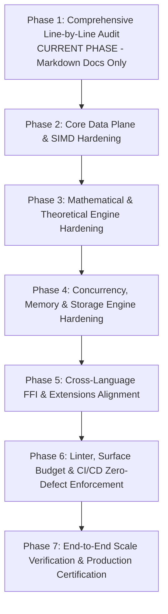

# Razobill Production Audit & Hardening — Master Plan

**Date**: 2026-10-17  
**Auditor**: Antigravity Autonomous Engineering & Audit Engine  
**Target Codebase**: Razobill v1.1.2 — In-Database Telemetry Decomposition & Exact Lossless Engine  
**Governing Standard**: Production-grade systems software (DuckDB / ClickHouse code quality benchmark)  
**Strict Directive**: Pure fixes, performance tuning, and architectural hardening — **NO NEW FEATURES OR ADD-ONS**.

---

## 1. Executive Summary & Objective

Razobill is an exact, invertible telemetry engine that turns unstructured log strings into queryable columnar data with zero byte loss, preserving the invariant:

$$\forall\, x \in \Sigma^*: \quad \operatorname{RzJoin}(\operatorname{RzSplit}(x)) = x$$

This document establishes the **Master Execution Plan** for a comprehensive, exhaustive, line-by-line audit and production hardening of the entire Razobill project. The audit examines the foundational mathematics (derived from *"Latitude and Doubt"*, M. M. Atta, 2026), CPU-level vectorization (AVX-512, AVX2, ARM NEON), memory management (Data-Oriented Design, cache alignment, bump allocators), multi-threaded concurrency, SQL dialects (DuckDB and ClickHouse via ADBC), and all public FFI/extension surfaces (C ABI, Python, Go OTel, Rust Vector VRL).

All findings are documented in structured markdown files within `/AUDIT/`. **No source code modifications are executed in this audit phase**, ensuring full review and alignment before implementation.

---

## 2. Available Resources, Agents, Skills, and MCP Tools

In accordance with user directives, the following tools, agents, skills, and model capabilities are marshaled:

### 2.1 Available MCP Servers & Tools
- **Serena MCP**: Semantic code intelligence, symbol search, memory tracking, AST manipulation (`find_symbol`, `search_for_pattern`, `get_symbols_overview`, `get_diagnostics_for_file`).
- **Context7 MCP**: Technical documentation lookup and external library resolution (`query-docs`, `resolve-library-id`).
- **Gemini API Docs MCP**: Official reference documentation for Google generative APIs (`gemini_search_docs`, `gemini_get_doc`).
- **Headroom MCP**: High-density context compression and retrieval (`headroom_compress`, `headroom_retrieve`).
- **Playwright MCP**: Browser automation, visual validation, and end-to-end web testing.

### 2.2 Available Specialized Subagent Personas
- `cpp-pro`: C++20 standard compliance, template metaprogramming, SIMD intrinsics, zero-allocation data structures.
- `c-pro`: Clean C ABI design, symbol visibility, memory safety, binary compatibility.
- `rust-pro`: Idiomatic Rust, FFI bindings, unsafe boundary verification, Vector VRL transform safety.
- `golang-pro`: Go 1.21+ idioms, cgo memory management, OpenTelemetry collector processor lifecycle.
- `python-pro`: Pybind11 zero-copy buffer protocol, GIL release semantics, Hypothesis property testing.
- `performance-engineer`: Cache coherency, branch predictor optimization, SIMD multi-version dispatching.
- `database-architect`: OLAP columnar storage layout, DuckDB extension ABI, ClickHouse MergeTree indexing.
- `database-optimizer`: Vectorized query execution, partition pruning, memory-bounded hash joins.
- `security-auditor`: Static analysis, fuzzing, memory safety, SQL injection defense-in-depth, ASan/TSan/UBSan.
- `devops-troubleshooter`: CI/CD pipelines, compiler matrix, sanitizers, multi-architecture emulation.

### 2.3 Available Superpowers & Engineering Skills
- `using-superpowers`: Skill invocation discipline and governance.
- `systematic-debugging`: Root cause isolation before patching.
- `test-driven-development`: Red-Green-Refactor test harness enforcement.
- `writing-plans` & `executing-plans`: Rigorous phase-based execution and verification.
- `cpplint-configuration`, `shellcheck-configuration`, `python-code-style`, `python-testing-patterns`.

---

## 3. Scope of the Audit

The audit covers 100% of the repository:

```
razobill/
├── include/librazobill/        # 16 Public C++20 and C headers
├── src/                        # 7 Core C++ implementation units
├── ext/
│   ├── duckdb/                 # DuckDB loadable C extension
│   ├── otel/                   # OpenTelemetry Collector Go processor
│   └── vector/                 # Rust Vector VRL transform
├── lib/python/                 # pybind11 PyRazobill & pure-Python fallback
├── tests/                      # Unit, integration, fuzz, S3, conformance suites
├── bench/                      # Single-core and storage benchmarks
├── tools/                      # Surface budget checkers and lint runners
├── .github/workflows/          # 9 CI/CD GitHub Actions workflows
└── docs/                       # Complete Diátaxis documentation tree
```

---

## 4. Multi-Phase Production Hardening Roadmap

The complete hardening process is divided into 7 distinct phases:



### Phase 1: Comprehensive Deep Audit & Blueprint (Current Phase)
- Line-by-line review of all algorithms, data structures, and memory flows.
- Compilation and static analysis runs across all linters (`clang-tidy`, `cpplint`, `ruff`, `cargo clippy`, `go vet`, `yamllint`).
- Production of detailed audit files in `/AUDIT/`.
- **Gate**: User review and approval before touching any code.

### Phase 2: Core Data Plane & SIMD Hardening
- Audit `Scanner.hpp` for delimiter classification branch predictability.
- Eliminate scalar fallbacks in `SimdScanner.hpp` where SIMD is available.
- Ensure strict bounds on numeric token parsing (`isIntToken`) avoiding 64-bit overflow edge cases.
- Guarantee two-pass reconstruction memory reservation in `Slots.cpp`.

### Phase 3: Mathematical & Theoretical Engine Hardening
- Audit Fréchet polytope projection in `Stats.cpp` ensuring $\max(C, E) \le J_{\text{bound}} \le C + E$.
- Review Neumaier compensated summation across all entropy and divergence routines.
- Audit Proposition 9 finite-precision constraints in `Channel.cpp` for long message sequences.
- Verify stratified Miller-Madow bias corrections and Proposition 10 certified intervals.

### Phase 4: Concurrency, Memory & Storage Engine Hardening
- Address `StringPool::lookup()` string view lifetime hazard under concurrent GC/clear.
- Formalize `MemoryArena` single-threaded usage contract or provide thread-local wrappers.
- Review `FormCatalog` collision handling under the Birthday Bound.
- Audit ADBC transaction guards and RAII resource cleanup in `BackendAdbc.cpp`.

### Phase 5: Cross-Language FFI & Extensions Alignment
- Align Vector VRL return keys (`"template"` vs `"form"` discrepancy with docs).
- Remove hardcoded developer paths in `tests/Support.hpp`.
- Streamline Python `splitMany` to avoid large pre-allocation prior to GIL release.
- Audit cgo pointer passing safety in `ext/otel/RazobillProcessor.go`.

### Phase 6: Linter, Surface Budget & CI/CD Zero-Defect Enforcement
- Reconcile `tools/CheckSurfaceC.py` budget (allow 7 functions for `RzAbiVersion` or refactor).
- Configure `Sanitizers.yml` clang-tidy step to treat warnings as fatal (`--warnings-as-errors='*'`).
- Fix documentation typo referencing non-existent `src/Core.cpp`.
- Verify zero warnings across all linters.

### Phase 7: End-to-End Scale Verification & Production Certification
- Run full doctest unit suite (50+ cases, ~2M assertions).
- Execute DuckDB and ClickHouse ADBC integration suites.
- Run 1,000,000 randomized fuzzing iterations under AddressSanitizer and UndefinedBehaviorSanitizer.
- Run ThreadSanitizer data race detection across multi-core workloads.
- Validate AWS S3 Parquet export bit-level invertibility.

---

## 5. Audit Document Structure

| Document | Focus Area |
|:---|:---|
| [`00-MASTER-PLAN.md`](00-MASTER-PLAN.md) | High-level roadmap, methodology, resource listing, and governance |
| [`01-SYSTEM-ARCHITECTURE.md`](01-SYSTEM-ARCHITECTURE.md) | Layer boundaries, Data vs Control Plane, DOD & SOLID audit |
| [`02-MATHEMATICAL-FOUNDATIONS.md`](02-MATHEMATICAL-FOUNDATIONS.md) | "Latitude & Doubt" proofs, entropy, JSD, Miller-Madow, Channel bounds |
| [`03-CORE-DATA-PLANE.md`](03-CORE-DATA-PLANE.md) | Tokenizer, 256-byte LUT, SIMD vectorization, Slot decomposition/reconstruction |
| [`04-CONCURRENCY-AND-PARALLELISM.md`](04-CONCURRENCY-AND-PARALLELISM.md) | ThreadPool, reader-writer locking, atomic state, race condition prevention |
| [`05-MEMORY-SAFETY-AND-DOD.md`](05-MEMORY-SAFETY-AND-DOD.md) | MemoryArena, StringPool, zero-copy views, 64-byte alignment, UB elimination |
| [`06-CONTROL-PLANE-AND-SQL.md`](06-CONTROL-PLANE-AND-SQL.md) | RazobillEngine, ADBC driver bridge, SQL dialects, injection protection |
| [`07-CROSS-LANGUAGE-ADAPTERS.md`](07-CROSS-LANGUAGE-ADAPTERS.md) | Universal C ABI, Python bindings, DuckDB extension, Go OTel, Rust Vector VRL |
| [`08-LINTER-AND-STATIC-ANALYSIS.md`](08-LINTER-AND-STATIC-ANALYSIS.md) | Tool reports: clang-tidy, cpplint, ruff, cargo, go vet, yamllint |
| [`09-PERFORMANCE-AND-BOTTLENECKS.md`](09-PERFORMANCE-AND-BOTTLENECKS.md) | Profiling, micro-benchmarks, Drain3/CLP comparison, cache line utilization |
| [`10-GAP-AND-VULNERABILITY-CATALOG.md`](10-GAP-AND-VULNERABILITY-CATALOG.md) | Complete itemized defect and risk register ranked by severity |
| [`11-PRODUCTION-HARDENING-ROADMAP.md`](11-PRODUCTION-HARDENING-ROADMAP.md) | Detailed implementation specifications for all approved remediation items |
