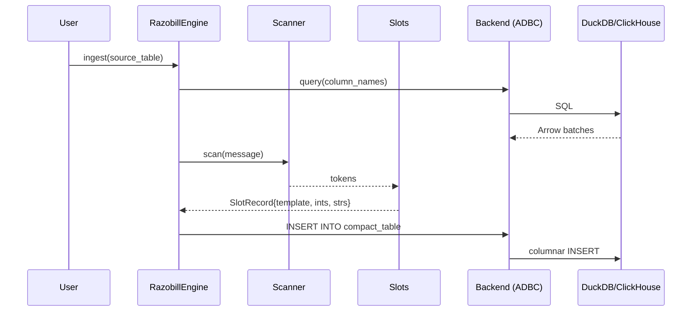

# Razobill Architecture Audit

## Layer Diagram

```mermaid
graph TD
    subgraph "Data Plane (Zero-Copy)"
        Scanner["Scanner.hpp<br/>constexpr LUT tokenizer"]
        SimdScanner["SimdScanner.hpp<br/>AVX-512/AVX2/NEON"]
        Slots["Slots.cpp<br/>parse() / reconstruct()"]
        Hash["Hash.hpp<br/>xxHash64"]
    end

    subgraph "Math Engine"
        Stats["Stats.cpp<br/>Ledger / JSD / Leakage"]
        Channel["Channel.cpp<br/>Stego embed/decode"]
    end

    subgraph "Control Plane"
        Engine["Razobill.cpp<br/>define/retire/compact/verify"]
        Dialect["Dialect.cpp<br/>DuckDB vs ClickHouse SQL"]
        FormCatalog["FormCatalog.hpp<br/>Thread-safe form registry"]
    end

    subgraph "Backend"
        Backend["Backend.hpp<br/>Abstract interface"]
        ADBC["BackendAdbc.cpp<br/>Arrow Database Connectivity"]
    end

    subgraph "Bindings"
        CABI["RazobillC.cpp<br/>C99 ABI"]
        Python["PyRazobill.cpp<br/>pybind11"]
        DuckExt["DuckdbExtension.cpp<br/>DuckDB extension"]
        Fallback["_fallback.py<br/>Pure Python"]
    end

    subgraph "Infrastructure"
        ThreadPool["ThreadPool.hpp"]
        StringPool["StringPool.hpp"]
        Arena["MemoryArena.hpp"]
    end

    Scanner --> Slots
    SimdScanner --> Scanner
    Slots --> Hash
    Engine --> Slots
    Engine --> Dialect
    Engine --> FormCatalog
    Engine --> Backend
    Backend --> ADBC
    CABI --> Slots
    Python --> Slots
    Python --> Engine
    DuckExt --> Slots
    DuckExt --> Engine
    Stats --> Hash
```

---

## SOLID Analysis

### ✅ Single Responsibility (mostly good)
- `Scanner` only tokenizes. `Slots` only parses/reconstructs. `Stats` only computes entropy.
- **Violation:** [Razobill.cpp](file:///C:/FM/rzd/razobill/src/Razobill.cpp) is a 621-line god class handling schema DDL, data migration, form registration, SQL generation, and verification. Should be decomposed but this is a fix-only pass.

### ✅ Open/Closed (good)
- `Dialect` base class with `DuckDialect` / `ClickHouseDialect` — extensible without modification.
- `Backend` abstract class with `AdbcBackend` — same pattern.

### ⚠️ Liskov Substitution (minor concern)
- `ClickHouseDialect::supportsCompact()` returns `false` — callers must check before calling `compact()`. Not a violation per se, but the engine silently does nothing rather than returning an error.

### ✅ Interface Segregation (good)
- `Backend` exposes only `exec()` and `query()` — minimal interface.
- `Dialect` has many methods but all are used by the control plane.

### ⚠️ Dependency Inversion (partially)
- `RazobillEngine` takes `Backend&` by reference — good inversion.
- **But:** `makeDialect()` is called internally based on `backend.flavor()` — dialect selection is coupled to backend flavor, not injected.

---

## Data Flow



---

## Key Design Decisions

| Decision | Rationale | Status |
|----------|-----------|--------|
| Zero-copy tokenizer (constexpr LUT) | Avoid regex overhead, O(n) single pass | ✅ Sound |
| xxHash64 for form fingerprinting | Fast, well-distributed, widely validated | ✅ Sound |
| Bump-pointer arena allocator | Batch alloc/dealloc for parsing chunks | ✅ Sound |
| ADBC over ODBC | Native Arrow columnar transfer, zero ser/deser | ✅ Sound |
| `std::variant<monostate,i64,u64,f64,string>` for Value | Type-safe nullable cells | ⚠️ High heap churn at scale |
| Dual camelCase/snake_case fields | Backward compat | 🔴 Error-prone manual sync |
| Duplicate source copies in `lib/python/` | Self-contained Python build | 🔴 Stale copy risk |

---

## Namespace Organization

```
razobill::              — Top-level: Engine, Backend, Dialect, Value
razobill::core::        — Data plane: Scanner, Slots, FormCatalog, ThreadPool, StringPool, Arena
razobill::stats::       — Math engine: ledger, JSD, leakage, priceOfSaying
razobill::channel::     — Steganographic channel: embed, decode, analyzeCapacity
```

Clean separation. No circular dependencies detected.
