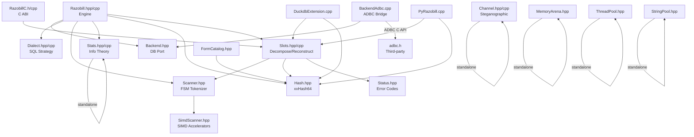

# 01 — Project Anatomy

## Directory Tree (non-log, non-build)

```
razobill/
├── include/librazobill/       # 16 public C++20 headers
│   ├── Razobill.hpp            # Control-plane engine
│   ├── Scanner.hpp             # FSM tokenizer (core algorithm)
│   ├── SimdScanner.hpp         # AVX-512/AVX2/NEON accelerators
│   ├── Slots.hpp               # Decompose/reconstruct API
│   ├── Hash.hpp                # xxHash64 seed-0
│   ├── Channel.hpp             # Steganographic channel (Theorem 8)
│   ├── MemoryArena.hpp         # Bump allocator
│   ├── ThreadPool.hpp          # Parallel worker pool
│   ├── StringPool.hpp          # Interned string dictionary
│   ├── FormCatalog.hpp         # Form registry + collision tracker
│   ├── Stats.hpp               # Information-theoretic ledger
│   ├── Status.hpp              # 1-byte error codes
│   ├── Backend.hpp             # Database port abstraction
│   ├── Dialect.hpp             # SQL dialect strategy
│   ├── Version.hpp             # Compile-time version macro
│   └── RazobillC.h             # Universal C ABI header
├── src/                        # 7 implementation files
│   ├── Razobill.cpp            # Engine orchestrator (703 lines)
│   ├── Slots.cpp               # Parse + reconstruct (310 lines)
│   ├── Channel.cpp             # Embedding/decoding (304 lines)
│   ├── Stats.cpp               # All math (458 lines)
│   ├── Dialect.cpp             # DuckDB + ClickHouse SQL (115 lines)
│   ├── BackendAdbc.cpp         # ADBC driver bridge (321 lines)
│   └── RazobillC.cpp           # C ABI impl (202 lines)
├── ext/
│   ├── duckdb/DuckdbExtension.cpp
│   ├── otel/processor.go + go.mod
│   └── vector/src/lib.rs + Cargo.toml + tests/
├── lib/python/
│   ├── PyRazobill.cpp
│   ├── setup.py + pyproject.toml
│   └── pyrazobill/__init__.py + _fallback.py
├── tests/
│   ├── UnitCore.cpp, UnitStats.cpp, UnitArena.cpp
│   ├── UnitCAPI.cpp, UnitChannel.cpp
│   ├── IntegrationDuckdb.cpp, IntegrationChdb.cpp
│   ├── Support.hpp (test framework helpers)
│   ├── fuzz/FuzzDecomposeReconstruct.cpp
│   ├── s3/ (MockS3Server, S3 export tests)
│   └── sql/razobill.test (SQL logic tests)
├── bench/                      # Benchmarks
├── tools/                      # Build & analysis scripts
├── docs/                       # Diátaxis documentation
├── .github/workflows/          # 8 CI/CD workflows
└── AUDIT/                      # This audit
```

## Dependency Graph



## Language & Size Summary

| Language | Files | Lines | Bytes |
|:---------|------:|------:|------:|
| C++ Headers | 16 | ~2,200 | ~78 KB |
| C++ Sources | 7 | ~2,413 | ~94 KB |
| DuckDB Extension | 1 | ~300 | ~12 KB |
| Python (bindings + tools) | ~15 | ~2,000 | ~60 KB |
| Go (OTel) | 2 | ~220 | ~7 KB |
| Rust (Vector) | 2 | ~200 | ~6 KB |
| CI/CD YAML | 8 | ~800 | ~25 KB |
| Documentation | ~30 | ~3,000 | ~80 KB |
| **Total** | **~80** | **~11,000** | **~362 KB** |

## Key Design Decisions Observed

1. **Header-only infrastructure**: MemoryArena, ThreadPool, StringPool, FormCatalog, Hash, Scanner, SimdScanner are all header-only → zero link overhead, but increases compile time
2. **Data Plane / Control Plane split**: Pure functions (Slots, Scanner) vs. stateful engine (Razobill.cpp) — good separation
3. **Zero-copy string views**: `SlotRecord::strs` stores `string_view` into the input message — requires caller to keep input alive
4. **Dual form key formats**: Legacy skeleton+types (`\x12`/`\x13`) and modern `{i}`/`{s}` — maintained for backward compatibility
5. **Single-threaded control plane**: `RazobillEngine` uses a single `std::mutex` — adequate for database orchestration, not a bottleneck
