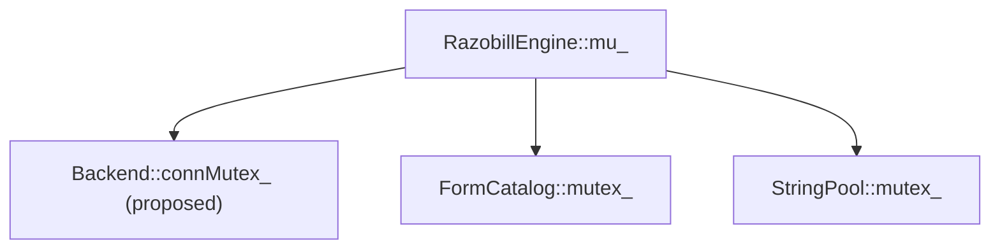

# Razobill Concurrency & Thread Safety Audit

---

## Overview

Razobill uses three concurrency primitives:

| Primitive | Location | Pattern |
|-----------|----------|---------|
| `std::mutex` | `RazobillEngine::mu_` | Coarse engine lock |
| `std::shared_mutex` | `FormCatalog::mutex_` | Reader-writer lock |
| `std::shared_mutex` | `StringPool::mutex_` | Reader-writer lock |
| `ThreadPool` (custom) | `ThreadPool.hpp` | Work-stealing with `std::function` queue |

---

## C1. `RazobillEngine::mu_` — Coarse Lock

**File:** [Razobill.hpp](file:///C:/FM/rzd/razobill/include/librazobill/Razobill.hpp), [Razobill.cpp](file:///C:/FM/rzd/razobill/src/Razobill.cpp)  
**Status:** ⚠️ Functional but overly conservative

**Analysis:** Every public method acquires `mu_` via `std::scoped_lock`. This serializes all operations:

```cpp
Ledger RazobillEngine::ledger(...) {
    std::scoped_lock lock(mu_);
    requireReadyLocked();
    // ... all work under lock ...
}
```

**Impact:** No concurrent reads. A long-running `ledger()` computation blocks all `query()`, `verify()`, `todo()` calls.

**Verdict:** Acceptable for correctness. Performance improvement would require read/write lock separation, but that changes the API contract (fix-only scope).

---

## C2. `FormCatalog` — Reader-Writer Lock

**File:** [FormCatalog.hpp](file:///C:/FM/rzd/razobill/include/librazobill/FormCatalog.hpp)  
**Status:** ✅ Correct pattern, 🔴 dangling pointer bug (see B7)

**Analysis:** Uses `std::shared_lock` for reads and `std::unique_lock` for writes — standard pattern:

```cpp
// Read path (fast)
std::shared_lock<std::shared_mutex> lock(mutex_);
auto it = formsByKey_.find(key);

// Write path
std::unique_lock<std::shared_mutex> lock(mutex_);
formsByKey_.emplace(entry.key, std::move(entry));
formsById_.push_back(&inserted.first->second);  // DANGLING on rehash
```

**Double-check locking:** The `registerFormWithHashGetId` method correctly uses the double-checked locking pattern — shared read check, then exclusive write check. This is safe with `shared_mutex`.

**Critical bug:** The `formsById_` vector stores raw pointers into `formsByKey_` (an `unordered_map`). Rehash invalidates all pointers. See [02-CRITICAL-BUGS.md B7](file:///C:/FM/rzd/razobill/AUDIT/02-CRITICAL-BUGS.md).

---

## C3. `StringPool` — Reader-Writer Lock

**File:** [StringPool.hpp](file:///C:/FM/rzd/razobill/include/librazobill/StringPool.hpp)  
**Status:** ✅ Correct

**Analysis:** Same shared_mutex pattern as FormCatalog. Interns strings into a `std::unordered_set<std::string>` and returns `std::string_view` to the interned copy.

**Safety:** `std::unordered_set` guarantees that element references are stable (no invalidation on insert/rehash for the elements themselves — only iterators may be invalidated, but `string_view` points to the `std::string` object's data, which is stable as long as the set element exists).

> [!NOTE]
> Unlike `unordered_map::value_type` (which stores `pair<const Key, Value>`), `unordered_set` elements ARE stable across rehash per the C++ standard: "Rehashing invalidates iterators [...] but does not invalidate pointers or references to elements." — [unord.req.general]/9

**Verdict:** Safe. No dangling reference risk.

---

## C4. `ThreadPool` — Custom Worker Pool

**File:** [ThreadPool.hpp](file:///C:/FM/rzd/razobill/include/librazobill/ThreadPool.hpp)  
**Status:** ✅ Correct with minor concerns

**Implementation:**
- Standard producer-consumer with `std::queue<std::function<void()>>`
- Workers wait on `condition_variable`, wake on task push or stop
- Destructor sets `stopping_ = true`, notifies all, joins all threads

**Concern C4a: `parallelFor` captures `fn` by reference**

```cpp
template <class Fn>
void parallelFor(std::size_t n, std::size_t chunk, const Fn& fn) {
    // fn captured by reference in lambda posted to queue
}
```

Currently safe because `parallelFor` blocks on `future::get()` before returning. But if someone calls `parallelFor` with a temporary and doesn't wait, the reference dangles.

**Concern C4b: `std::function<void()>` type erasure overhead**

Each task enqueue allocates a `std::function` (typically 32–64 bytes inline, heap for larger captures). For fine-grained tasks this adds overhead. The coarse chunking (`parallelFor` with chunk size 5000–10000) mitigates this.

**Concern C4c: No thread affinity or NUMA awareness**

Workers are plain `std::thread` with no CPU pinning. On NUMA systems, cross-socket memory access adds latency. Acceptable for log parsing workloads.

---

## C5. `AdbcBackend` — No Internal Synchronization

**File:** [BackendAdbc.cpp:133](file:///C:/FM/rzd/razobill/src/BackendAdbc.cpp#L133)  
**Status:** 🟠 HIGH risk

**Problem:** `AdbcBackend::run()` uses `conn_`, `driver_`, and creates `AdbcStatement` without any mutex. ADBC drivers (DuckDB, chDB) may not be thread-safe per connection.

**Current mitigation:** `RazobillEngine::mu_` serializes backend access from the engine. But:
- Python bindings may call backend methods directly
- Multiple `RazobillEngine` instances sharing the same backend would race

**Fix:** Add `std::mutex connMutex_` to `AdbcBackend`:

```cpp
void run(std::string_view sql, Table* out) {
    std::scoped_lock lock(connMutex_);
    // ...
}
```

---

## C6. Static Thread Pool in Python Bindings

**File:** [PyRazobill.cpp — `splitMany`](file:///C:/FM/rzd/razobill/lib/python/PyRazobill.cpp)  
**Status:** ⚠️ Acceptable but undocumented

**Problem:** `splitMany` creates a `static core::ThreadPool pool`. This pool:
- Is created on first call and never destroyed
- Persists for the entire process lifetime
- Threads remain alive even when Python is idle

**Impact:** In a web server with worker process recycling (gunicorn, uwsgi), the thread pool survives fork. On `fork()`, only the calling thread is duplicated — worker threads are lost, leaving the pool in an inconsistent state.

**Fix:** Document the limitation. For fork-safety, detect `os.fork()` and recreate the pool via `os.register_at_fork()`.

---

## Lock Ordering Analysis



**No deadlock risk detected.** All locking flows from `mu_` outward. `FormCatalog` and `StringPool` never call back into the engine or each other.

---

## Summary

| Component | Thread Safe? | Issue |
|-----------|:---:|--------|
| RazobillEngine | ✅ | Coarse lock, no concurrency |
| FormCatalog | ⚠️ | Correct locking, dangling pointer on rehash |
| StringPool | ✅ | Stable references across rehash |
| ThreadPool | ✅ | Reference capture fragility |
| AdbcBackend | ❌ | No internal synchronization |
| Python static pool | ⚠️ | Fork-unsafe, never destroyed |
