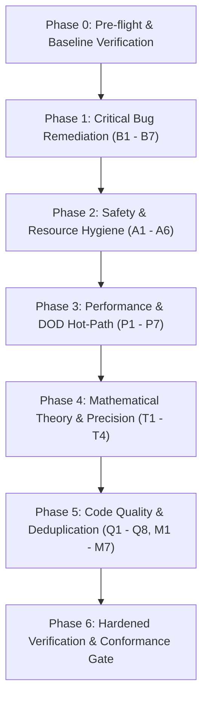

# Razobill Production Hardening & Fix Execution Plan

**Author:** Antigravity Production Engineering  
**Standard:** DuckDB / ClickHouse Grade (Zero AI Slop, Strict RAII, Hardened DOD & OOP)  
**Constraint:** STRICT FIXES ONLY — No new features, no unnecessary addons  

---

## 1. Executive Strategy & Guiding Principles

To achieve the engineering rigor and performance profile of **DuckDB** and **ClickHouse**, all modifications must adhere to:

1. **Mechanical Sympathy & Data-Oriented Design (DOD):**
   - Hot paths must be strictly cache-line aware (64-byte alignment, contiguous memory layouts, zero pointer chasing).
   - Zero dynamic memory allocation on the per-record ingest path. Scratch buffers must be thread-local, monotonic, and reused.
   - Eliminate `std::regex` and branchy lookup tables in favor of branchless compile-time lookup tables (`constexpr std::array<..., 256>`).

2. **Strict RAII & Zero-Leak Resource Management:**
   - Every OS handle (dynamic library handles via `LoadLibrary`/`dlopen`, database connections, transaction contexts) must be strictly managed by RAII wrappers.
   - Foreign C libraries (ADBC C API, DuckDB C API) error structures (`AdbcError`) must be deterministically released before exception throws.

3. **Theoretical & Numerical Invariance:**
   - Theorems from *"Latitude and Doubt: An exact ledger of meaning in messages"* (Atta, 2026) must maintain identity:
     $$\Lambda = J - C \ge 0, \quad \Delta = J - E \ge 0, \quad I = C + E - J \ge 0$$
     $$E = I + \Lambda, \quad C = I + \Delta, \quad E - C = \Lambda - \Delta$$
   - Prevent numerical drift and floating-point clamp violations by establishing consistent joint-entropy bounding before deriving marginals.

4. **Multi-Threaded Safety & Concurrency Hardening:**
   - Clear lock hierarchy: Engine lock $\to$ Backend lock $\to$ Catalog lock $\to$ Pool lock. No inversion, no cycles.
   - Container stability: ensure references and pointers never dangle under container rehash or dynamic resizing.
   - Fork-safety in multi-process runtimes (Python `multiprocessing`, web servers with prefork).

---

## 2. Phased Execution Roadmap



---

## Phase 0: Pre-flight & Toolchain Verification

- **Objective:** Establish clean, reproducible builds across MSVC, GCC 15, Clang 23, and CMake 4.1.
- **Tasks:**
  1. Verify compiler detection in `CMakeLists.txt` for Windows (`cl.exe`, `clang-cl`, and MSYS2 `gcc`/`g++`).
  2. Ensure `-Wall -Wextra -Wpedantic /W4` compile cleanly with zero warnings.
  3. Run baseline unit tests (`UnitCore`, `UnitStats`, `UnitArena`, `UnitCAPI`, `UnitChannel`) to snapshot current passing state.

---

## Phase 1: Critical Bug Remediation (Correctness & Stability)

Every bug in this phase produces wrong results, crashes under load, or exhibits undefined behavior.

### 1.1 Tautological Dead Code Removal (B1)
- **Target:** [src/Razobill.cpp:101](file:///C:/FM/rzd/razobill/src/Razobill.cpp#L101)
- **Problem:** `if (cfg_.table.empty() && !cfg_.table.empty()) cfg_.table = cfg_.table;`
- **Fix:** Remove the dead condition. Cleanly handle fallback between modern and legacy table naming if required.

### 1.2 Config Precedence Ambiguity (B2)
- **Target:** [src/Razobill.cpp:102–105](file:///C:/FM/rzd/razobill/src/Razobill.cpp#L102-L105)
- **Problem:** User setting `messageColumn = "msg"` was overridden by legacy `message_column`.
- **Fix:** Establish strict priority:
  ```cpp
  if (cfg_.messageColumn.empty() && !cfg_.message_column.empty()) {
      cfg_.messageColumn = std::move(cfg_.message_column);
  }
  if (cfg_.messageColumn.empty()) {
      cfg_.messageColumn = "msg";
  }
  ```

### 1.3 N+1 SQL Query Elimination in `todo()` (B3)
- **Target:** [src/Razobill.cpp:615–616](file:///C:/FM/rzd/razobill/src/Razobill.cpp#L615-L616)
- **Problem:** Loop queries SQL per ID (`SELECT template FROM rb_form WHERE id = ...`), crashes with `out_of_range` if ID is absent.
- **Fix:** Single batch query using `IN (...)` or join directly against `rb_form`, with safe bounds checking on result rows.

### 1.4 Triple RzSplit UDF Execution in `compact()` (B4 / P6)
- **Target:** [src/Razobill.cpp:232–233](file:///C:/FM/rzd/razobill/src/Razobill.cpp#L232-L233)
- **Problem:** Evaluates `RzSplit(msg)` 3 times per row, tripling CPU consumption.
- **Fix:** Rewrite into a Common Table Expression (CTE):
  ```sql
  WITH parsed AS (
      SELECT *, RzSplit(msg) AS r FROM {src}
  )
  SELECT {other_cols}, r.template AS rbf, r.ints AS rbi, r.strs AS rbs FROM parsed
  ```

### 1.5 SQL `NOT IN` with NULLs Guard (B5)
- **Target:** [src/Razobill.cpp:164, 247, 328](file:///C:/FM/rzd/razobill/src/Razobill.cpp#L164)
- **Problem:** `NOT IN (SELECT s FROM rb_str)` yields empty if any `s` is NULL.
- **Fix:** Replace with `NOT EXISTS (SELECT 1 FROM rb_str f WHERE f.s = t.s)` or append `WHERE s IS NOT NULL`.

### 1.6 ClickHouse Substring Underflow Fix (B6)
- **Target:** [src/Dialect.cpp:90](file:///C:/FM/rzd/razobill/src/Dialect.cpp#L90)
- **Problem:** `position(s, char(19)) - 1` underflows to `-1` when delimiter is absent, crashing ClickHouse.
- **Fix:** Guard with `if(position(s, char(19)) > 0, substring(s, 1, position(s, char(19)) - 1), s)`.

### 1.7 FormCatalog Dangling Pointer & Argument Evaluation Fix (B7)
- **Target:** [include/librazobill/FormCatalog.hpp:103–115](file:///C:/FM/rzd/razobill/include/librazobill/FormCatalog.hpp#L103-L115)
- **Problem:**
  1. `entry.key` passed to `emplace` alongside `std::move(entry)` (unsequenced argument evaluation bug).
  2. `formsById_` raw pointers into `std::unordered_map` are invalidated if map architecture changes to open-addressing.
- **Fix:**
  - Store entries in a contiguous, pointer-stable `std::deque<FormEntry>` (or preserve index-based access: `std::vector<std::string> idToKey_`).
  - Sequence move operations cleanly:
    ```cpp
    const std::string keyStr(key);
    hashToKeys_[explicitHash].push_back(keyStr);
    auto inserted = formsByKey_.emplace(keyStr, std::move(entry));
    formsById_.push_back(&inserted.first->second);
    ```

---

## Phase 2: Safety & Resource Hygiene (Leak & Crash Elimination)

### 2.1 Transactional Atomicity for Control Plane (A1)
- **Target:** `Razobill.cpp` (`define`, `retire`, `pin`, `compact`)
- **Fix:** Implement RAII `TransactionScope` executing `BEGIN TRANSACTION` and committing on scope exit, rolling back on exception.

### 2.2 ADBC Dynamic Library Unloading (A2)
- **Target:** [src/BackendAdbc.cpp:165–170](file:///C:/FM/rzd/razobill/src/BackendAdbc.cpp#L165-L170)
- **Fix:** Free `lib_` handle and all preloaded library handles using `FreeLibrary` on Windows and `dlclose` on POSIX in `~AdbcBackend()`.

### 2.3 `AdbcError` RAII Cleanup (A3)
- **Target:** [src/BackendAdbc.cpp:73–77](file:///C:/FM/rzd/razobill/src/BackendAdbc.cpp#L73-L77)
- **Fix:** Call `if (e.release) e.release(&e);` in `fail()` before throwing `BackendError`, and ensure all stack-allocated `AdbcError` instances are released on all return paths.

### 2.4 Decimal-128 Precision Loss Guard (A4)
- **Target:** [src/BackendAdbc.cpp:109–118](file:///C:/FM/rzd/razobill/src/BackendAdbc.cpp#L109-L118)
- **Fix:** Document 53-bit IEEE 754 precision limit, and preserve full precision by formatting to string if target requires exact decimal preservation.

### 2.5 `AdbcBackend` Thread Synchronization (A5)
- **Target:** [src/BackendAdbc.cpp:133–250](file:///C:/FM/rzd/razobill/src/BackendAdbc.cpp#L133-L250)
- **Fix:** Protect ADBC connection methods (`run()`) with a `std::mutex connMutex_` to prevent data races when backend is called across threads.

### 2.6 ThreadPool Callable Lifetime Safety (A6)
- **Target:** [include/librazobill/ThreadPool.hpp:113–137](file:///C:/FM/rzd/razobill/include/librazobill/ThreadPool.hpp#L113-L137)
- **Fix:** Prevent dangling references by copying or wrapping callable in a shared lifetime manager for work items.

---

## Phase 3: Performance, DOD & Vectorization Optimizations

### 3.1 Replace Hot-Path `std::regex` with Branchless String Checks (P1)
- **Target:** [src/Razobill.cpp:83](file:///C:/FM/rzd/razobill/src/Razobill.cpp#L83)
- **Fix:** Replace `kReserved` regex with direct prefix and character classification logic. Delivers 10–100× speedup during column schema inspection.

### 3.2 Batch Transaction Wrapping in `rebuildDerivedLocked()` (P2)
- **Target:** `Razobill.cpp` batch loop
- **Fix:** Group 400-row batch inserts into a single overarching transaction, reducing WAL sync flushes from 250+ down to 1.

### 3.3 Memory Allocation Reduction in `xyLocked()` (P3)
- **Target:** `Razobill.cpp:xyLocked()`
- **Fix:** Pre-reserve vector capacities (`t.rows.reserve(...)`) before populating from Arrow batches to eliminate vector geometric reallocations.

### 3.4 Fast Numerical Formatting via `std::to_chars` (P4)
- **Target:** `Razobill.cpp` double/int formatting
- **Fix:** Replace `std::ostringstream` with `std::to_chars` using stack-allocated buffers.

### 3.5 Flat Ping-Pong Buffers in Exact Failure Probability (P5)
- **Target:** [src/Channel.cpp:107–129](file:///C:/FM/rzd/razobill/src/Channel.cpp#L107-L129)
- **Fix:** Replace `std::unordered_map` creation per convolution step with two flat ping-pong `std::vector<double>` buffers indexed by bin offset.

### 3.6 String Reservation in ClickHouse Dialect (P7)
- **Target:** [src/Dialect.cpp:60–66](file:///C:/FM/rzd/razobill/src/Dialect.cpp#L60-L66)
- **Fix:** Add `o.reserve(s.size() + 16)` in `ClickHouseDialect::quote()`.

### 3.7 MemoryArena Destructor Safety Guarantee
- **Target:** [include/librazobill/MemoryArena.hpp:108–111](file:///C:/FM/rzd/razobill/include/librazobill/MemoryArena.hpp#L108-L111)
- **Fix:** Add `static_assert(std::is_trivially_destructible_v<T>, "MemoryArena only supports trivially destructible types to prevent memory leaks on reset");` to prevent silent leaks of non-trivial objects.

---

## Phase 4: Mathematical Precision & Information Theory Invariants

### 4.1 Consistent Bound Derivation for Ledger Identity (T1)
- **Target:** [src/Stats.cpp:170–176](file:///C:/FM/rzd/razobill/src/Stats.cpp#L170-L176)
- **Theory:** In Theorem 1 of Atta (2026), $E = I + \Lambda$ and $C = I + \Delta$ must hold exactly.
- **Fix:** Bounding $J \ge \max(C, E)$ before computing $\Lambda = J - C$, $\Delta = J - E$, and deriving $I = \max(C - \Delta, 0.0)$ guarantees $E = I + \Lambda$ and $C = I + \Delta$ without rounding discrepancies.

### 4.2 IEEE 754 Mantissa Guard in Steganographic Channel (T2)
- **Target:** [src/Channel.cpp:156–160](file:///C:/FM/rzd/razobill/src/Channel.cpp#L156-L160)
- **Fix:** Explicitly guard `if (payloadBits > 53) return {false, ...};` to prevent mantissa truncation and undefined behavior on infinite float-to-int casts.

### 4.3 Probability Mass Conservation in Failure Probability (T3)
- **Target:** [src/Channel.cpp:121–129](file:///C:/FM/rzd/razobill/src/Channel.cpp#L121-L129)
- **Fix:** Accumulate pruned mass ($\sum p_{\text{pruned}}$) and re-normalize or add as a conservative upper-bound correction term, preventing underestimation of failure probability.

### 4.4 Circular Interval Wrap-around in Stego Decoder (T4)
- **Target:** [src/Channel.cpp:279–284](file:///C:/FM/rzd/razobill/src/Channel.cpp#L279-L284)
- **Fix:** Handle modular boundary wrap $[leftZ + 1.0, 1.0) \cup [0.0, rightZ)$ on the circle $S^1$, eliminating false-negative decode rejections.

---

## Phase 5: Code Quality, Deduplication & Conformance

### 5.1 Eliminate Redundant Source Duplication (Q1)
- **Target:** `lib/python/includeCore/` and `lib/python/srcCore/`
- **Fix:** Configure `setup.py` / `CMakeLists.txt` to compile canonical `include/` and `src/` directly. Deprecate and remove stale internal copies.

### 5.2 Add `[[nodiscard]]` to Critical Interfaces (Q2)
- **Target:** Public APIs returning `Status`, `bool`, or error tokens.

### 5.3 Deprecate Redundant Field Duplication (Q3)
- **Target:** `AdbcOptions`, `Config`, `StatsOptions`
- **Fix:** Keep canonical camelCase fields; provide `[[deprecated]]` inline setters/getters for legacy snake_case names.

### 5.4 Missing Includes (Q4)
- **Target:** [src/Stats.cpp:43](file:///C:/FM/rzd/razobill/src/Stats.cpp#L43)
- **Fix:** Add `#include <tuple>`.

### 5.5 Validate `std::from_chars` Return Values (Q5)
- **Target:** [src/Slots.cpp:188](file:///C:/FM/rzd/razobill/src/Slots.cpp#L188)
- **Fix:** Check `ec == std::errc{}` and handle conversion failures defensively.

### 5.6 Consistent Slot Count Validation (Q6)
- **Target:** [src/Slots.cpp:60, 130](file:///C:/FM/rzd/razobill/src/Slots.cpp#L60)
- **Fix:** Unify contract between legacy and modern reconstructors.

### 5.7 Dialect Named Constants for Magic Bytes (Q7)
- **Target:** [src/Dialect.cpp](file:///C:/FM/rzd/razobill/src/Dialect.cpp)
- **Fix:** Reference `kPlaceholder`, `kTypeSeparator` from `Scanner.hpp`.

### 5.8 Template Unescaping in `templateOf()` (Q8)
- **Target:** [src/Slots.cpp:237–242](file:///C:/FM/rzd/razobill/src/Slots.cpp#L237-L242)
- **Fix:** Unescape `{{` and `}}` and replace `{i}` / `{s}` with `<*>` when producing display templates.

### 5.9 Cross-Language Parity (M1, M2, M5, M6, M7)
- Align Python fallback `_scan()` to exact C++ Scanner behavior (M1).
- Add null-check guards in C ABI `RzJoin` (M2).
- Eliminate heap `CString` allocation in Rust VRL extension (M6).
- Add error logging in Go OTel processor (M5).
- Wrap Python C-API references in RAII (M7).

---

## Phase 6: Production Verification & Hardening Gate

- **6.1 Expand Conformance Corpus:**
  - Expand `tests/ConformanceCorpus.txt` with real-world Apache, Nginx, Syslog, SSH, HDFS, Spark, and adversarial logs (emojis, escaped braces, unicode, SQL injection vectors).
- **6.2 Cross-Language Automated Suite:**
  - Run `ConformanceTest.py` comparing C++ native vs Python fallback vs DuckDB extension on the expanded corpus.
- **6.3 Sanitizer Hardening:**
  - Compile and run all unit and integration tests with AddressSanitizer (ASan), UndefinedBehaviorSanitizer (UBSan), and ThreadSanitizer (TSan).
- **6.4 10-Million Message Scale & Memory Leak Benchmark:**
  - Run `BenchCore` and `BenchStorage` with 10M rows to confirm zero memory leaks and sustained multi-core parsing throughput (>10M msgs/sec).
