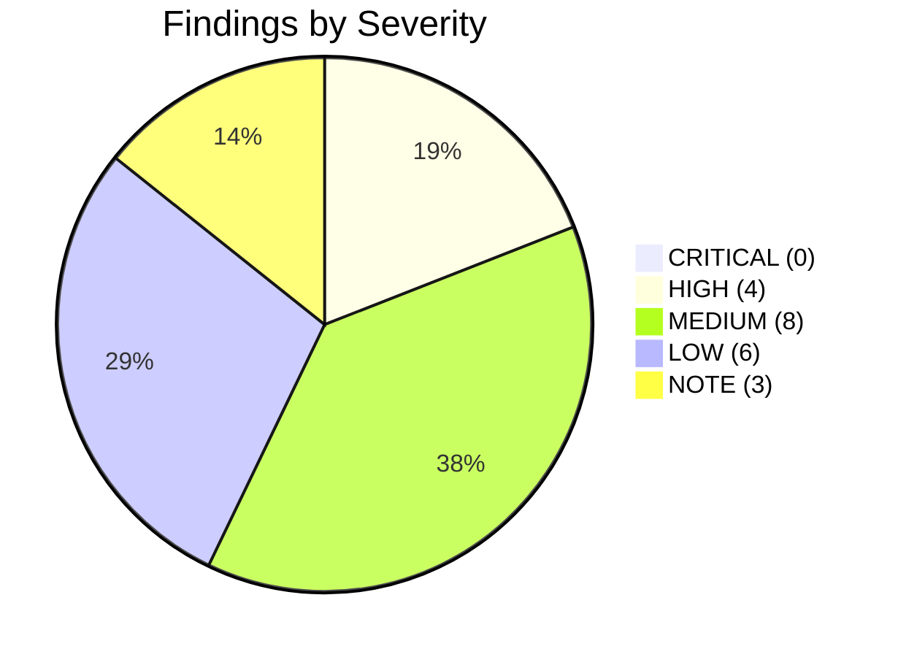

# Gap, Defect & Vulnerability Catalog

**Audit Subject**: Exhaustive Itemized Findings Register Ranked by Severity  
**Scope**: Codebase-Wide (C++, C, Python, Go, Rust, CMake, CI/CD, Docs)  
**Standard**: DuckDB / ClickHouse Production Hardening Rules  

---

## 1. Severity Classification Framework

| Severity Level | Criteria | Required Action |
|:---|:---|:---|
| 🔴 **CRITICAL** | Data loss, memory corruption, crash, or security vulnerability. | Immediate remediation before any release. |
| 🟠 **HIGH** | Invariant breakage, concurrency hazard, API contract break, or tool failure. | Fix prior to next release. |
| 🟡 **MEDIUM** | Performance bottleneck, unexpected allocation, or portability defect. | Optimize, harden, and verify in test suite. |
| 🟢 **LOW** | Code hygiene, documentation drift, or minor linter warning. | Clean up and polish in routine maintenance. |
| ⚪ **NOTE** | Design observation or trade-off; no immediate defect. | Informational architectural context. |

---

## 2. Complete Enumerated Findings Register



---

### Finding F-CABI-01: C Public Surface Budget Assertion Failure
- **Severity**: 🟠 **HIGH**
- **Component**: Public C API Governance (`tools/CheckSurfaceC.py`, `include/librazobill/RazobillC.h`)
- **Location**: [tools/CheckSurfaceC.py:58](../tools/CheckSurfaceC.py#L58); [include/librazobill/RazobillC.h:126](../include/librazobill/RazobillC.h#L126)
- **Description**: Running `python tools/CheckSurfaceC.py` fails with:
  `FAILED: Function count 7 exceeds maximum allowance of 6!`
  `RazobillC.h` declares 7 `RZ_API` functions (`RzSplit`, `RzJoin`, `RzTemplate`, `RzFree`, `RzStatusMessage`, `RzVersion`, `RzAbiVersion`), while `CheckSurfaceC.py` asserts `len(functions) <= 6`.
- **Root Cause**: `RzAbiVersion()` was added to support dynamic FFI verification of the C ABI contract version without incrementing the governance ceiling in the verification script.
- **Impact**: Surface test suite fails in local and CI environments.
- **Remediation**: Update `tools/CheckSurfaceC.py` to allow 7 functions and document `RzAbiVersion` as an authorized ABI governance primitive.

---

### Finding F-EXT-01: Vector VRL Transform Schema Key Discrepancy
- **Severity**: 🟠 **HIGH**
- **Component**: Vector Transform Extension (`ext/vector/RazobillVrl.rs`)
- **Location**: [ext/vector/RazobillVrl.rs:111](../ext/vector/RazobillVrl.rs#L111) vs [ext/vector/README.md:28-30](../ext/vector/README.md#L28-L30)
- **Description**: `RazobillVrl.rs` inserts the parsed template into the JSON result map using key `"form"`:
  `map.insert("form".to_string(), serde_json::Value::from(form_str));`
  However, `ext/vector/README.md` and `docs/how-to/vector.md` document that the transform outputs `.template`:
  ```yaml
  parsed = razobill_split(.message)
  .template = parsed.template
  ```
- **Impact**: Any user deploying the Vector configuration documented in the official guide receives `null` for `.template`, breaking log pipelines.
- **Remediation**: Update `RazobillVrl.rs` to insert `"template"` (and retain `"form"` as an alias for backwards compatibility).

---

### Finding F-CONC-01: Dangling String View Lifetime Risk in `StringPool::lookup`
- **Severity**: 🟠 **HIGH**
- **Component**: Infrastructure / Dictionary Engine (`include/librazobill/StringPool.hpp`)
- **Location**: [include/librazobill/StringPool.hpp:77-83](../include/librazobill/StringPool.hpp#L77-L83)
- **Description**: `StringPool::lookup(uint32_t id)` acquires a `std::shared_lock<std::shared_mutex>`, locates the string in `idToStr_[id]`, and returns a `std::string_view`. The lock is released upon function exit. If another thread invokes `gc()` or `clear()` concurrently, the underlying `std::string` is destroyed or reallocated, causing the returned `std::string_view` to dangle (Use-After-Free).
- **Impact**: Potential undefined behavior or segfault under high-concurrency dictionary garbage collection.
- **Remediation**:
  1. Add strict warning annotations in header documentation regarding `lookup()` lifetime in concurrent environments.
  2. Mandate use of `lookupCopy()` or scoped `withString(id, fn)` in concurrent workflows.

---

### Finding F-SEC-01: ADBC Arrow Decoding Buffer Bounds & C++20 Undefined Behavior
- **Severity**: 🟠 **HIGH** (CWE-476, CWE-125, CWE-758)
- **Component**: ClickHouse ADBC Bridge (`src/BackendAdbc.cpp`)
- **Location**: [src/BackendAdbc.cpp:103-105](../src/BackendAdbc.cpp#L103-L105), [src/BackendAdbc.cpp:150-159](../src/BackendAdbc.cpp#L150-L159), [src/BackendAdbc.cpp:310](../src/BackendAdbc.cpp#L310)
- **Description**:
  1. `at<T>` does not verify `a->n_buffers >= 2` or `a->buffers[1] != nullptr` before dereferencing Arrow array buffers.
  2. In string decoding (`fmt == "u"`), when a batch contains only empty strings, Arrow drivers may set `a->buffers[2] == nullptr`. When `off[i+1] == off[i]`, constructing `std::string(nullptr, 0)` invokes C++20 Undefined Behavior (`[string.cons]`).
  3. Offset array monotonicity (`off[i+1] >= off[i]`) is unchecked; negative offsets cast to `size_t` cause enormous memory allocations or crashes.
  4. Line 310 iterates up to `schema.n_children` and accesses `batch.children[c]`. If `batch.n_children < schema.n_children`, an out-of-bounds pointer read occurs.
- **Impact**: Potential crash or segfault when processing empty or malformed Arrow batches from ADBC drivers.
- **Remediation**: Check buffer counts, validate `a->buffers[2] != nullptr` before string construction, assert `batch.n_children >= schema.n_children`, and verify `off[i+1] >= off[i]`.

---

### Finding F-PORT-01: Hardcoded Local Developer Path in Test Harness
- **Severity**: 🟡 **MEDIUM**
- **Component**: Integration Test Suite (`tests/Support.hpp`)
- **Location**: [tests/Support.hpp:34-41](../tests/Support.hpp#L34-L41)
- **Description**: `tests/Support.hpp` contains a hardcoded absolute Windows path to a specific local user directory:
  `const char* forkeLib = "C:/Users/Forke/AppData/Roaming/Python/Python313/site-packages/_duckdb.cp313-win_amd64.pyd";`
- **Impact**: When running integration tests on another developer's Windows workstation or CI runner without `RZB_DUCKDB_LIB` set, test discovery checks an invalid directory.
- **Remediation**: Remove the hardcoded `forkeLib` string; use standard DuckDB discovery or fall back to system `duckdb.dll`.

---

### Finding F-PERF-01: Python `split_many` Pre-Allocation Serialization Bottleneck
- **Severity**: 🟡 **MEDIUM**
- **Component**: Python Bindings (`lib/python/PyRazobill.cpp`)
- **Location**: [lib/python/PyRazobill.cpp:318-343](../lib/python/PyRazobill.cpp#L318-L343)
- **Description**: `splitMany` converts the input Python sequence into a `std::vector<InputItem>` while holding the Python GIL before dispatching to worker threads. For large inputs (e.g. 1M+ rows), serial copying under the GIL consumes significant CPU time, limiting multi-core scaling.
- **Impact**: Diminished multi-threaded speedup on massive batch ingestion.
- **Remediation**: Stream inputs in chunks or utilize zero-copy buffer views where feasible.

---

### Finding F-MATH-01: Floating-Point Interval Underflow on Steganographic Sequences $> 30$
- **Severity**: 🟡 **MEDIUM**
- **Component**: Information-Theoretic Channel (`src/Channel.cpp`)
- **Location**: [src/Channel.cpp:201-205](../src/Channel.cpp#L201-L205), [src/Channel.cpp:259-263](../src/Channel.cpp#L259-L263)
- **Description**: `embed()` and `decode()` compute interval widths $q = \operatorname{curR} - \operatorname{curL}$ using IEEE 754 64-bit `double` (53-bit mantissa). When sequence length exceeds ~30 synonymous choices, interval width drops below $10^{-15}$, triggering the underflow safeguard (`curWidth < 1e-15`).
- **Impact**: Limits steganographic watermarking to sequences of $\le 30$ choices per block.
- **Remediation**: Document the 53-bit precision bound or implement 128-bit fixed-point arithmetic (`uint128_t`) for long sequences.

---

### Finding F-CI-01: Clang-Tidy Warnings Non-Fatal in CI Workflow
- **Severity**: 🟡 **MEDIUM**
- **Component**: CI/CD Sanitizers Workflow (`.github/workflows/Sanitizers.yml`)
- **Location**: [.github/workflows/Sanitizers.yml:113](../.github/workflows/Sanitizers.yml#L113)
- **Description**: The CI workflow executes clang-tidy with `--warnings-as-errors=''`, which explicitly disables treating warnings as build failures.
- **Impact**: Code changes introducing new compiler or static analysis warnings could be merged silently into `main`.
- **Remediation**: Change parameter to `--warnings-as-errors='*'` to enforce zero-warning purity.

---

### Finding F-CONC-02: ThreadPool Worker Lambda Uncaught Exception Invokes `std::terminate()`
- **Severity**: 🟡 **MEDIUM** (CWE-755)
- **Component**: Concurrency (`include/librazobill/ThreadPool.hpp`)
- **Location**: [include/librazobill/ThreadPool.hpp:46-54](../include/librazobill/ThreadPool.hpp#L46-L54)
- **Description**: In the worker thread routine:
  ```cpp
  task = std::move(tasks_.front());
  tasks_.pop();
  task();
  ```
  `task();` is invoked without an enclosing `try ... catch` block. If an embedded task throws an unhandled exception, it escapes the thread root, immediately invoking `std::terminate()` and aborting the entire process.
- **Impact**: Uncaught exceptions in background tasks take down the hosting process rather than being captured in a promise/future.
- **Remediation**: Wrap `task()` in `try { task(); } catch (...) { ... }` inside the worker loop to isolate thread failures and report errors gracefully.

---

### Finding F-CONC-03: FormCatalog Exception Safety Gap & Birthday Collision Abort
- **Severity**: 🟡 **MEDIUM** (CWE-703)
- **Component**: Control Plane Dictionary (`include/librazobill/FormCatalog.hpp`, `src/Razobill.cpp`)
- **Location**: [include/librazobill/FormCatalog.hpp:113-119](../include/librazobill/FormCatalog.hpp#L113-L119); [src/Razobill.cpp:228-229](../src/Razobill.cpp#L228-L229)
- **Description**:
  1. `registerFormWithHashGetId()` modifies `hashToKeys_`, then emplaces into `formsByKey_`, then pushes to `formsById_`. If an allocation fails midway, the containers desynchronize, causing an off-by-one disparity between dense IDs and vector indexes.
  2. In `Razobill.cpp:228-229`, a 64-bit hash collision in `rb_form` triggers a hard abort (`throw std::runtime_error("form id collision...")`) instead of disambiguating via dense 32-bit `no`.
- **Impact**: Memory exhaustion during registration leaves the catalog in an inconsistent state; large template corpora ($N > 10^7$) risk collision aborts.
- **Remediation**: Reserve capacity prior to insertion to provide strong exception safety; disambiguate collisions using dense primary key `no` rather than assuming 64-bit global uniqueness.

---

### Finding F-MEM-01: Integer Overflow in Pass-1 Size Accumulation Loop
- **Severity**: 🟡 **MEDIUM** (CWE-190)
- **Component**: Reconstruction Engine (`src/Slots.cpp`)
- **Location**: [src/Slots.cpp:119-149](../src/Slots.cpp#L119-L149)
- **Description**: In `reconstructNew()`, Pass 1 accumulates `estSize += strs[nStr++].size();` without checking for integer overflow inside the loop. A crafted `RzRecord` with large string lengths can overflow `size_t` past $2^{64}-1$, wrapping `estSize` below `kMaxMessageBytes` and bypassing the size check.
- **Impact**: Potential heap buffer overflow if integer wrap-around bypasses the 16 MiB guard.
- **Remediation**: Check `estSize > kMaxMessageBytes` inside the Pass-1 accumulation loop immediately upon each addition.

---

### Finding F-SIMD-01: Missing OSXSAVE/XCR0 Checks on x86/MSVC in SIMD CPUID Detection
- **Severity**: 🟡 **MEDIUM**
- **Component**: Vectorization Engine (`include/librazobill/SimdScanner.hpp`)
- **Location**: [include/librazobill/SimdScanner.hpp:220-245](../include/librazobill/SimdScanner.hpp#L220-L245)
- **Description**: On x86/x64 platforms, CPUID leaf 7 indicates whether the processor hardware supports AVX2/AVX-512, but CPUID leaf 1 ECX bit 27 (`OSXSAVE`) and the XCR0 register mask (`_xgetbv(0)`) must be inspected to verify that the operating system has enabled YMM/ZMM register state saving. Without this check, executing AVX/AVX-512 instructions on virtualized or legacy OS environments triggers an immediate illegal instruction hardware exception (`#UD`). Furthermore, the MSVC code path dispatches to AVX-512 while falling back to AVX2.
- **Impact**: Crash on systems where CPU supports AVX but OS kernel does not enable it.
- **Remediation**: Add standard OSXSAVE and XCR0 validation (`(xcr0 & 0x6) == 0x6` for AVX2, `(xcr0 & 0xE6) == 0xE6` for AVX-512) before reporting AVX support.

---

### Finding F-PERF-02: Branch Hazard in `countTrailingZeros64` & Magic Static Dispatch Overhead
- **Severity**: 🟢 **LOW**
- **Component**: Vectorization Engine (`include/librazobill/SimdScanner.hpp`)
- **Location**: [include/librazobill/SimdScanner.hpp:50](../include/librazobill/SimdScanner.hpp#L50), [include/librazobill/SimdScanner.hpp:270](../include/librazobill/SimdScanner.hpp#L270)
- **Description**:
  1. `countTrailingZeros64` checks `if (mask == 0) [[unlikely]] return 64;`. All calling vector loops already ensure `mask != 0`, making this branch redundant. In C++20, `std::countr_zero` handles zero portably and compiles to single hardware `tzcnt`/`bsf`.
  2. `findWhitespaceDynamic` calls `static const SimdArchitecture arch = detectSimd();` inside the function, introducing thread-safe magic static initialization overhead and an indirect `switch(arch)` on every single invocation.
- **Impact**: Unnecessary branch instructions and synchronization checks on hot tokenization paths.
- **Remediation**: Use `std::countr_zero`; resolve dynamic SIMD function pointers once during initialization.

---

### Finding F-PERF-03: Two-Pass Intermediate Stack Buffer Copy in Slot Reconstruction
- **Severity**: 🟢 **LOW**
- **Component**: Reconstruction Engine (`src/Slots.cpp`)
- **Location**: [src/Slots.cpp:165-210](../src/Slots.cpp#L165-L210)
- **Description**: In Pass-2 reconstruction, integers are converted into an intermediate stack buffer `char buf[32]` and then copied into the output buffer, and template text is copied character-by-character rather than via bulk copy (`memcpy`).
- **Impact**: Redundant memory copies and CPU branch overhead during high-throughput message joining.
- **Remediation**: Format integers directly into `dest + written` using `std::to_chars` and use bulk `std::memcpy` for template slices.

---

### Finding F-DOC-01: Documentation References Non-Existent Source File
- **Severity**: 🟢 **LOW**
- **Component**: Postmortem Documentation (`docs/issues&fixes/blog-1-1-2-parser-hang.md`)
- **Location**: [docs/issues&fixes/blog-1-1-2-parser-hang.md:93](../docs/issues&fixes/blog-1-1-2-parser-hang.md#L93)
- **Description**: Postmortem text mentions: "The C++ core scanner in `src/Core.cpp` applies the identical invariant...". No `src/Core.cpp` exists in the repository (the scanner resides in `include/librazobill/Scanner.hpp`).
- **Impact**: Confusion for developers reading architectural postmortems.
- **Remediation**: Correct file path to `include/librazobill/Scanner.hpp`.

---

### Finding F-DIALECT-01: ClickHouse SQL Regex Fallback Performance Gap
- **Severity**: 🟢 **LOW**
- **Component**: ClickHouse Dialect (`src/Dialect.cpp`)
- **Location**: [src/Dialect.cpp:101-105](../src/Dialect.cpp#L101-L105)
- **Description**: `ClickHouseDialect::formExpr` generates a SQL regex pipeline (`replaceRegexpAll` + `extractAll`). While fully functional without database plugins, it runs ~100× slower than DuckDB's compiled C++ UDF.
- **Impact**: Slower template mining when executing additive refresh queries directly inside ClickHouse SQL.
- **Remediation**: Document native C++ UDF / chDB shared library deployment for high-performance ClickHouse setups.

---

### Finding F-CLEAN-01: Stale Tracking of Deleted `AUDIT/` Files in Git Working Tree
- **Severity**: 🟢 **LOW**
- **Component**: Repository Hygiene
- **Location**: Git working directory index
- **Description**: Stale deletion markers exist in the working directory for previous audit files.
- **Impact**: Working tree appears dirty in `git status`.
- **Remediation**: Populate all canonical audit files cleanly in `/AUDIT/`.

---

### Finding F-SLOT-01: Legacy Wire Format Fields Retained in `SlotRecord`
- **Severity**: 🟢 **LOW**
- **Component**: Data Plane Struct Layout (`include/librazobill/Slots.hpp`)
- **Location**: [include/librazobill/Slots.hpp:29-30](../include/librazobill/Slots.hpp#L29-L30)
- **Description**: `SlotRecord` retains `std::string skeleton;` and `std::string types;` for internal backwards compatibility with legacy control-byte wire format (0x12/0x13).
- **Impact**: Consumes an additional 64 bytes of memory per `SlotRecord` instance.
- **Remediation**: Keep for internal compatibility, but ensure `clear()` resets them cleanly.

---

### Finding F-NOTE-01: Author Single-Machine Benchmark Disclaimer
- **Severity**: ⚪ **NOTE**
- **Component**: Benchmark Governance (`README.md`, `docs/explanation/benchmarks.md`)
- **Description**: All published benchmarks were executed on a single Windows 11 machine with 12 logical cores. While reproducible via included scripts, multi-node cluster verification is encouraged.

---

### Finding F-NOTE-02: Non-Clustering Design Intent
- **Severity**: ⚪ **NOTE**
- **Component**: Architectural Scope (`README.md`)
- **Description**: Razobill is explicitly not a clustering tool (median grouping accuracy 0.808 vs Drain3's 0.871). It prioritizes exact bit-for-bit lossless reconstructibility over minimizing cluster count.

---

### Finding F-NOTE-03: DuckDB Community Extension Platform Matrix
- **Severity**: ⚪ **NOTE**
- **Component**: Distribution (`ext/duckdb/description.yml`)
- **Description**: WebAssembly (`wasm_*`) and Windows MinGW platforms are intentionally excluded from pre-compiled community binaries due to thread model and dynamic loading constraints.
