# Production Hardening & Remediation Roadmap

**Audit Subject**: Actionable Engineering Plan for Subsequent Fixing Phases  
**Guiding Constraint**: Fixes, stability, performance, and hardening only — **NO NEW FEATURES**  

---

## 1. Remediation Workstreams & Priority Matrix

Each finding documented in [`10-GAP-AND-VULNERABILITY-CATALOG.md`](10-GAP-AND-VULNERABILITY-CATALOG.md) is mapped to an actionable engineering workstream:

```mermaid
gantt
    title Remediation Roadmap Phases
    dateFormat  X
    axisFormat %s
    section Workstream 1: High-Priority Fixes
    Reconcile C Surface Budget (F-CABI-01)          :active, 0, 1
    Align Vector VRL Keys (F-EXT-01)               :active, 1, 2
    Arrow ADBC Decoding UB Guard (F-SEC-01)        :active, 2, 3
    Remove Hardcoded Paths in Support.hpp (F-PORT-01) :active, 3, 4
    section Workstream 2: Concurrency & Safety
    ThreadPool Worker Exception Safety (F-CONC-02) :active, 4, 5
    Pass-1 In-Loop Size Overflow Guard (F-MEM-01)  :active, 5, 6
    SIMD CPUID OSXSAVE/XCR0 Checks (F-SIMD-01)     :active, 6, 7
    FormCatalog Strong Exception Safety (F-CONC-03):active, 7, 8
    Harden StringPool Lifetime Contracts (F-CONC-01):active, 8, 9
    section Workstream 3: Performance & Hygiene
    Enforce Fatal Warnings in Sanitizers.yml (F-CI-01):active, 9, 10
    Correct Docs Typo src/Core.cpp (F-DOC-01)       :active, 10, 11
    Streamline Python splitMany Serialization (F-PERF-01):active, 11, 12
    section Workstream 4: Verification & Certification
    End-to-End Test & Linter Certification (ALL)   :crit, 12, 13
```



---

## 2. Detailed Technical Remediation Specifications

### 2.1 Workstream 1: High-Priority Fixes & API Surface

#### Action 1.1: Reconcile C Public Surface Budget (`F-CABI-01`)
- **Target File**: `tools/CheckSurfaceC.py`
- **Specification**:
  - Update `CheckSurfaceC.py` max function allowance from 6 to 7.
  - Add explicit verification that `RzAbiVersion` is present among the 7 declared symbols.
  - Verify that `python tools/CheckSurfaceC.py` exits with code 0.

#### Action 1.2: Align Vector VRL Return Key (`F-EXT-01`)
- **Target File**: `ext/vector/RazobillVrl.rs`
- **Specification**:
  - In `parse_razobill()`, insert both `"template"` and `"form"`:
    ```rust
    map.insert("template".to_string(), serde_json::Value::from(form_str.clone()));
    map.insert("form".to_string(), serde_json::Value::from(form_str));
    ```
  - Update `ext/vector/tests/TestVectorVrl.rs` to assert `res.contains_key("template")`.
  - Verify `cargo test --manifest-path ext/vector/Cargo.toml` passes.

#### Action 1.3: Arrow ADBC Buffer Bounds & C++20 UB Remediation (`F-SEC-01`)
- **Target File**: `src/BackendAdbc.cpp`
- **Specification**:
  - In `at<T>`, verify `a->n_buffers >= 2` and `a->buffers[1] != nullptr`.
  - In string decoding (`fmt == "u"`), check `off[i+1] >= off[i]`, verify `len > 0`, and ensure `base != nullptr` before calling `std::string(base + off[i], len)`.
  - In line 310, verify `batch.n_children >= schema.n_children` before indexing `batch.children[c]`.

#### Action 1.4: Eliminate Hardcoded Local Developer Path (`F-PORT-01`)
- **Target File**: `tests/Support.hpp`
- **Specification**:
  - Remove `forkeLib` reference and hardcoded Windows path.
  - Implement clean dynamic candidate discovery (`build`, `build/Release`, `bin`) and fallback to system `duckdb.dll` or `RZB_DUCKDB_LIB`.
  - Verify `IntegrationDuckdb.exe` executes and passes cleanly.

---

### 2.2 Workstream 2: Concurrency, Memory Safety & Hardware Portability

#### Action 2.1: ThreadPool Worker Exception Safety (`F-CONC-02`)
- **Target File**: `include/librazobill/ThreadPool.hpp`
- **Specification**:
  - In the worker loop, enclose `task();` in `try { task(); } catch (...) { /* swallow or log */ }` to prevent uncaught exceptions from invoking `std::terminate()`.
  - Use overflow-safe chunk count arithmetic `numChunks = total / chunkSize + (total % chunkSize != 0)`.

#### Action 2.2: Pass-1 In-Loop Size Overflow Guard (`F-MEM-01`)
- **Target File**: `src/Slots.cpp`
- **Specification**:
  - In `reconstructNew()`, check `if (estSize > kMaxMessageBytes) return Status::TooLarge;` inside the string and integer size accumulation loop to prevent `size_t` integer wrap-around.

#### Action 2.3: SIMD CPUID Feature Detection OSXSAVE & XCR0 Check (`F-SIMD-01`)
- **Target File**: `include/librazobill/SimdScanner.hpp`
- **Specification**:
  - On x86/MSVC, verify CPUID leaf 1 ECX bit 27 (`OSXSAVE`), then verify `_xgetbv(0)` enables XMM/YMM state (`0x6`) before enabling AVX2, and ZMM state (`0xE6`) before enabling AVX-512.
  - Hoist `SimdArchitecture` resolution to a module-level global `kSimdArch` to eliminate magic static initialization guard overhead.

#### Action 2.4: FormCatalog Strong Exception Safety (`F-CONC-03`)
- **Target File**: `include/librazobill/FormCatalog.hpp`, `src/Razobill.cpp`
- **Specification**:
  - In `registerFormWithHashGetId()`, reserve capacity in `hashToKeys_` and `formsById_` prior to insertion to provide strong exception safety.
  - In `Razobill.cpp`, disambiguate form collisions using dense 32-bit `no` rather than throwing fatal runtime error.

#### Action 2.5: Harden `StringPool` Concurrent Lifetime Contracts (`F-CONC-01`)
- **Target File**: `include/librazobill/StringPool.hpp`
- **Specification**:
  - Add explicit `@warning` Doxygen documentation on `lookup(id)` clarifying that the returned `string_view` must not be retained across calls to `gc()` or `clear()`.
  - Add compile-time and runtime guidance directing concurrent multi-threaded callers to `lookupCopy()` or `withString()`.

---

### 2.3 Workstream 3: Performance, CI/CD Quality Gates & Hygiene

#### Action 3.1: Enforce Fatal Clang-Tidy Warnings in CI (`F-CI-01`)
- **Target File**: `.github/workflows/Sanitizers.yml`
- **Specification**:
  - Change line 113 to `clang-tidy-18 -p build src/*.cpp --warnings-as-errors='*'`.
  - Guarantees zero warning tolerance on pull requests.

#### Action 3.2: Correct Documentation Path Discrepancy (`F-DOC-01`)
- **Target File**: `docs/issues&fixes/blog-1-1-2-parser-hang.md`
- **Specification**:
  - Replace `src/Core.cpp` with `include/librazobill/Scanner.hpp`.

#### Action 3.3: Streamline Python Batch Processing (`F-PERF-01`)
- **Target File**: `lib/python/PyRazobill.cpp`
- **Specification**:
  - Optimize `splitMany` to reduce redundant allocations while copying string buffers prior to GIL release.

---

## 3. Verification & Certification Protocol

Upon implementation of the approved remediation items, the following verification gates must be executed:

1. **C++ Unit Tests**:
   - `build/UnitTests.exe` (50 test cases, 1,982,613 assertions).
2. **DuckDB Integration Suite**:
   - `build/IntegrationDuckdb.exe` (14 test cases, 134,906 assertions).
3. **Fuzzing Stress Harness**:
   - `build/FuzzDecomposeReconstruct.exe 1000000` (1M iterations across 12 threads with zero crashes or leaks).
4. **Python Suite**:
   - `python -m unittest discover -s lib/python/tests` (20 unit tests).
   - `python lib/python/tests/TestProperties.py` (Hypothesis property-based tests).
   - `python tests/ConformanceTest.py` (Cross-language byte parity).
5. **Rust & Go Suites**:
   - `cargo test --manifest-path ext/vector/Cargo.toml`
   - `go test -v ./...` in `ext/otel`
6. **Linter Sweep**:
   - `clang-tidy src/*.cpp -p build` (0 warnings).
   - `cpplint --recursive include src tests bench lib/python ext/duckdb` (0 errors).
   - `ruff check .` (0 errors).
   - `cargo clippy` (0 warnings).
   - `go vet ./...` (0 errors).
   - `yamllint .` (0 warnings).
   - `python tools/CheckSurfaceC.py` (0 violations).
   - `python tools/CheckSurfaceDuckdb.py` (0 violations).
   - `python tools/CheckSurfacePython.py` (0 violations).
   - `python tools/LintDocs.py` (0 violations).
   - `python tools/VerifyMarkdownLinks.py` (0 broken links).
