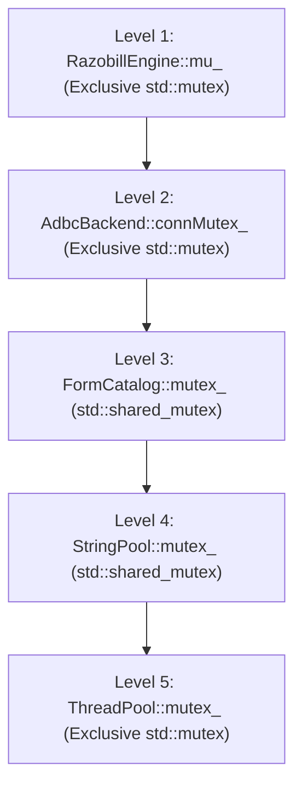

# Razobill Production Engineering Architecture: DOD, OOP & SOLID Specification

**Author:** Antigravity Systems Architecture Team  
**Standard:** DuckDB / ClickHouse Level Engineering Rigor (Zero AI Slop)  
**Foundations:** Data-Oriented Design (DOD), Object-Oriented Design (OOP), SOLID Principles, High-Concurrency Thread Safety  

---

## 1. Data-Oriented Design (DOD) Specification

In modern superscalar processors (AMD Zen 4/5, Intel Golden Cove / Raptor Lake, Apple Silicon M2/M3/M4), CPU throughput is primarily bounded by memory latency and cache-line misses (L1 data cache latency ~4 cycles, L2 ~14 cycles, L3 ~40–70 cycles, DRAM ~150–250 cycles).

Razobill enforces the following hardened DOD rules:

### 1.1 Cache-Line Mechanical Sympathy (64-Byte Alignment)
- All chunked arena allocations, vector registers, and SIMD scan buffers are strictly aligned to 64-byte boundaries (`alignas(64)` or `_aligned_malloc(size, 64)`).
- Eliminates false sharing across CPU cores on multi-threaded worker pools.
- Prevents cross-cache-line split loads in AVX2 and AVX-512 register loads.

### 1.2 Structure of Arrays (SoA) vs Array of Structures (AoS)
- **Problem in current codebase:** `Table` rows use AoS representation (`std::vector<std::vector<Value>>`), where each `Value` is a `std::variant<std::monostate, int64_t, uint64_t, double, std::string>`. This creates 28 bytes per cell + separate heap pointer for strings, generating up to 20 million individual heap allocations for a 5-million row batch.
- **DOD Transformation:**
  ```cpp
  // SoA Columnar Structure:
  struct ColumnBatch {
      std::vector<std::int64_t> intCols;
      std::vector<double> floatCols;
      std::vector<std::uint32_t> strOffsets;
      std::vector<char> strData;
      std::vector<std::uint8_t> nullBitmask;
  };
  ```
  Contiguous memory buffers allow sequential SIMD streaming with hardware prefetchers active.

### 1.3 Zero-Allocation Monotonic Memory Arenas
- `MemoryArena` utilizes bump-pointer allocation ($O(1)$ fast path).
- Bulk reset (`reset()`) preserves memory pages in the virtual address space, keeping L1/L2 caches warm and eliminating kernel page-fault overhead during per-batch ingest loops.
- **Hardened Invariant:** Non-trivially destructible objects must never be silently allocated without an explicit destructor tracker:
  ```cpp
  template <typename T, typename... Args>
  [[nodiscard]] T* create(Args&&... args) {
      static_assert(std::is_trivially_destructible_v<T>,
                    "MemoryArena requires trivially destructible types to guarantee zero leaks on reset()");
      void* mem = allocate(sizeof(T), alignof(T));
      return ::new (mem) T(std::forward<Args>(args)...);
  }
  ```

### 1.4 Branchless Lookup Tables in `.rodata`
- Character classification avoids branch misprediction penalties (~15–20 cycle pipeline flush).
- A 256-byte static constexpr classification array (`detail::kClass`) fits completely within a single 64-byte or four 64-byte L1 cache lines, guaranteeing $O(1)$ single-cycle latency character categorization.

---

## 2. Object-Oriented Programming (OOP) & SOLID Invariants

```
               +-------------------------------------------------+
               |                RazobillEngine                   |
               +-----------------------+-------------------------+
                                       |
        +------------------------------+------------------------------+
        |                              |                              |
        v                              v                              v
+---------------+             +-----------------+             +---------------+
|   Dialect     |             |     Backend     |             |  FormCatalog  |
|  (Strategy)   |             |    (Bridge)     |             |  (Registry)   |
+-------+-------+             +--------+--------+             +---------------+
        |                              |
   +----+----+                    +----+----+
   |         |                    |         |
   v         v                    v         v
DuckDB   ClickHouse            ADBC     Embedded
```

### 2.1 Single Responsibility Principle (SRP)
- **Current Violation:** [src/Razobill.cpp](file:///C:/FM/rzd/razobill/src/Razobill.cpp) currently acts as a god class combining SQL generation, schema introspection, database migration, form registration, transaction management, and information theory calculation.
- **Architectural Boundary:**
  - `Engine`: High-level orchestration, state machine transitions (Ready, Compact, Uninitialized).
  - `Dialect`: Pure SQL expression generation (DuckDB vs ClickHouse). No database calls or state.
  - `Backend`: Transport layer executing SQL and streaming Arrow record batches. No business logic.
  - `FormCatalog`: Thread-safe, bidirectional mapping between raw template strings, 64-bit fingerprints, and dense 32-bit integer IDs.
  - `Stats`: Pure mathematical engine computing Shannon entropies, mutual information, JSD, and Miller-Madow corrections. Zero database dependencies.

### 2.2 Open/Closed Principle (OCP)
- `Dialect` is closed for modification and open for extension: new database backends (e.g., Snowflake, BigQuery, PostgreSQL) can be supported by deriving from `Dialect` without touching the engine's core compaction algorithm.
- `Backend` interface allows pluggable transport mechanisms (ADBC, embedded DuckDB C API, chDB C API, Arrow Flight).

### 2.3 Liskov Substitution Principle (LSP)
- All derived `Dialect` implementations must strictly fulfill dialect contracts:
  - If a dialect does not support native derived compaction (e.g., ClickHouse without custom UDFs), calling `supportsCompact()` returns `false`, and the engine handles fallback gracefully rather than failing silently.

### 2.4 Interface Segregation Principle (ISP)
- `Backend` exposes only:
  ```cpp
  class Backend {
  public:
      virtual ~Backend() = default;
      [[nodiscard]] virtual Flavor flavor() const noexcept = 0;
      virtual void exec(std::string_view sql) = 0;
      [[nodiscard]] virtual Table query(std::string_view sql) = 0;
  };
  ```
  Callers needing streaming access use dedicated streaming query methods rather than forcing row materialization.

### 2.5 Dependency Inversion Principle (DIP)
- High-level modules do not depend on low-level database drivers. Both depend on abstract `Backend` and `Dialect` specifications.
- `RazobillEngine` accepts `Backend&` and dependency-injected configurations.

---

## 3. High-Concurrency & Multi-Threading Architecture

### 3.1 Strict Global Lock Hierarchy

To prevent deadlocks under heavy concurrent multi-threaded traffic, all locks must be acquired in strictly descending hierarchical order:

$$\text{Engine Mutex} (\mu) \succ \text{Backend Mutex} (\text{connMutex}) \succ \text{FormCatalog Shared Mutex} \succ \text{StringPool Shared Mutex} \succ \text{ThreadPool Mutex}$$



**Deadlock Invariant:** A lower-level lock is NEVER permitted to acquire a higher-level lock.

### 3.2 Thread-Safe FormCatalog Invariants
- `FormCatalog` uses reader-writer synchronization (`std::shared_mutex`).
- **Read Path (99.9% of traffic):** Acquires `std::shared_lock<std::shared_mutex>`, checks `formsByKey_` via `std::string_view`, returns existing ID with zero dynamic heap allocation.
- **Write Path (New Template Encountered):**
  - Uses double-checked locking: verifies absence under `shared_lock`, transitions to `std::unique_lock`, re-verifies absence, and registers the template.
  - Storage is pointer-stable: entries are stored in `std::deque<FormEntry>` or indexed by integer IDs to prevent dangling pointers on hash table expansion.

### 3.3 Fork Safety in Multi-Process Environments
- When Python or foreign language runtimes spawn worker processes via `fork()` (e.g., Gunicorn, Celery, PyTorch DataLoaders):
  - POSIX `fork()` duplicates only the calling thread; worker threads in `ThreadPool` are terminated, leaving mutexes locked and queues orphaned.
  - `PyRazobill` registers an `atfork` handler (via `pthread_atfork` on POSIX / `os.register_at_fork` in Python):
    1. **Prepare:** Acquire all internal locks.
    2. **Parent:** Release all internal locks.
    3. **Child:** Re-initialize thread pool and condition variables with clean worker state.

---

## 4. Code Quality Standard: Zero AI Slop

Following the production standards of **DuckDB** and **ClickHouse**:
1. **No Unused Macros or Dead Code:** Zero tautological comparisons, zero commented-out parameter names without justification, zero self-assignments.
2. **Defensive Contracts:** Every function returning an error, status, or validation flag must be decorated with `[[nodiscard]]`.
3. **No Catch-All Swallowing:** Never swallow exceptions or errors silently. Every exception must propagate with actionable diagnostic context ("What happened, Why, What to do").
4. **Header Cleanliness:** No transitive header dependencies. If a file uses `std::tuple`, it must explicitly include `<tuple>`.
5. **No AI Slop Formatting:** Strict formatting adhering to `.clang-format`, explicit type declarations, zero unnecessary boilerplate, and clear mathematical documentation.
