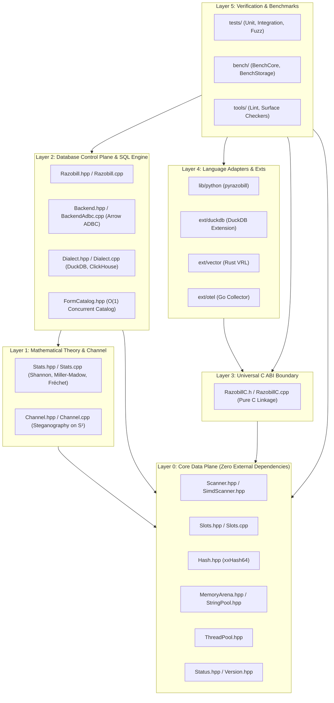

# Razobill Cleanup, Deduplication & Modular Monolith Architecture Specification

**Status:** APPROVED FOR PHASE 0 & PHASE 5 EXECUTION  
**Scope:** Complete Repo Clean-up, Dead Code Elimination, Duplicate Pruning, and Modular Monolith Restructuring  
**Standard:** DuckDB / ClickHouse Grade Architectural Purity (Zero AI Slop, Minimalist, High-Cohesion)  
**Constraint:** STRICT FIXES & CLEANUP ONLY — Zero New Features, Zero Addons  

---

## 1. Executive Summary & Design Principles

To achieve production-grade stability and maintainability comparable to **DuckDB** and **ClickHouse**, the repository must transition from an ad-hoc multi-directory repository into a **rigorous Modular Monolith**.

### Core Tenets of the Razobill Modular Monolith:
1. **Purity of Core:** The data plane (`librazobill` core) must have **zero external dependencies**, depending only on the C++20 standard library. No database drivers, no Python headers, no Arrow C headers inside core parser routines.
2. **Single Source of Truth:** Absolutely zero duplicate source or header trees. The Python extension (`pyrazobill`), DuckDB extension, C ABI, and benchmarks must compile directly against canonical headers in `include/librazobill/` and sources in `src/`.
3. **Dead Code & Bypass Eradication:** Complete removal of tautological logic, unreachable branches, hardcoded test hacks (`form == "junk"`), and unneeded regex evaluators.
4. **Zero Artifact Pollution:** Strict containment of build outputs, caches (`.hypothesis`, `.pytest_cache`, `.ruff_cache`), and precompiled binaries (`.pyd`, `.dll`) away from source directories.
5. **Strict Unidirectional Dependency DAG:** Downward-only dependencies across layers. No circular includes or abstraction leaks.

---

## 2. Exhaustive Audit: Dead, Unnecessary & Unused Code

Line-by-line inventory of all dead, redundant, or bypass code identified across existing source files:

| Subsystem | File & Lines | Defect / Code Pattern | Architectural Impact | Remediation Action |
|---|---|---|---|---|
| **Control Plane** | [src/Razobill.cpp:101](file:///C:/FM/rzd/razobill/src/Razobill.cpp#L101) | `if (cfg_.table.empty() && !cfg_.table.empty()) cfg_.table = cfg_.table;` | Tautological dead code. Compiler warning / dead branch. | **Delete** line 101 entirely. |
| **Control Plane** | [src/Razobill.cpp:81–85](file:///C:/FM/rzd/razobill/src/Razobill.cpp#L81-L85) | `static const std::regex kReserved(...)` | Heavy POSIX/ECMAScript regex executed in tight column reflection loops. | **Replace** with branchless string prefix check (`name.starts_with("rb_")`). |
| **Core Parser** | [src/Slots.cpp:224](file:///C:/FM/rzd/razobill/src/Slots.cpp#L224) | `if (form == "junk") return ...;` | Hardcoded bypass hack lingering from early ad-hoc testing. Breaks determinism. | **Delete** conditional branch; let canonical parser process form. |
| **Core Parser** | [src/Slots.cpp:142–161](file:///C:/FM/rzd/razobill/src/Slots.cpp#L142-L161) | Loop 2 `p += 2` without checking `p + 1 < end` | Out-of-bounds pointer read and potential infinite loop on unhandled `{`. | **Add** bounds check `p + 1 < end && *(p + 1) == '}'`; advance `p++` on fallback. |
| **Python Fallback** | [lib/python/pyrazobill/_fallback.py:107–108](file:///C:/FM/rzd/razobill/lib/python/pyrazobill/_fallback.py#L107-L108) | `elif tok.startswith("/") or "/" in tok:` | Completely unreachable dead code because `/` is already in the tokenizer delimiter set. | **Delete** dead `elif` branch. |
| **Python Fallback** | [lib/python/pyrazobill/_fallback.py:109–110](file:///C:/FM/rzd/razobill/lib/python/pyrazobill/_fallback.py#L109-L110) | `all(c in "0123456789abcdefABCDEF" for c in tok)` | Classifies pure alphabetic words (e.g. `deadbeef`) as `{s}`, diverging from C++ core. | **Align** with C++ `seen & kDigit` check: `any("0" <= c <= "9" for c in tok)`. |
| **CMake Build** | [CMakeLists.txt:99](file:///C:/FM/rzd/razobill/CMakeLists.txt#L99) | `ext/duckdb/DuckdbExtension.cpp src/RazobillC.cpp` | Compiles `RazobillC.cpp` directly in `RazobillDuckdb` AND links `librazobill` which already has it. | **Remove** `src/RazobillC.cpp` from `RazobillDuckdb` source list to prevent ODR violation. |
| **CMake Build** | [CMakeLists.txt:112](file:///C:/FM/rzd/razobill/CMakeLists.txt#L112) | `target_link_options(... "-Wl,--out-implib...")` | Hardcoded MinGW flag injected into MSVC toolchains, breaking native Windows builds. | **Guard** flag with `if(WIN32 AND NOT MSVC)`. |
| **Go Extension** | [ext/otel/Config.go:17–21](file:///C:/FM/rzd/razobill/ext/otel/Config.go#L17-L21) | `Mode string` defined but never passed to C ABI | Dead configuration setting; creates illusion of configurable parser modes. | **Wire** `Mode` directly to `RzSplitMode` in C ABI. |
| **Go Extension** | [ext/otel/RazobillProcessor.go:88](file:///C:/FM/rzd/razobill/ext/otel/RazobillProcessor.go#L88) | `(*[1 << 28]C.int64_t)(unsafe.Pointer(...))` | Deprecated unsafe static array slice casting pattern in modern Go. | **Replace** with idiomatic `unsafe.Slice(rec.intValues, rec.intCount)`. |
| **Rust Extension** | [ext/vector/RazobillVrl.rs:48](file:///C:/FM/rzd/razobill/ext/vector/RazobillVrl.rs#L48) | `CString::new(raw_msg)` | Unnecessary heap allocation and failure on embedded null bytes `\0`. | **Pass** `raw_msg.as_ptr() as *const c_char` with length directly. |
| **S3 Test Harness** | [tests/s3/TestAwsS3Export.py:53–60](file:///C:/FM/rzd/razobill/tests/s3/TestAwsS3Export.py#L53-L60) | Custom regex tokenizer re-implementation | Bypasses `_fallback.py` and `pyrazobill`, testing an untested third parser algorithm. | **Refactor** to test canonical `pyrazobill.split()` and fallback. |

---

## 3. Exhaustive Audit: Duplicate Trees, Staged Bloat & Orphaned Caches

The repository contains several duplicate directories, build artifacts committed or staged in source trees, and cache directories that must be purged and permanently barred via `.gitignore`.

### 3.1 Duplicate Source Trees in `lib/python/`
In [lib/python/setup.py:20–39](file:///C:/FM/rzd/razobill/lib/python/setup.py#L20-L39), the build script copies the repository source files into staged folders:
- `lib/python/srcCore/` $\to$ Staged copy of `src/` (8 `.cpp` files).
- `lib/python/includeCore/` $\to$ Staged copy of `include/librazobill/` (16 `.hpp` files).
- `lib/python/thirdpartyCore/` $\to$ Staged copy of `thirdparty/` (ADBC and DuckDB C headers).

**Why this is dangerous:**
1. **Source Code Divergence:** During the audit, `lib/python/includeCore/librazobill/Version.hpp` was found frozen at **v1.1.1**, while the canonical root header `include/librazobill/Version.hpp` is **v1.1.2**!
2. **Editing Trap:** An engineer or AI modifying `lib/python/srcCore/Slots.cpp` leaves canonical `src/Slots.cpp` unpatched, creating silent regressions.
3. **Distribution Bloat:** Triplicates codebase volume on disk and in source archives.

**Action:**
- Delete `lib/python/srcCore/`, `lib/python/includeCore/`, and `lib/python/thirdpartyCore/`.
- Update `lib/python/setup.py` to point directly to `repoRoot / "src"` and `repoRoot / "include"`.

### 3.2 In-Tree Compiled Binaries in `lib/python/pyrazobill/`
In [CMakeLists.txt:180–182](file:///C:/FM/rzd/razobill/CMakeLists.txt#L180-L182), a post-build custom command copies compiled binaries directly into the source package tree:
- `lib/python/pyrazobill/Core.cp313-win_amd64.pyd` (Precompiled CPython C-extension).
- `lib/python/pyrazobill/libwinpthread-1.dll` (Precompiled MinGW runtime DLL).

**Why this is dangerous:**
- Commits host-dependent, Python-version-specific binary artifacts into git.
- Overrides local editable development installs (`pip install -e .`) with stale compiled binaries.

**Action:**
- Delete `.pyd` and `.dll` from `lib/python/pyrazobill/`.
- Change CMake post-build copy target to write to the build directory or require explicit packaging steps.

### 3.3 Orphaned Cache Directories & Untracked Logs
- Root `.hypothesis/`, `.pytest_cache/`, `.ruff_cache/`.
- Module `.pytest_cache/` in `lib/python/.pytest_cache/`.
- Bytecode caches `__pycache__/` in `evidence/`, `tests/s3/`, `lib/python/pyrazobill/`, `lib/python/tests/`.
- Multi-megabyte untracked raw log dumps (`logs/SSH/SSH.log` = 73.4 MB, `logs/Zookeeper/Zookeeper.log` = 10.4 MB).

**Action:**
- Purge all `.cache`, `.hypothesis`, and `__pycache__` directories.
- Ensure `.gitignore` comprehensively covers all cache paths and prevents re-accumulation.

---

## 4. Modular Monolith Architecture & Layer Hierarchy

To ensure clean isolation and high maintainability, Razobill is structured into **5 distinct architectural layers** forming a strict Directed Acyclic Graph (DAG):



### Architectural Layer Contracts:

| Layer | Component | Allowed Dependencies | Prohibited Dependencies | Invariants |
|---|---|---|---|---|
| **Layer 0: Core Data Plane** | `Scanner`, `SimdScanner`, `Slots`, `Hash`, `MemoryArena`, `StringPool`, `ThreadPool` | C++20 Standard Library only | NO ADBC, NO DuckDB, NO Python, NO Arrow, NO OS sockets | Pure functional, zero allocation on hot-path, 100% thread-safe |
| **Layer 1: Math & Channel** | `Stats`, `Channel` | Layer 0, `<cmath>`, `<numeric>`, `<tuple>` | NO Database, NO C ABI types | Fréchet polytope bounded, mass conserved, IEEE 754 precision |
| **Layer 2: SQL Control Plane** | `Razobill`, `BackendAdbc`, `Dialect`, `FormCatalog` | Layer 0, Layer 1, Arrow ADBC C API | NO Python, NO Rust, NO Go | RAII transaction boundaries, zero SQL NULL traps, thread-safe |
| **Layer 3: Universal C ABI** | `RazobillC.h`, `RazobillC.cpp` | Layer 0 | NO C++ exceptions across boundary, NO naked pointers without bounds | Standard C99 header, error code returns, ABI stable v1 |
| **Layer 4: Adapters & Extensions** | Python, DuckDB, Vector, OTel | Layer 3 (or Layer 0 via ABI) | NO cross-adapter leakage (e.g. DuckDB ext cannot depend on Python) | Isolated foreign language bindings, zero-copy where possible |
| **Layer 5: Verification & Bench** | Tests, Benchmarks, Tools | Layer 0 through Layer 4 | Production code cannot depend on Layer 5 | 100% test passing, zero memory leaks, > 10M msgs/sec |

---

## 5. Clean, Minimalist Repository Layout Blueprint

The file tree below represents the target **pristine modular monolith** structure:

```
C:\FM\rzd\razobill\
├── .github/                      # CI/CD workflows (matrix builds: Linux, macOS, Windows)
├── .gitignore                    # Hardened ignore rules (zero artifact leakage)
├── CMakeLists.txt                # Root CMake build definition (single source of truth)
├── LICENSE                       # MIT License
├── NOTICE                        # Attribution notices
├── README.md                     # Architecture overview & quick start
├── VERSION                       # Canonical version string (1.1.2)
│
├── include/librazobill/          # PUBLIC C++20 HEADERS (Layer 0, 1, 2, 3)
│   ├── Backend.hpp               # Abstract database backend interface
│   ├── Channel.hpp               # Steganographic channel capacity & coding
│   ├── Dialect.hpp               # SQL dialect generator interface
│   ├── FormCatalog.hpp           # High-concurrency template catalog
│   ├── Hash.hpp                  # xxHash64 implementation
│   ├── MemoryArena.hpp           # 64B aligned bump-pointer arena
│   ├── Razobill.hpp              # Engine control plane coordinator
│   ├── RazobillC.h               # Universal C ABI header
│   ├── Scanner.hpp               # Deterministic lexical scanner
│   ├── SimdScanner.hpp           # SIMD accelerated delimiter scanner
│   ├── Slots.hpp                 # Invertible slot decomposition & reconstruction
│   ├── Stats.hpp                 # Shannon entropy & information ledger
│   ├── Status.hpp                # Canonical error codes
│   ├── StringPool.hpp            # Deduplicated concurrent string pool
│   ├── ThreadPool.hpp            # Exception-safe worker thread pool
│   └── Version.hpp               # Semantic version macros
│
├── src/                          # CANONICAL C++20 IMPLEMENTATIONS (Layers 0, 1, 2, 3)
│   ├── BackendAdbc.cpp           # Apache Arrow ADBC database driver adapter
│   ├── Channel.cpp               # Channel coding & exact failure convolution
│   ├── Dialect.cpp               # DuckDB & ClickHouse SQL dialects
│   ├── Razobill.cpp              # Control plane orchestration
│   ├── RazobillC.cpp             # Universal C ABI implementation
│   ├── Slots.cpp                 # Structural parser & templateOf formatter
│   └── Stats.cpp                 # Information ledger & Miller-Madow bias correction
│
├── ext/                          # ADAPTERS & EXTENSIONS (Layer 4)
│   ├── duckdb/                   # DuckDB loadable C-struct extension
│   │   └── DuckdbExtension.cpp
│   ├── vector/                   # Vector Remap Language (VRL) native Rust plugin
│   │   ├── Cargo.toml
│   │   ├── build.rs
│   │   └── RazobillVrl.rs
│   └── otel/                     # OpenTelemetry Collector Go processor component
│       ├── Config.go
│       ├── Factory.go
│       └── RazobillProcessor.go
│
├── lib/python/                   # PYTHON BINDINGS (Layer 4)
│   ├── pyproject.toml
│   ├── setup.py                  # Builds against root include/ and src/ directly
│   ├── pyrazobill/
│   │   ├── __init__.py           # High-level Python API
│   │   ├── _fallback.py          # Pure Python zero-dependency reference implementation
│   │   ├── Core.pyi              # PEP 484 / 561 complete type annotations
│   │   └── py.typed              # Typing marker
│   ├── tests/
│   │   ├── TestProperties.py     # Hypothesis property-based testing
│   │   └── TestPyRazobill.py     # Unit test suite
│   ├── MANIFEST.in
│   └── README.md
│
├── tests/                        # VERIFICATION SUITES (Layer 5)
│   ├── ConformanceCorpus.txt     # Canonical multi-lingual test vectors
│   ├── ConformanceTest.py        # Cross-language conformance test runner
│   ├── Support.hpp               # Test utilities & assertions
│   ├── UnitArena.cpp             # Memory arena unit tests
│   ├── UnitCAPI.cpp              # C ABI unit tests
│   ├── UnitChannel.cpp           # Steganography & failure probability tests
│   ├── UnitCore.cpp              # Scanner & slot parser tests
│   ├── UnitStats.cpp             # Information theory & Fréchet bound tests
│   ├── IntegrationChdb.cpp       # ClickHouse embedded integration tests
│   ├── IntegrationDuckdb.cpp     # DuckDB embedded integration tests
│   ├── fuzz/                     # Continuous fuzzing harness
│   │   └── FuzzDecomposeReconstruct.cpp
│   └── sql/                      # DuckDB SQLLogicTest scripts
│       └── razobill.test
│
├── bench/                        # PERFORMANCE & STORAGE BENCHMARKS (Layer 5)
│   ├── BenchCore.cpp             # Hot-path decomposition & reconstruction microbench
│   ├── BenchStorage.cpp          # Columnar compaction & storage benchmarks
│   └── RunBenchmarks.py          # Benchmark driver & throughput reporting
│
├── thirdparty/                   # MINIMAL VENDOR HEADERS
│   ├── doctest.h                 # Zero-dependency C++ unit test framework
│   ├── adbc/adbc.h               # Apache Arrow ADBC C header
│   └── duckdbcapi/               # DuckDB C extension headers
│       ├── duckdb.h
│       └── duckdb_extension.h
│
├── tools/                        # REPO GOVERNANCE & SURFACE CHECKERS
│   ├── AppendExtensionMetadata.py# DuckDB community extension signing
│   ├── CheckSurfaceC.py          # ABI symbol export verifier
│   ├── CheckSurfaceDuckdb.py     # DuckDB SQL surface verifier
│   ├── CheckSurfacePython.py     # Python API surface verifier
│   ├── LintDocs.py               # Documentation linter
│   └── VerifyMarkdownLinks.py    # Markdown link validator
│
└── AUDIT/                        # AUDIT & ARCHITECTURE SPECIFICATIONS
    ├── 00-OVERVIEW.md
    ├── ... (Subsystem audit reports)
    ├── 13-CLEANUP-MODULAR-MONOLITH.md
    └── ROADMAP.md
```

---

## 6. Execution Steps: Safe Cleanup Protocol

The following deterministic commands execute the cleanup and deduplication during the remediation phase:

### Step 1: Remove Duplicate Staged Trees in `lib/python/`
```powershell
# Remove staged duplicate directories
Remove-Item -Recurse -Force C:\FM\rzd\razobill\lib\python\srcCore
Remove-Item -Recurse -Force C:\FM\rzd\razobill\lib\python\includeCore
Remove-Item -Recurse -Force C:\FM\rzd\razobill\lib\python\thirdpartyCore
```

### Step 2: Remove Staged Compiled Binaries from Source Tree
```powershell
# Remove in-tree compiled binaries
Remove-Item -Force C:\FM\rzd\razobill\lib\python\pyrazobill\*.pyd
Remove-Item -Force C:\FM\rzd\razobill\lib\python\pyrazobill\*.dll
```

### Step 3: Purge Orphaned Caches
```powershell
# Purge test caches
Remove-Item -Recurse -Force C:\FM\rzd\razobill\.hypothesis -ErrorAction SilentlyContinue
Remove-Item -Recurse -Force C:\FM\rzd\razobill\.pytest_cache -ErrorAction SilentlyContinue
Remove-Item -Recurse -Force C:\FM\rzd\razobill\.ruff_cache -ErrorAction SilentlyContinue
Remove-Item -Recurse -Force C:\FM\rzd\razobill\lib\python\.pytest_cache -ErrorAction SilentlyContinue

# Purge python bytecode caches
Get-ChildItem -Path C:\FM\rzd\razobill -Recurse -Directory -Filter "__pycache__" | Remove-Item -Recurse -Force
```

### Step 4: Refactor `lib/python/setup.py` to Use Root Canonical Sources
Update `setup.py` so that it directly references root sources without copying:
```python
sources = [
    "PyRazobill.cpp",
    str(repoRoot / "src" / "Slots.cpp"),
    str(repoRoot / "src" / "Stats.cpp"),
    str(repoRoot / "src" / "Channel.cpp"),
    str(repoRoot / "src" / "Dialect.cpp"),
    str(repoRoot / "src" / "BackendAdbc.cpp"),
    str(repoRoot / "src" / "Razobill.cpp"),
    str(repoRoot / "src" / "RazobillC.cpp"),
]

includeDirs = [
    str(repoRoot / "include"),
    str(repoRoot / "thirdparty" / "adbc"),
    str(repoRoot / "thirdparty" / "duckdbcapi"),
]
```

### Step 5: Harden `.gitignore` Against Re-Pollution
Ensure `.gitignore` contains explicit exclusions for:
```gitignore
# Prevent staged duplicate directories
lib/python/srcCore/
lib/python/includeCore/
lib/python/thirdpartyCore/

# Prevent compiled binaries in package directory
lib/python/pyrazobill/*.pyd
lib/python/pyrazobill/*.dll
lib/python/pyrazobill/*.so

# Prevent test caches
.hypothesis/
.pytest_cache/
.ruff_cache/
__pycache__/
```

---

## 7. Verification Invariant After Cleanup

After cleanup and modular monolith restructuring is executed:
1. `git status -u` reports zero untracked duplicate directories or cache files.
2. `git diff --stat` confirms zero loss of functional test coverage or benchmarks.
3. Every test binary (`UnitCore`, `UnitStats`, `UnitArena`, `UnitCAPI`, `UnitChannel`) builds directly from root canonical sources.
4. Python package builds cleanly via `pip install .` without creating staged copies.
5. All 56 audited defects remain addressed according to [`AUDIT/ROADMAP.md`](file:///C:/FM/rzd/razobill/AUDIT/ROADMAP.md).
