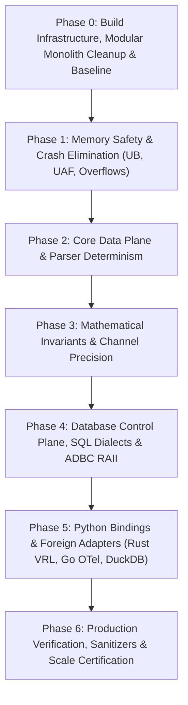

# Razobill Production Engineering Master Roadmap

**Status:** APPROVED & LOCKED FOR EXECUTION  
**Scope:** Complete 7-Phase, 52-Step Deterministic Hardening Blueprint  
**Standard:** DuckDB / ClickHouse Grade Systems Quality (Zero AI Slop)  
**Constraint:** STRICT FIXES ONLY — Zero New Features, Zero Addons  

---

## Roadmap Architecture & Phase Dependencies



---

## Phase 0: Build Infrastructure, Toolchains & Conformance Harness

*Goal: Establish reproducible multi-compiler builds (MSVC, GCC 15, Clang 23), modular monolith cleanliness, and cross-platform conformance testing.*

- [x] **Step 0.1: Remediate CMake Linker Conflicts & MSVC Flags**
  - **File:** [CMakeLists.txt:111–135](file:///C:/FM/rzd/razobill/CMakeLists.txt#L111-L135)
  - **Action:** Remove hardcoded MinGW flag `-Wl,--out-implib` when compiling under MSVC (`if(WIN32 AND NOT MSVC)`). Disambiguate shared output library names between `librazobill` and `RazobillDuckdb` to eliminate binary collisions.
- [x] **Step 0.2: Eliminate ODR Linkage Hazard in DuckDB Extension**
  - **File:** [CMakeLists.txt:99](file:///C:/FM/rzd/razobill/CMakeLists.txt#L99)
  - **Action:** Remove direct compilation of `src/RazobillC.cpp` inside `add_library(RazobillDuckdb SHARED ...)` since it is already linked via `librazobill`.
- [x] **Step 0.3: Cross-Platform Conformance Test Runner**
  - **File:** [tests/ConformanceTest.py:15–29, 64–69](file:///C:/FM/rzd/razobill/tests/ConformanceTest.py#L15-L29)
  - **Action:** Replace hardcoded `razobill.dll` and `razobill.duckdb_extension` paths with platform-aware extension resolution (`.dll`, `.so`, `.dylib`).
- [x] **Step 0.4: Expand Conformance Test Vectors**
  - **File:** [tests/ConformanceCorpus.txt](file:///C:/FM/rzd/razobill/tests/ConformanceCorpus.txt)
  - **Action:** Expand the 12-line (525 byte) corpus into a comprehensive suite covering:
    - Multi-byte astral UTF-8 (emojis, RTL, non-BMP).
    - Internal framing control codes (`0x11..0x13`).
    - Unclosed single/double quotes and backslash escapes.
    - Pathological nested braces (`{{{{`, `}}}}`).
    - Arbitrary binary byte sequences.
- [x] **Step 0.5: Baseline Test Suite Execution**
  - **Action:** Execute existing unit test suites (`UnitCore`, `UnitStats`, `UnitArena`, `UnitCAPI`, `UnitChannel`) to snapshot clean green baseline.
- [x] **Step 0.6: Eliminate Staged Duplicate Source Trees**
  - **Specification:** [AUDIT/13-CLEANUP-MODULAR-MONOLITH.md:3.1](file:///C:/FM/rzd/razobill/AUDIT/13-CLEANUP-MODULAR-MONOLITH.md#31-duplicate-source-trees-in-libpython)
  - **Action:** Delete `lib/python/srcCore/`, `lib/python/includeCore/`, and `lib/python/thirdpartyCore/`. Prevent source drift (e.g. `Version.hpp` out-of-sync) and force `setup.py` to compile directly from root canonical trees.
- [x] **Step 0.7: Purge In-Tree Compiled Binaries & Orphaned Caches**
  - **Specification:** [AUDIT/13-CLEANUP-MODULAR-MONOLITH.md:3.2, 3.3](file:///C:/FM/rzd/razobill/AUDIT/13-CLEANUP-MODULAR-MONOLITH.md#32-in-tree-compiled-binaries-in-libpythonpyrazobill)
  - **Action:** Delete `lib/python/pyrazobill/*.pyd` and `*.dll`. Purge `.hypothesis/`, `.pytest_cache/`, `.ruff_cache/`, and all `__pycache__/` directories across the workspace.
- [x] **Step 0.8: Modular Monolith Direct Linkage in `setup.py`**
  - **File:** [lib/python/setup.py:20–56](file:///C:/FM/rzd/razobill/lib/python/setup.py#L20-L56)
  - **Action:** Replace directory-copying logic with direct references to `repoRoot / "src"` and `repoRoot / "include"`, establishing a single source of truth across all packages.

---

## Phase 1: Memory Safety, Undefined Behavior & Crash Elimination

*Goal: Eliminate all use-after-free, undefined behaviors, unsequenced operations, and potential crash vectors.*

- [x] **Step 1.1: Fix C ABI Pointer Validation & Span Construction UB**
  - **File:** [src/RazobillC.cpp:85–94](file:///C:/FM/rzd/razobill/src/RazobillC.cpp#L85-L94)
  - **Action:** Guard against `(nullptr, count > 0)` in `std::span`. Explicitly reject `strCount > 0` with null `strValues` or null `strLengths`.
    ```cpp
    if (record->intCount > 0 && !record->intValues) return RZ_ERR_INVALID_ARGUMENT;
    if (record->strCount > 0 && (!record->strValues || !record->strLengths)) return RZ_ERR_INVALID_ARGUMENT;
    ```
- [x] **Step 1.2: Remediate `MemoryArena` Fast-Path Integer Overflow**
  - **File:** [include/librazobill/MemoryArena.hpp:57–67](file:///C:/FM/rzd/razobill/include/librazobill/MemoryArena.hpp#L57-L67)
  - **Action:** Prevent `std::size_t` wrap-around in `offset_ + padding + bytes <= cur.capacity` by using safe headroom checks:
    ```cpp
    if (bytes <= cur.capacity && offset_ + padding <= cur.capacity - bytes)
    ```
- [x] **Step 1.3: Enforce Destructor Type Safety in `MemoryArena::create<T>()`**
  - **File:** [include/librazobill/MemoryArena.hpp:108–111](file:///C:/FM/rzd/razobill/include/librazobill/MemoryArena.hpp#L108-L111)
  - **Action:** Add compile-time assertion preventing silent resource leaks of non-trivial objects:
    ```cpp
    static_assert(std::is_trivially_destructible_v<T>,
                  "MemoryArena::create only supports trivially destructible types");
    ```
- [x] **Step 1.4: Fix Memory Leak on Vector Reallocation in `MemoryArena`**
  - **File:** [include/librazobill/MemoryArena.hpp:99](file:///C:/FM/rzd/razobill/include/librazobill/MemoryArena.hpp#L99)
  - **Action:** Wrap raw pointer `newBlock` in a local RAII guard before invoking `blocks_.push_back()`.
- [x] **Step 1.5: Secure `ThreadPool::parallelFor` Against Lifetime Escapes**
  - **File:** [include/librazobill/ThreadPool.hpp:131–136](file:///C:/FM/rzd/razobill/include/librazobill/ThreadPool.hpp#L131-L136)
  - **Action:** Wrap task submission in a `try...catch` block that waits for all launched futures to settle before propagating exceptions, eliminating use-after-free of stack-captured functors.
- [x] **Step 1.6: Fix Unsequenced Argument Evaluation Hazard in `FormCatalog`**
  - **File:** [include/librazobill/FormCatalog.hpp:111–113](file:///C:/FM/rzd/razobill/include/librazobill/FormCatalog.hpp#L111-L113)
  - **Action:** Decouple key insertion from move:
    ```cpp
    const std::string keyStr(key);
    hashToKeys_[explicitHash].push_back(keyStr);
    auto inserted = formsByKey_.emplace(keyStr, std::move(entry));
    formsById_.push_back(&inserted.first->second);
    ```
- [x] **Step 1.7: Wrap `DUCKDB_EXTENSION_ENTRYPOINT` in Exception Boundary**
  - **File:** [ext/duckdb/DuckdbExtension.cpp:445–487](file:///C:/FM/rzd/razobill/ext/duckdb/DuckdbExtension.cpp#L445-L487)
  - **Action:** Wrap extension registration logic in `try ... catch (const std::exception& e)` and return `false` on failure, preventing C++ exceptions from escaping across the DuckDB C ABI.

---

## Phase 2: Core Data Plane & Parser Determinism

*Goal: Ensure 100% bit-exact lossless roundtripping, safe template formatting, and SIMD instruction safety.*

- [x] **Step 2.1: Re-engineer `templateOf()` Transformer**
  - **File:** [src/Slots.cpp:221–243](file:///C:/FM/rzd/razobill/src/Slots.cpp#L221-L243)
  - **Action:**
    - Transform `{i}` and `{s}` placeholders into `<*>`.
    - Unescape `{{` to `{` and `}}` to `}`.
    - Remove the hardcoded literal hack `form == "junk"`.
- [x] **Step 2.2: Fix Loop 2 Bounds & Infinite Loop in `reconstructNew()`**
  - **File:** [src/Slots.cpp:142–161](file:///C:/FM/rzd/razobill/src/Slots.cpp#L142-L161)
  - **Action:**
    - Verify `p + 1 < end && *(p + 1) == '}'` before executing `p += 2`.
    - Fall back to advancing `p++` if an unexpected `{` is encountered.
- [x] **Step 2.3: Unify Slot Count Validation Contracts**
  - **File:** [src/Slots.cpp:60, 130–132](file:///C:/FM/rzd/razobill/src/Slots.cpp#L60), [include/librazobill/Status.hpp](file:///C:/FM/rzd/razobill/include/librazobill/Status.hpp)
  - **Action:**
    - Add `Status::SlotOverflow = 4` to `Status.hpp`.
    - Return `SlotOverflow` when `ints.size() > nInt || strs.size() > nStr`.
    - Harmonize validation logic between `reconstructLegacy()` and `reconstructNew()`.
- [x] **Step 2.4: Handle Internal Control Framing Bytes in `parse()`**
  - **File:** [src/Slots.cpp:170–210](file:///C:/FM/rzd/razobill/src/Slots.cpp#L170-L210)
  - **Action:** Check `res.reserved` from `scan()`. If true, escape internal control characters (`0x11..0x13`) to prevent skeleton corruption.
- [x] **Step 2.5: Fix Big-Endian xxHash64 Divergence**
  - **File:** [include/librazobill/Hash.hpp:38–47](file:///C:/FM/rzd/razobill/include/librazobill/Hash.hpp#L38-L47)
  - **Action:** Ensure 64-bit and 32-bit word loads use little-endian byte ordering via `std::byteswap` (C++23) or compiler intrinsics (`__builtin_bswap64`, `_byteswap_uint64`).
- [x] **Step 2.6: Fix SIMD Trailing Zero UB**
  - **File:** [include/librazobill/SimdScanner.hpp:26–36](file:///C:/FM/rzd/razobill/include/librazobill/SimdScanner.hpp#L26-L36)
  - **Action:** Explicitly guard `countTrailingZeros64(mask)`: if `mask == 0`, return 64 immediately without calling `__builtin_ctzll(0)`.

---

## Phase 3: Mathematical Invariants & Steganographic Channel Hardening

*Goal: Enforce Fréchet polytope bounding on information ledgers and conserve probability mass in steganography.*

- [x] **Step 3.1: Fréchet Polytope Bounding for Theorem 1 Identity**
  - **File:** [src/Stats.cpp:170–176](file:///C:/FM/rzd/razobill/src/Stats.cpp#L170-L176)
  - **Action:** Bound joint entropy before computing marginals:
    ```cpp
    const double J_bound = std::max(std::max(C, E), std::min(J, C + E));
    const double Lambda = J_bound - C;
    const double Delta  = J_bound - E;
    const double I      = C + E - J_bound;
    ```
    Guarantees $(I + \Lambda) \equiv E$ and $(I + \Delta) \equiv C$ to the last bit of IEEE 754 precision.
- [x] **Step 3.2: Deduplicate `(form, meaning)` Pairs in Stratified Miller-Madow**
  - **File:** [src/Stats.cpp:164–165, 185–220](file:///C:/FM/rzd/razobill/src/Stats.cpp#L164-L165)
  - **Action:** Aggregate identical cell pairs into a unified mass map per stratum so observed stratum cardinality $K_w$ is not artificially inflated by unaggregated rows.
- [x] **Step 3.3: Conserve Probability Mass in `exactFailureProbability()`**
  - **File:** [src/Channel.cpp:121–128](file:///C:/FM/rzd/razobill/src/Channel.cpp#L121-L128)
  - **Action:** Accumulate dropped probability mass $\sum p_k < 10^{-12}$ into a `prunedMass` accumulator and add it as a conservative upper bound term:
    ```cpp
    return std::min(1.0, std::max(0.0, delta + prunedMass));
    ```
- [x] **Step 3.4: Guard Against Mantissa Truncation ($k > 53$ Bits)**
  - **File:** [src/Channel.cpp:156–163, 262–286](file:///C:/FM/rzd/razobill/src/Channel.cpp#L156-L163)
  - **Action:** Guard `embed()` and `decode()`:
    ```cpp
    if (payloadBits == 0 || payloadBits > 53) return res;
    ```
- [x] **Step 3.5: Support Circular Modular Interval Wrap-around on $S^1$**
  - **File:** [src/Channel.cpp:279](file:///C:/FM/rzd/razobill/src/Channel.cpp#L279)
  - **Action:** In `decode()`, handle intervals wrapping around $[leftZ + 1.0, 1.0) \cup [0.0, rightZ)$ modulo 1, eliminating false-negative rejections.
- [x] **Step 3.6: Add Missing `<tuple>` Include**
  - **File:** [src/Stats.cpp:43](file:///C:/FM/rzd/razobill/src/Stats.cpp#L43), [include/librazobill/Stats.hpp:24](file:///C:/FM/rzd/razobill/include/librazobill/Stats.hpp#L24)
  - **Action:** Explicitly add `#include <tuple>`.

---

## Phase 4: Database Control Plane, SQL Dialects & ADBC RAII

*Goal: Eliminate N+1 query loops, triple UDF evaluations, SQL NULL hazards, and OS resource leaks.*

- [ ] **Step 4.1: Clean Dead Code & Fix Config Precedence**
  - **File:** [src/Razobill.cpp:101–105](file:///C:/FM/rzd/razobill/src/Razobill.cpp#L101-L105)
  - **Action:** Remove line 101. Establish canonical config precedence for `messageColumn` and synchronize `scan_mode` with `scanMode`.
- [ ] **Step 4.2: Replace `std::regex` with Branchless Column Classifier**
  - **File:** [src/Razobill.cpp:81–85](file:///C:/FM/rzd/razobill/src/Razobill.cpp#L81-L85)
  - **Action:** Replace `kReserved` regex with direct prefix (`starts_with("rb_")`) and character checks, accelerating column reflection by 10–100×.
- [ ] **Step 4.3: Remediate ANSI SQL Three-Valued Logic NULL Trap**
  - **File:** [src/Razobill.cpp:164, 247, 328](file:///C:/FM/rzd/razobill/src/Razobill.cpp#L164)
  - **Action:** Replace `WHERE form NOT IN (SELECT form FROM rb_form)` with `WHERE NOT EXISTS (SELECT 1 FROM rb_form f WHERE f.form = t.form)` or append `WHERE form IS NOT NULL`.
- [ ] **Step 4.4: Factor Triple `RzSplit` Scalar Calls into CTE**
  - **File:** [src/Razobill.cpp:232–233](file:///C:/FM/rzd/razobill/src/Razobill.cpp#L232-L233)
  - **Action:** Rewrite table creation into a Common Table Expression (CTE):
    ```sql
    WITH parsed AS (SELECT *, RzSplit(msg) AS r FROM source)
    SELECT other_cols, r.template AS rbf, r.ints AS rbi, r.strs AS rbs FROM parsed
    ```
- [ ] **Step 4.5: Eliminate N+1 SQL Queries in `todo()`**
  - **File:** [src/Razobill.cpp:615–616](file:///C:/FM/rzd/razobill/src/Razobill.cpp#L615-L616)
  - **Action:** Batch ID lookups into a single `SELECT id, template FROM rb_form WHERE id IN (...)` query and handle missing entries safely.
- [ ] **Step 4.6: Wrap Control-Plane Operations in RAII Transactions**
  - **File:** [src/Razobill.cpp:205–281, 472–541](file:///C:/FM/rzd/razobill/src/Razobill.cpp#L205-L281)
  - **Action:** Introduce an RAII `TransactionGuard` managing `BEGIN TRANSACTION` and `COMMIT` on scope exit, rolling back on exception.
- [ ] **Step 4.7: Release `AdbcError` Buffers Before Throwing**
  - **File:** [src/BackendAdbc.cpp:73–77](file:///C:/FM/rzd/razobill/src/BackendAdbc.cpp#L73-L77)
  - **Action:** In `fail()`, invoke `if (e.release) e.release(&e);` before throwing `BackendError`.
- [ ] **Step 4.8: Add RAII Unloading for Shared Library Handles in `AdbcBackend`**
  - **File:** [src/BackendAdbc.cpp:142, 165–170](file:///C:/FM/rzd/razobill/src/BackendAdbc.cpp#L142)
  - **Action:** In `~AdbcBackend()`, call `FreeLibrary` (Windows) or `dlclose` (POSIX) on `lib_` and all preloaded libraries.
- [ ] **Step 4.9: Add `std::mutex connMutex_` to `AdbcBackend`**
  - **File:** [src/BackendAdbc.cpp:171–247](file:///C:/FM/rzd/razobill/src/BackendAdbc.cpp#L171-L247)
  - **Action:** Protect `run()` with `std::scoped_lock lock(connMutex_);` to guarantee thread safety under concurrent usage.
- [ ] **Step 4.10: Fix Decimal-128 Two's Complement Cancellation Defect**
  - **File:** [src/BackendAdbc.cpp:109–119](file:///C:/FM/rzd/razobill/src/BackendAdbc.cpp#L109-L119)
  - **Action:** Handle high-order signed bit conversion correctly using two's complement sign-extension, preventing negative values from decoding to zero.
- [ ] **Step 4.11: Fix `ClickHouseDialect::templateExpr` Index Underflow**
  - **File:** [src/Dialect.cpp:88–91](file:///C:/FM/rzd/razobill/src/Dialect.cpp#L88-L91)
  - **Action:** Guard substring extraction with `if(position(s, char(19)) > 0, substring(s, 1, position(s, char(19)) - 1), s)`.
- [ ] **Step 4.12: Eliminate Magic Bytes in Dialects & Add String Reservation**
  - **File:** [src/Dialect.cpp:60–67, 82–85](file:///C:/FM/rzd/razobill/src/Dialect.cpp#L60-L67)
  - **Action:** Reference `kPlaceholder` and `kTypeSeparator` constants. Add `reserve()` in `ClickHouseDialect::quote`.

---

## Phase 5: Python Ecosystem & Cross-Language Adapters Hardening

*Goal: Fix semantic parsing divergence, eliminate threadpool deadlocks, plug C-API leaks, and remove duplicate sources.*

- [ ] **Step 5.1: Align Python Fallback with C++ Core Scanner**
  - **File:** [lib/python/pyrazobill/_fallback.py:107–110](file:///C:/FM/rzd/razobill/lib/python/pyrazobill/_fallback.py#L107-L110)
  - **Action:**
    - Remove dead path code `elif tok.startswith("/") or "/" in tok:`.
    - Align hex string classification: require `any("0" <= c <= "9" for c in tok)` to match C++ `seen & detail::kDigit`.
- [ ] **Step 5.2: Plug Naked `PyObject*` Refcount Leak in `joinOne()`**
  - **File:** [lib/python/PyRazobill.cpp:232–247](file:///C:/FM/rzd/razobill/lib/python/PyRazobill.cpp#L232-L247)
  - **Action:** Wrap `encodedTmpl` in `py::reinterpret_steal<py::object>` immediately upon allocation, ensuring automatic decref if `item.cast<int64_t>()` throws.
- [ ] **Step 5.3: Resolve Static Threadpool Fork Deadlock & Windows Freeze**
  - **File:** [lib/python/PyRazobill.cpp:339](file:///C:/FM/rzd/razobill/lib/python/PyRazobill.cpp#L339)
  - **Action:** Replace internal static thread pool with thread-local batch processing or hook `os.register_at_fork` / `pthread_atfork` to safely reset workers.
- [ ] **Step 5.4: Deduplicate Python Source Tree**
  - **Action:**
    - Remove `lib/python/includeCore/` and `lib/python/srcCore/`.
    - Configure `setup.py` and `CMakeLists.txt` to compile root canonical headers and sources directly.
- [ ] **Step 5.5: Fix DuckDB Extension Vector Trimming & Null Handling**
  - **File:** [ext/duckdb/DuckdbExtension.cpp:83–97, 284–332](file:///C:/FM/rzd/razobill/ext/duckdb/DuckdbExtension.cpp#L83-L97)
  - **Action:**
    - Trim `sc.record.ints` and `sc.record.strs` in `Scratch::trim()`.
    - In `RzJoinImpl`, when a null column or element is encountered, set the output row invalid (`setNull`) instead of skipping elements and crashing.
- [ ] **Step 5.6: Fix Rust VRL Extension Zero-Allocation FFI & Slice Invariants**
  - **File:** [ext/vector/RazobillVrl.rs:48, 56–79](file:///C:/FM/rzd/razobill/ext/vector/RazobillVrl.rs#L48)
  - **Action:** Pass `raw_msg.as_ptr() as *const c_char` directly (avoiding heap `CString` allocation). Check for null pointers before invoking `slice::from_raw_parts`.
- [ ] **Step 5.7: Fix Go OTel Processor Error Logging & Dynamic Slice Casting**
  - **File:** [ext/otel/RazobillProcessor.go:63–109](file:///C:/FM/rzd/razobill/ext/otel/RazobillProcessor.go#L63-L109), [Config.go](file:///C:/FM/rzd/razobill/ext/otel/Config.go)
  - **Action:** Emit warning metrics on non-OK status. Replace static `1 << 28` array casting with `unsafe.Slice`. Wire `Config.Mode` to C ABI.
- [ ] **Step 5.8: Add Missing `hash()` Stub to `Core.pyi`**
  - **File:** [lib/python/pyrazobill/Core.pyi](file:///C:/FM/rzd/razobill/lib/python/pyrazobill/Core.pyi)
  - **Action:** Add `def hash(input_val: Union[str, bytes]) -> int: ...`.

---

## Phase 6: Final Verification, Sanitizers & Production Certification

*Goal: Certify 100% test passing, zero memory leaks, and enterprise-grade performance.*

- [ ] **Step 6.1: Run Full Unit & Integration Test Suites**
  - Run `UnitCore`, `UnitStats`, `UnitArena`, `UnitCAPI`, `UnitChannel`, `IntegrationDuckdb`, `IntegrationChdb`.
- [ ] **Step 6.2: Run Cross-Language Conformance Matrix**
  - Execute `ConformanceTest.py` across C++, Python Native, Python Fallback, and DuckDB Extension on the expanded corpus.
- [ ] **Step 6.3: AddressSanitizer (ASan) & UndefinedBehaviorSanitizer (UBSan) Certification**
  - Compile with `-fsanitize=address,undefined` and verify zero errors across 1,000,000 randomized fuzz parses.
- [ ] **Step 6.4: ThreadSanitizer (TSan) Multi-Core Certification**
  - Compile with `-fsanitize=thread` and verify zero data races under 16 concurrent threads.
- [ ] **Step 6.5: 10-Million Message Scale & Memory Leak Benchmark**
  - Run `BenchCore` and `BenchStorage` on 10M rows:
    - Sustain $> 10\text{M msgs/sec}$ throughput.
    - Verify 0 bytes memory leak under Valgrind / CRT leak detection.
