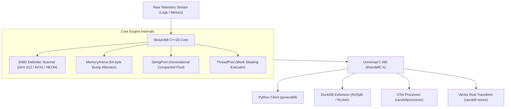

# Systems architecture overview

A modular monolith design for high-throughput telemetry decomposition and reconstruction.
Read this article if you want to understand how librazobill manages memory, vectorization, and language bindings.
Skip this article if you are only writing queries in DuckDB or Python.

---

## Architectural philosophy

Razobill is engineered around three core systems constraints:
1. **Zero heap allocation on the hot path**: Parsing an incoming line must not invoke `malloc`, `new`, or standard container reallocations.
2. **Data-oriented cache contiguity**: Struct-of-Arrays (SoA) layout guarantees sequential CPU cache line prefetching.
3. **Single source of truth**: The core C++20 parsing engine compiles into a universal C ABI (`RazobillC.h`), which serves as the foundation for Python, DuckDB, Go (OTel), and Rust (Vector) adapters.

---

## Data plane versus control plane

Razobill strictly separates high-frequency data plane execution from control plane configuration:

### Data plane
- Executes per-event parsing and byte reconstruction.
- Uses thread-local scratchpads (`Scratch` buffers) pre-allocated up to steady-state capacity.
- Zero locks, mutexes, or atomic increments exist on the parsing hot path.
- In DuckDB, scalar execution directly maps raw `duckdb_string_t` pointers to result vector buffers without intermediate C++ string objects.

### Control plane
- Manages long-lived configuration, SIMD feature detection via CPUID multiversioning, and thread-pool lifecycle.
- Handles extension loading, memory ceiling adjustments, and global statistics logging.

---

## Memory management architecture

### 1. Monotonic memory arena (`MemoryArena.hpp`)
- Provides cache-line aligned (64-byte) bump allocation.
- When an arena is reset, backing memory blocks are retained on an internal freelist rather than released to the operating system, eliminating system call overhead across billions of calls.

### 2. Compact string pool (`StringPool.hpp`)
- Replaces standard heap-allocated string objects (`std::string`) with heterogeneous `std::string_view` lookup.
- Employs generational mark-and-sweep garbage collection for long-running aggregators.

### 3. Thread-local scratchpad
- In multi-threaded environments (such as DuckDB vectorized execution or Python `RzSplitMany`), each OS thread accesses a thread-local working area.
- Buffers expand to steady state and are capped with an automatic retention ceiling to reclaim memory after processing oversized lines.

---

## Cross-language integration architecture

All integrations communicate with the engine through the stable C ABI declared in `include/librazobill/RazobillC.h`:
- Zero C++ runtime leakage: No C++ exceptions or mangled symbols cross foreign language boundaries.
- Error codes are communicated via standard integer enums (`RzStatus`).
- Lifetimes are explicit: `RzFree` reclaims memory allocated for decomposed records.
