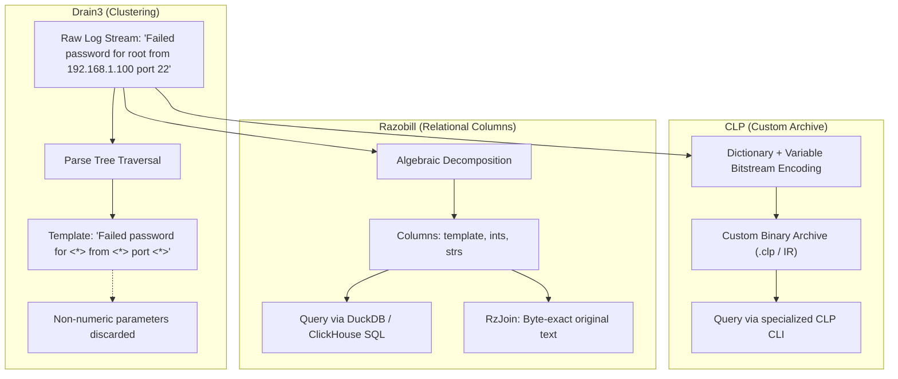

# System comparisons: Drain3, CLP, and Razobill

[Docs](../README.md) > [Explanations](../README.md#explanations-and-architecture) > System comparisons

This article compares Razobill with two established log processing systems: Drain3 (probabilistic log clustering) and CLP (Compressed Log Processor).

- **Question**: When should you choose Razobill, Drain3, or CLP?
- **Audience**: Systems architects, database engineers, and telemetry pipeline designers.
- **Key takeaway**: Drain3 minimizes template count via lossy clustering; CLP maximizes compression via custom binary archives; Razobill enables lossless SQL analytics inside standard relational databases.

---

## Architectural models

| System | Primary goal | Storage format | Invertibility | Query interface |
| --- | --- | --- | --- | --- |
| **Drain3** | Template discovery & log clustering | Variable-depth parse tree (in-memory) | Lossy (variable tokens discarded) | Python API |
| **CLP** | Searchable log archive compression | Custom compressed binary format (`.clp`, IR) | Lossless (custom bitstream) | Specialized CLI (`clp`) and FFI |
| **Razobill** | In-database compaction & SQL analytics | Relational columns (DuckDB, ClickHouse, Parquet) | Lossless (algebraic round trip) | Standard SQL (`SELECT ...`) |

---

## Razobill versus Drain3

Drain3 is an established online log parsing algorithm that groups messages using a fixed-depth parse tree.

### Key differences

1. **Information preservation**:
   - Drain3 abstracts away dynamic tokens into wildcards (`<*>`). Once parsed, variable tokens such as usernames, hostnames, and IP addresses cannot be recovered from the template alone.
   - Razobill decomposes lines into `(template, ints, strs)`. Calling `join(template, ints, strs)` restores the exact original byte stream.
2. **Execution speed**:
   - Drain3 scans tokens character-by-character in Python and traverses a dictionary tree, scaling with tree depth.
   - Razobill executes a single linear pass in C++20 accelerated by SIMD instructions (AVX-512, AVX2, ARM NEON).
3. **Clustering trade-off**:
   - Drain3 aggressively merges similar messages, yielding fewer distinct templates (median 45.5 clusters across 16 benchmark datasets).
   - Razobill prioritizes invertibility, resulting in more granular templates (median 70.5 clusters) and a grouping accuracy of 0.808 versus Drain3's 0.871.

### Empirical throughput comparison (`tools/BenchDrain.py`)

Measured on identical hardware (Windows 11, Intel 6-Core / 12-Thread, Python 3.13) across 25,000 events per dataset:

| Dataset | Total lines | Drain3 throughput | Razobill throughput | Speedup factor |
| --- | --- | --- | --- | --- |
| **SSH** | 25,000 | 3,779 lines/s | 57,060 lines/s | **15.1×** |
| **Linux** | 25,000 | 24,100 lines/s | 62,660 lines/s | **2.6×** |
| **Proxifier** | 21,329 | 28,000 lines/s | 70,000 lines/s | **2.5×** |
| **Zookeeper** | 25,000 | 22,000 lines/s | 79,200 lines/s | **3.6×** |
| **BGL** | 25,000 | 18,900 lines/s | 81,270 lines/s | **4.3×** |
| **Average** | — | — | — | **5.6×** |

---

## Razobill versus CLP

YScope's Compressed Log Processor (CLP, OSDI 2021) is a production log management system that separates static log types from variable values to achieve high compression and fast search.

Razobill shares this core conceptual motivation, but differs in architecture and deployment target:

1. **Storage ecosystem**: CLP encodes logs into a custom compressed archive format (`.clp`) and intermediate representations (CLP IR). Razobill outputs standard relational columns (`VARCHAR`, `BIGINT[]`, `VARCHAR[]`) queryable in DuckDB, ClickHouse, and Apache Parquet.
2. **Query engine**: CLP searches logs using specialized command-line utilities. Razobill integrates directly into SQL engines, allowing analytical aggregations, joins, window functions, and filters without external search services.
3. **Architecture scope**: CLP is a complete log management platform. Razobill is an embedded C++ engine and extension library.

### Empirical head-to-head measurements (`tools/BenchCLP.py`)

Both engines were benchmarked on identical hardware across 100,000 log events per dataset using `clp-ffi-py` (v0.0.14) and `clp-logging` (v0.0.15).

#### 1. Ingestion throughput and lossless fidelity

| Dataset | Total events | Raw size | Razobill RzSplit (1T) | CLP FourByteSerializer | Razobill RzSplitMany (Batch) | Fidelity |
| --- | --- | --- | --- | --- | --- | --- |
| **SSH Auth** | 100,000 | 10.34 MB | 331,761 lines/s | **597,810 lines/s** | 209,334 lines/s | 100.0% (0 mismatches) |
| **BGL Alerts** | 100,000 | 12.55 MB | 248,342 lines/s | **737,756 lines/s** | 146,020 lines/s | 100.0% (0 mismatches) |
| **Zookeeper** | 74,000 | 9.74 MB | 245,468 lines/s | **692,739 lines/s** | 216,969 lines/s | 100.0% (0 mismatches) |
| **Synthetic** | 100,000 | 10.73 MB | 285,819 lines/s | **623,539 lines/s** | 153,814 lines/s | 100.0% (0 mismatches) |

#### 2. Reconstruction and decoding throughput

| Dataset | Total events | Razobill RzJoin (Memory) | CLP IR Raw Decode | CLP IR Zstd Decode | Razobill Parquet + RzJoin |
| --- | --- | --- | --- | --- | --- |
| **SSH Auth** | 100,000 | **570,779 lines/s** | 403,053 lines/s | 382,271 lines/s | 80,604 lines/s |
| **BGL Alerts** | 100,000 | **593,436 lines/s** | 332,075 lines/s | 369,935 lines/s | 73,935 lines/s |
| **Zookeeper** | 74,000 | **556,962 lines/s** | 405,296 lines/s | 391,976 lines/s | 77,606 lines/s |
| **Synthetic** | 100,000 | **530,588 lines/s** | 392,926 lines/s | 365,682 lines/s | 65,101 lines/s |

#### 3. Storage footprint and compression ratios

| Dataset | Raw size | CLP IR + Zstd | Razobill Parquet Zstd | Razobill DuckDB Disk | CLP Reduction | Razobill Parquet Reduction |
| --- | --- | --- | --- | --- | --- | --- |
| **SSH Auth** | 10.44 MB | 632.6 KB | **615.1 KB** | 2,060.0 KB | 16.9× (94.1%) | **17.4× (94.3%)** |
| **BGL Alerts** | 12.65 MB | 1,594.0 KB | **1,487.1 KB** | 3,852.0 KB | 8.1× (87.7%) | **8.7× (88.5%)** |
| **Zookeeper** | 9.82 MB | **434.1 KB** | 513.9 KB | 2,828.0 KB | **23.2× (95.7%)** | 19.6× (94.9%) |
| **Synthetic** | 10.83 MB | 2,729.9 KB | **2,555.7 KB** | 3,852.0 KB | 4.1× (75.4%) | **4.3× (77.0%)** |

#### 4. Search and analytical query latency (DuckDB SQL vs CLP IR)

Measured across 100,000 log events per dataset:

| Dataset | Query type | CLP IR search latency | Razobill DuckDB SQL latency | Speedup |
| --- | --- | --- | --- | --- |
| **SSH Auth** | Needle Wildcard Search | 299.2 ms | **3.6 ms** | **83.1× faster scan** |
| **SSH Auth** | Top-10 Template Group-by | 297.0 ms | **6.8 ms** | **43.9× faster aggregation** |
| **BGL Alerts** | Needle Wildcard Search | 270.5 ms | **3.4 ms** | **79.3× faster scan** |
| **BGL Alerts** | Top-10 Template Group-by | 284.6 ms | **5.7 ms** | **50.2× faster aggregation** |
| **Zookeeper** | Needle Wildcard Search | 215.7 ms | **2.7 ms** | **80.8× faster scan** |
| **Zookeeper** | Top-10 Template Group-by | 214.0 ms | **5.4 ms** | **39.7× faster aggregation** |
| **Synthetic** | Needle Wildcard Search | 272.7 ms | **8.8 ms** | **31.1× faster scan** |
| **Synthetic** | Top-10 Template Group-by | 314.7 ms | **7.5 ms** | **41.9× faster aggregation** |

---

## When to choose which tool

- **Choose Drain3** if your primary requirement is discovering high-level error categories, finding a minimal set of clusters, and discarding variable text is acceptable.
- **Choose CLP** if you need a standalone archival storage and command-line search system for compressed raw text logs.
- **Choose Razobill** if you need to query, filter, and aggregate log parameters inside DuckDB, ClickHouse, or Parquet lakes with standard SQL, while guaranteeing 100% byte-for-byte lossless reconstruction.

---

## Related

- [Empirical benchmarks and methodology](benchmarks.md)
- [Known limits and engineering boundaries](limits.md)
- [Lossless invertibility mechanics](lossless-invertibility.md)
