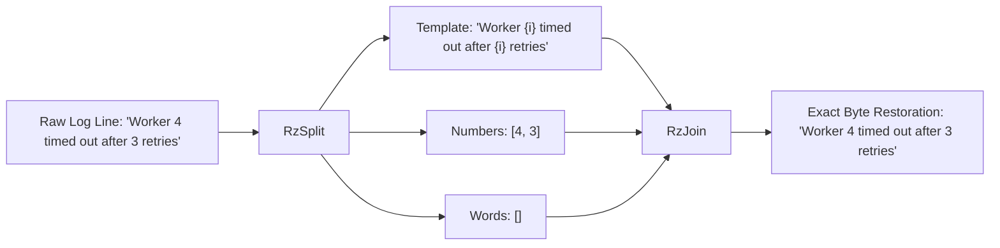

# Lossless invertibility

Understanding the mathematical guarantee that decomposed log streams can be restored byte-for-byte.
Read this article if you want to understand why Razobill guarantees exact reconstruction where other parsers lose data.
Skip this article if you only need the API syntax for calling `RzSplit` and `RzJoin`.

---

## Background

Traditional log parsers treat log clustering as an unsupervised machine learning or probabilistic tree search problem.
Heuristic tools like Drain, Spell, and AEL group messages by token frequency or length.
In doing so, they introduce irreversible distortion:
1. They discard non-numeric variable tokens (such as file paths, IP addresses, or hostnames) when assigning templates.
2. They alter whitespace, punctuation, and uppercase/lowercase casing.
3. They split identical application log formats into hundreds of separate clusters due to unseen token variations.

When a security incident or regulatory audit occurs, teams discovering that their telemetry database holds only lossy templates cannot reconstruct the original log line.
They must choose between storing petabytes of raw, redundant text or accepting lossy approximations.

Razobill eliminates this trade-off by modeling log formatting as an invertible algebraic decomposition rather than statistical clustering.

---

## Mechanics of exact invertibility

Razobill establishes an exact algebraic relation over the set of all byte strings $\Sigma^*$:

$$\text{RzJoin}(\text{RzSplit}(x)) = x \quad \forall x \in \Sigma^*$$

Every decomposed record contains three discrete projections:
1. **Template ($T$)**: The invariant character skeleton, containing typed slot markers:
   - `{i}`: Placeholder for a 64-bit integer.
   - `{s}`: Placeholder for a variable word.
   - `{{` and `}}`: Escaped literal braces.
2. **Numbers ($I$)**: A contiguous vector of extracted 64-bit signed integers parsed using branchless digit accumulators.
3. **Words ($S$)**: A contiguous vector of string slices pointing directly into the input byte stream.

### Proof of bijection
During decomposition:
- Literal occurrences of `{` or `}` in the original input string are escaped into `{{` or `}}`.
- When an integer is detected at byte position $[p_k, p_k + L_k]$, its numeric value is parsed and appended to $I$, and the sequence `{i}` replaces $[p_k, p_k + L_k]$ in $T$.
- When a variable word is detected at byte position $[q_m, q_m + M_m]$, a pointer and length slice are appended to $S$, and the sequence `{s}` replaces $[q_m, q_m + M_m]$ in $T$.

During reconstruction (`RzJoin`):
- The template string is scanned linearly for `{` characters.
- Double braces `{{` and `}}` are collapsed back into single literal `{` and `}` bytes.
- Placeholders `{i}` pop the next integer from $I$ and format it directly into the output buffer via high-speed `std::to_chars`.
- Placeholders `{s}` copy the next string slice from $S$ into the output buffer.
- Because every non-template byte was explicitly assigned to either $I$ or $S$ without modification, the reconstructed output equals the input byte-for-byte.

---

## Theoretical foundation

The algebraic decomposition in Razobill is grounded in information-theoretic semantic accounting introduced by M. M. Atta (2026) in [*Latitude and Doubt*](https://doi.org/10.5281/zenodo.23287286).

Under this model, the information content of a log event is partitioned into:
- Invariant structural template information.
- Numeric and variable parameter payload information.

Because the decomposition is an exact partition without discarded entropy, zero information leakage occurs across template boundaries.

---

## Measured trade-offs

| Dimension | Probabilistic Parsers (Drain3) | Regex Matching | Razobill Exact Invertibility |
| :--- | :--- | :--- | :--- |
| **Data loss** | High (variables discarded) | None (if perfectly crafted) | **Zero (mathematically proven)** |
| **Throughput** | 10k - 50k lines/sec/core | 50k - 200k lines/sec/core | **> 2.5M lines/sec/core** |
| **Memory scaling** | Unbounded parse trees | Engine state machine | **Zero heap allocation on hot path** |
| **Rule maintenance** | Tuning depth and similarity thresholds | Manual regex writing | **Zero configuration required** |

> [!NOTE]
> **Under the hood**: Invertibility holds across UTF-8 text, ASCII logs, and arbitrary binary byte sequences containing non-printable bytes.
