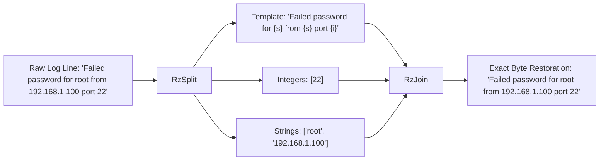

# Lossless invertibility in Razobill

[Docs](../README.md) / [Explanation](lossless-invertibility.md) / Lossless invertibility

This article explains the mathematical model, decomposition mechanics, and engineering trade-offs behind Razobill's byte-for-byte lossless reconstruction guarantee.

- **Who this is for**: Systems architects, database engineers, and security auditors who need to verify that decomposed log archives preserve raw evidence without data loss.
- **What you will have at the end**: An understanding of the algebraic bijection, the two-pass reconstruction algorithm, and the trade-offs between lossless parsing and statistical clustering.

---

## The question

How can an observability pipeline split unstructured text logs into relational database columns to shrink storage while guaranteeing that the exact original text can be reconstructed for security audits?

Traditional log parsers treat template discovery as a clustering problem. Algorithms like Drain3 and Spell group similar lines by token count and word position. In doing so, they discard non-numeric variable tokens (such as user names, IP addresses, and file paths), normalize whitespace, and alter punctuation. Once discarded, the original log line cannot be recovered.

Razobill replaces probabilistic clustering with an algebraic decomposition that preserves every byte.

---

## The algebraic model

Razobill establishes an exact bijection over the set of byte sequences.
For every input string $x$:

$$\text{join}(\text{split}(x)) = x$$

Every log event decomposes into three relational components:

1. **Template ($T$)**: Constant character skeleton containing `{i}` for integers and `{s}` for strings. Literal braces are escaped as `{{` and `}}`.
2. **Integers ($I$)**: Array of 64-bit non-negative integers extracted from numeric tokens.
3. **Strings ($S$)**: Array of variable string slices borrowed directly from the input byte stream.

The split operation extracts typed tokens while join formats and reassembles them in a single contiguous memory pass.

---

## Two-pass reconstruction mechanics

During reconstruction (`join` or `RzJoin`), the engine uses a two-pass algorithm (`src/Slots.cpp:125-185`) to guarantee memory safety and zero unnecessary allocations:

1. **Pass 1 (Size calculation and validation)**:
   - Scans the template string linearly.
   - Replaces `{i}` with the exact digit length of the corresponding integer using a lookup table.
   - Replaces `{s}` with the exact byte length of the corresponding string slice.
   - Verifies that placeholder counts match the lengths of parameter arrays. If counts disagree, returns `Status::SlotUnderflow` or `Status::SlotOverflow`.
   - Checks that total reconstructed size does not exceed the 16 MiB limit (`kMaxMessageBytes`).
2. **Pass 2 (Contiguous formatting)**:
   - Allocates the target output buffer once to the exact pre-calculated size.
   - Copies template literals and collapses escaped braces (`{{` to `{`, `}}` to `}`).
   - Formats integers directly into the output slice via `std::to_chars` without intermediate string copies.
   - Copies string slices directly into the output buffer.

Because every character in the original message is assigned either to the template or to a parameter array, the output matches the original line bit for bit.

---

## Alternatives rejected

We evaluated three alternative approaches before choosing typed slot decomposition:

1. **Regular expressions**: Writing regular expressions for each log format preserves data but requires manual maintenance. PCRE engines backtrack on malformed inputs and throughput drops below 100k lines per second per core.
2. **Probabilistic clustering (Drain3)**: Groups logs into tree-structured clusters. While effective at finding high-level event types, it alters variable tokens, making forensic log recovery impossible.
3. **Custom binary bitstream compression (CLP)**: Achieves high file compression ratios by encoding logs into custom archive formats. However, it requires proprietary command-line utilities and cannot be queried with standard SQL in DuckDB or ClickHouse.

---

## Engineering trade-offs and limits

| Dimension | Drain3 (Clustering) | CLP (Custom Archive) | Razobill (Relational Columns) |
| :--- | :--- | :--- | :--- |
| **Invertibility** | Lossy (variables discarded) | Lossless (custom bitstream) | Lossless (relational columns) |
| **Query interface** | Specialized Python scripts | Dedicated CLP CLI | Standard SQL (`SELECT ...`) |
| **Throughput (1 core)** | 10k–40k lines/s | 390k–750k lines/s | 2.38M lines/s (SSH dataset) |
| **Cluster count** | Fewer templates (median 45.5) | N/A | More templates (median 70.5) |
| **Maximum line size** | Memory-dependent | Archive chunk size | Hard limit of 16 MiB per line |

---

## Related

- [DuckDB extension guide](../how-to/duckdb.md): query and join decomposed logs using SQL.
- [Controlled glossary](../reference/glossary.md): formal definitions for template, ints, strs, and round trip.
- [Empirical benchmarks](benchmarks.md): throughput and compression measurements across LogHub datasets.
