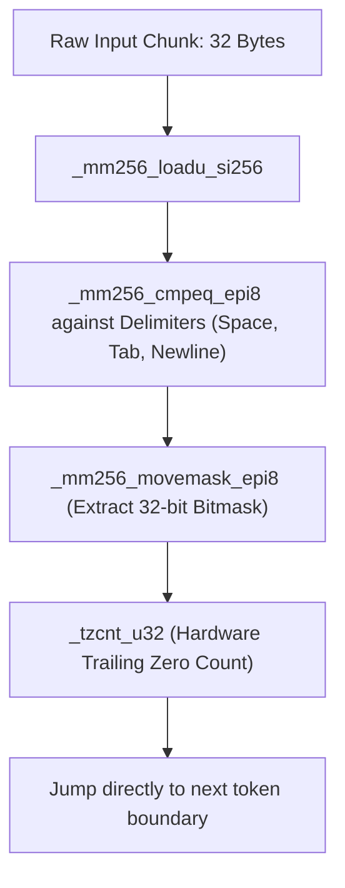

# SIMD vectorization and hardware dispatch

Accelerating delimiter tokenization using AVX-512, AVX2, and ARM NEON vector instructions.
Read this article if you want to understand how librazobill parses delimiters at hardware line rates.
Skip this article if you only need high-level API details.

---

## Branchless delimiter scanning

Traditional log tokenizers scan strings byte-by-byte in a scalar loop:
```c
while (*ptr && *ptr != ' ' && *ptr != '\t' && *ptr != '\n') {
    ptr++;
}
```
In modern superscalar CPUs, this scalar loop suffers from branch mispredictions whenever delimiter frequencies fluctuate.

Razobill replaces scalar loops with SIMD vector scanning (`SimdScanner.hpp`):
- 32 bytes (AVX2) or 64 bytes (AVX-512) are loaded into SIMD vector registers in a single instruction.
- The input chunk is compared against delimiter broadcast vectors in parallel.
- The result of the comparison is extracted into a bitmask (`_mm256_movemask_epi8`).
- Hardware trailing-zero count instructions (`_tzcnt_u64` on x86, `__builtin_ctzll` on ARM) find the exact position of the first delimiter in a single CPU cycle, completely eliminating branch mispredictions.



---

## Dynamic CPUID multiversioning

To ensure broad portability while extracting maximum performance from modern processors, `findWhitespaceDynamic` performs CPUID feature detection at runtime:

1. **AVX-512BW (x86-64)**: Scans 64-byte chunks per iteration on modern Intel and AMD processors.
2. **AVX2 (x86-64)**: Scans 32-byte chunks per iteration. Supported by virtually all modern x86 servers and desktops.
3. **ARM NEON (AArch64)**: Scans 16-byte chunks per iteration using 128-bit NEON registers on Apple Silicon and AWS Graviton processors.
4. **Scalar fallback**: Portable portable fallback loop utilized when SIMD instructions are absent.

Feature detection runs once on first invocation. Subsequent calls dispatch through cached function pointers with zero branching overhead.
