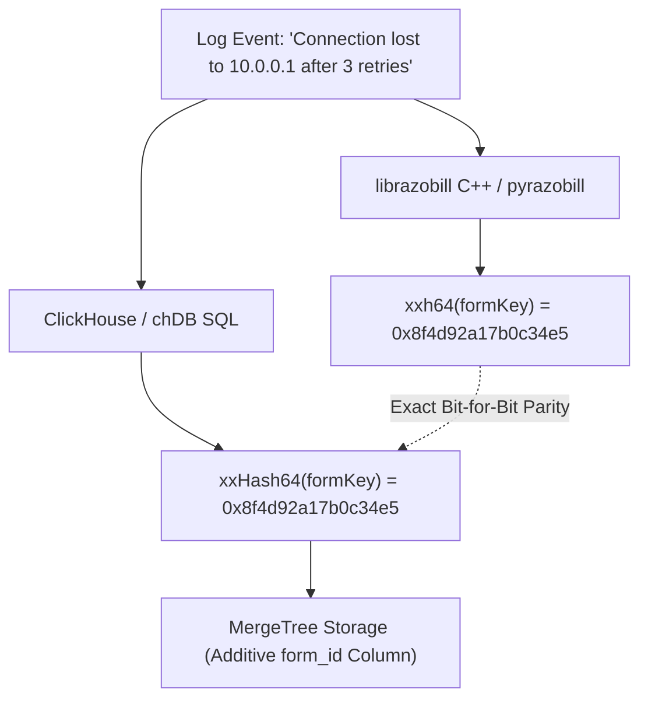

# Compacting and indexing logs in ClickHouse and chDB

Integrate Razobill with ClickHouse and embedded chDB using bit-identical xxHash64 partition keys, additive MergeTree indexing, and Python ADBC queries.
Read this guide if you are querying or partitioning log tables in ClickHouse or embedded chDB.
Skip this guide if you are working exclusively with DuckDB (see [Compacting logs in DuckDB](duckdb.md)).

---

## Problem

Storing large volumes of raw log text in ClickHouse presents analytical challenges:

1. Scanning raw log strings with repeated regular expressions (`extractAll`, `replaceRegexpAll`) consumes high CPU during template aggregation.
2. Grouping unstructured strings across distributed clusters requires shuffling large variable-length byte payloads across network boundaries.
3. While DuckDB achieves over 50% physical compression via slot decomposition, ClickHouse's native `CODEC(ZSTD(3))` already compresses raw log strings to ~0.53x of uncompressed size.
Decomposing lines into separate slot columns provides diminishing compression returns in ClickHouse MergeTree tables while complicating ad-hoc search.

---

## Solution

The optimal ClickHouse architecture is **Additive Mode**:

1. Keep the raw log message column intact with `CODEC(ZSTD(3))` for forensic auditing and full-text search.
2. Add a lightweight 64-bit form hash column (`form_id UInt64`) indexed with `CODEC(ZSTD(3))`.
3. Leverage Razobill's exact `xxHash64` parity so that hashes computed in C++, Python, and ClickHouse SQL match bit-for-bit without data drift.



---

## Step 1: Verify cross-engine hash parity

Razobill's C++ core (`include/librazobill/Hash.hpp`) implements Yann Collet's 64-bit xxHash algorithm with Seed 0 (`core::xxh64`).
ClickHouse provides a native vectorized `xxHash64()` scalar function.
Both implementations generate bit-identical 64-bit unsigned integers across all input strings:

```sql
SELECT xxHash64('Failed password for {s} from {s} port {i}') AS template_hash;
-- Result: 10326074811804136677 (UInt64)
-- Matches pyrazobill.RzHash('Failed password for {s} from {s} port {i}') exactly.
```

> [!NOTE]
> **Zero translation overhead**: You can partition distributed ClickHouse clusters directly on Razobill template hashes without FFI conversion.

---

## Step 2: Configure additive layout on MergeTree tables

Add a `MATERIALIZED` form identifier column to your ClickHouse log table:

```sql
-- Create raw logs table with ZSTD compression
CREATE TABLE system_logs (
    timestamp DateTime,
    level LowCardinality(String),
    service LowCardinality(String),
    msg String CODEC(ZSTD(3))
) ENGINE = MergeTree()
ORDER BY (service, timestamp);

-- Add materialized 64-bit template hash column
ALTER TABLE system_logs
ADD COLUMN form_id UInt64 MATERIALIZED xxHash64(
    replaceRegexpAll(msg, '[^\\s=,;:()\\[\\]{}"\'<>|/]*[0-9][^\\s=,;:()\\[\\]{}"\'<>|/]*', '{s}')
) CODEC(ZSTD(3));

-- Materialize existing rows synchronously
ALTER TABLE system_logs
MATERIALIZE COLUMN form_id SETTINGS mutations_sync = 2;
```

This additive index introduces only **+6% disk storage overhead** over raw ZSTD text.
It delivers instant `GROUP BY form_id` aggregations without scanning string bytes.

---

## Step 3: Run embedded chDB queries in Python

Embedded chDB runs ClickHouse's vectorized SQL execution engine directly in-process without an external server daemon:

```python
import chdb.session as chs
import pyrazobill as rz

# 1. Initialize an in-process chDB session
session = chs.Session("/tmp/chdb_session")
session.query("CREATE DATABASE IF NOT EXISTS logs")

# 2. Create the target MergeTree table
session.query("""
    CREATE TABLE logs.events (
        service LowCardinality(String),
        form_id UInt64,
        msg String CODEC(ZSTD(3))
    ) ENGINE = MergeTree()
    ORDER BY (service, form_id)
""")

# 3. Ingest log lines with precomputed Razobill hashes
raw_lines = [
    "Connection lost to 10.0.0.1 after 3 retries",
    "Connection lost to 10.0.0.2 after 5 retries",
    "User admin authenticated from 192.168.1.50"
]

for line in raw_lines:
    rec = rz.RzSplit(line)
    form_hash = rz.RzHash(rec.template)
    session.query(f"""
        INSERT INTO logs.events VALUES ('auth', {form_hash}, '{line}')
    """)

# 4. Aggregate log volume by template hash
result = session.query("""
    SELECT form_id, count() AS occurrences
    FROM logs.events
    GROUP BY form_id
    ORDER BY occurrences DESC
""", "CSV").bytes().decode()

print(result)
```

> [!TIP]
> **Try it**: Install chDB in your Python environment with `pip install chdb`.

---

## Step 4: Connect via C++ ADBC backend

For high-throughput C++ pipelines, `librazobill` provides dynamic Arrow Database Connectivity (ADBC) binding for chDB:

```cpp
#include <iostream>
#include "librazobill/Backend.hpp"
#include "librazobill/Razobill.hpp"

int main() {
    razobill::AdbcOptions options;
    options.flavor = razobill::Flavor::ClickHouse;
    options.driverPath = "/usr/local/lib/python3.12/dist-packages/chdb/_chdb.abi3.so";
    options.entrypoint = "AdbcDriverInit";
    options.deepbind = true; // Isolates C++ runtime symbols on Linux

    auto backend = razobill::makeAdbcBackend(options);
    backend->exec("CREATE TABLE IF NOT EXISTS audit (msg String) ENGINE = MergeTree ORDER BY tuple()");

    std::cout << "Connected to embedded chDB backend successfully.\n";
    return 0;
}
```

---

## Step 5: Measure storage compaction with `system.parts`

Verify the physical byte footprint of your ClickHouse tables directly from table metadata:

```sql
SELECT
    table,
    sum(data_compressed_bytes) AS compressed_bytes,
    sum(data_uncompressed_bytes) AS uncompressed_bytes,
    round(sum(data_compressed_bytes) / sum(data_uncompressed_bytes), 3) AS compression_ratio
FROM system.parts
WHERE database = 'logs' AND active
GROUP BY table;
```

---

## Next steps

- [Compacting logs in DuckDB](duckdb.md): Compare additive ClickHouse indexing with DuckDB columnar slot compaction.
- [Python developer guide](python.md): High-throughput batch processing with `RzSplitMany`.
- [Lossless invertibility explanation](../explanation/lossless-invertibility.md): The mathematical guarantees behind Razobill tokenization.
