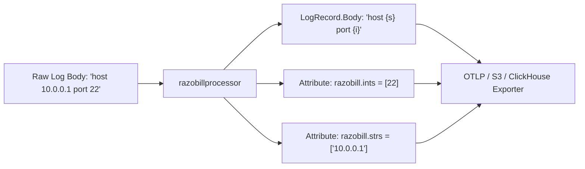

# Deploying OpenTelemetry processor

Configure razobillprocessor inside the OpenTelemetry Collector to compact logs at the edge.
Read this guide if you are deploying the OpenTelemetry Collector as a DaemonSet or sidecar.
Skip this guide if you are ingesting logs directly into a database.

---

## Problem

Edge logging pipelines transmit uncompressed, unstructured log strings across cloud availability zones and networks.
This consumes substantial network egress bandwidth and overburdens downstream log collectors.

---

## Solution

The `razobillprocessor` module compiles the librazobill C ABI into a native Go processor for the OpenTelemetry Collector.
It parses incoming `plog.LogRecord` payloads in sub-microsecond time:

1. Replaces `LogRecord.Body` with the compact template string.
2. Extracts numeric values into a typed integer slice attribute (`razobill.ints`).
3. Extracts variable words into a string slice attribute (`razobill.strs`).



---

## Configuration

Add the `razobill` processor to your collector configuration (`config.yaml`):

```yaml
receivers:
  filelog:
    include: [/var/log/containers/*.log]

processors:
  memory_limiter:
    check_interval: 1s
    limit_percentage: 75
    spike_limit_percentage: 20

  razobill:
    drop_raw_body: true
    include_hash: true

exporters:
  otlp:
    endpoint: telemetry-gateway.internal:4317

service:
  pipelines:
    logs:
      receivers: [filelog]
      processors: [memory_limiter, razobill]
      exporters: [otlp]
```

### Configuration parameters

| Parameter | Type | Default | Description |
| :--- | :--- | :--- | :--- |
| `drop_raw_body` | boolean | `true` | When true, overwrites `LogRecord.Body` with the template. |
| `include_hash` | boolean | `true` | Populates the `razobill.formHash` attribute with a 64-bit template hash. |

---

## Building with the OpenTelemetry collector builder

To compile a custom collector binary including `razobillprocessor`, use the official builder manifest (`BuilderConfig.yaml`):

```yaml
dist:
  name: otelcol-razobill
  description: OpenTelemetry Collector with Razobill processor
  output_path: ./dist

processors:
  - gomod: github.com/razobill/razobill/ext/otel v1.1.1
    path: ext/otel
```

Compile the collector:

```bash
builder --config ext/otel/BuilderConfig.yaml
```

---

## Verification

Start the collector and send a test log message:

```bash
./dist/otelcol-razobill --config config.yaml
```

Verify that exported records contain the template body and parameter slice attributes.
Downstream consumers can reconstruct the raw log message at any time by calling `RzJoin`.
