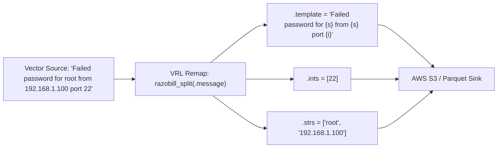

# Transforming logs with Vector

[Docs](../README.md) / [How-to guides](vector.md) / Vector

This guide shows you how to integrate the native Razobill Rust transform into Vector pipelines using Vector Remap Language (VRL).

- **Who this is for**: Infrastructure and telemetry engineers deploying Vector to ship logs from container hosts or Kubernetes nodes.
- **What you will have at the end**: A Vector remap transform configuration that decomposes raw log lines into structured template and parameter fields before streaming to object storage.
- **Maturity**: Beta.

---

## The problem

Vector pipelines shipping raw text messages to centralized object storage incur high network transfer fees and storage costs.
Compressing unstructured text directly leaves repetitive string templates unindexed, requiring downstream systems to parse raw strings on every query.

---

## The solution: razobill-vector transform

The `razobill-vector` crate (`ext/vector`) exposes native VRL functions wrapping the librazobill C ABI.
It decomposes incoming log messages into `(template, ints, strs)` fields:

- Constant format string is assigned to `.template`.
- Extracted numbers are assigned to `.ints`.
- Extracted variable words are assigned to `.strs`.
- Original verbose message string can be dropped via `del(.message)`.



The transform decomposes messages at the edge before sending them over the network.

---

## Prerequisites

- Vector installed (`vector --version`).
- Rust and Cargo 1.75 or newer (`cargo --version`).
- Compiled `librazobill` shared library available in the library search path.

---

## Step 1: Configure the transform in Vector YAML

Create or update your Vector pipeline configuration (`vector.yaml`):

```yaml
sources:
  auth_logs:
    type: file
    include:
      - /var/log/auth.log

transforms:
  razobill_compact:
    type: remap
    inputs:
      - auth_logs
    source: |
      parsed = razobill_split(.message)
      .template = parsed.template
      .ints = parsed.ints
      .strs = parsed.strs
      del(.message)

sinks:
  s3_archive:
    type: aws_s3
    inputs:
      - razobill_compact
    bucket: example-telemetry-archive
    region: us-east-1
    key_prefix: logs/year=%Y/month=%m/
    compression: zstd
    encoding:
      codec: parquet
```

---

## Step 2: Build and test the crate

Build the native C++ library and run the Rust integration test suite:

```bash
# 1. Build the native C ABI engine
cmake -B build -DCMAKE_BUILD_TYPE=Release
ninja -C build

# 2. Run Cargo tests in ext/vector
cargo test --manifest-path ext/vector/Cargo.toml
```

Expected output:

```text
running 1 test
test test_parse_razobill ... ok

test result: ok. 1 passed; 0 failed; 0 ignored; 0 measured; 0 filtered out
```

---

## How to verify

Execute a dry run of your Vector configuration against sample log data:

```bash
vector --config vector.yaml --dry-run
```

Confirm that output records contain structured `.template`, `.ints`, and `.strs` fields without the raw string payload.

---

## Related

- [Deploying OpenTelemetry processor](opentelemetry.md): edge compaction with the OpenTelemetry Collector.
- [Universal C ABI reference](../reference/c-abi.md): C99 library signatures.
- [Parquet on S3](s3-compaction.md): storing decomposed stripes in columnar files.
