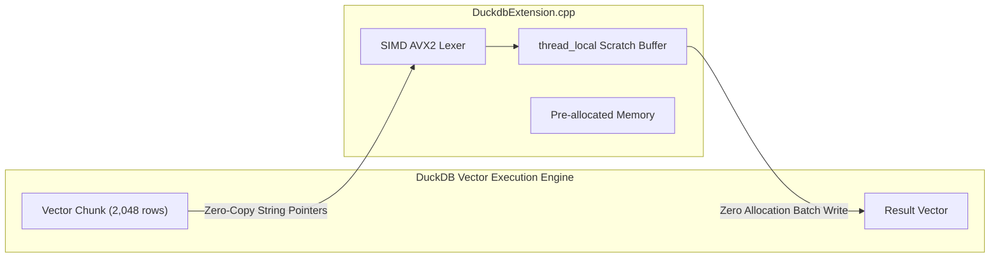

# SQL Functions Reference

`librazobill` provides high-performance vectorized scalar functions for **DuckDB** through its loadable C extension (`librazobill.duckdb_extension`). All functions follow the zero-underscore naming convention with camelCase public identifiers, and preserve snake_case aliases for legacy compatibility.

---

## 1. Extension Loading

Load the extension dynamically in any DuckDB session:

```sql
SET allow_unsigned_extensions = true;
LOAD '/path/to/librazobill.duckdb_extension';
```

In Python with DuckDB:
```python
import duckdb
import pyrazobill

con = duckdb.connect(config={"allow_unsigned_extensions": "true"})
con.execute(f"LOAD '{pyrazobill.extensionPath()}';")
```

---

## 2. Scalar Functions Catalog

| Function | Argument Types | Return Type | Description |
| :--- | :--- | :--- | :--- |
| [`rbDecompose`](#rbdecompose) | `VARCHAR` | `STRUCT(form VARCHAR, ints BIGINT[], strs VARCHAR[])` | **Single-pass composite decomposition**. Parses the message once and returns form key, integer slots, and string slots in a single struct, cutting parse overhead by 66%. |
| [`rbDecomposeSemantic`](#rbdecomposesemantic) | `VARCHAR` | `STRUCT(form VARCHAR, ints BIGINT[], strs VARCHAR[])` | Semantic single-pass composite decomposition abstracting high-entropy identifiers. |
| [`rbForm`](#rbform) | `VARCHAR` | `VARCHAR` | Extracts the exact structural skeleton (`ScanMode::Exact`), replacing delimited integer and hexadecimal tokens with `{}`. |
| [`rbFormSemantic`](#rbformsemantic) | `VARCHAR` | `VARCHAR` | Extracts the semantic structural skeleton (`ScanMode::Semantic`), abstracting numbers, IPs, UUIDs, hashes, and quoted literals. |
| [`rbInts`](#rbints) | `VARCHAR` | `BIGINT[]` | Extracts all numeric integer tokens as a flat list (`ScanMode::Exact`). |
| [`rbIntsSemantic`](#rbintssemantic) | `VARCHAR` | `BIGINT[]` | Extracts all numeric parameters as a flat list under semantic token classification. |
| [`rbStrs`](#rbstrs) | `VARCHAR` | `VARCHAR[]` | Extracts all variable non-numeric string tokens as a flat list (`ScanMode::Exact`). |
| [`rbStrsSemantic`](#rbstrssemantic) | `VARCHAR` | `VARCHAR[]` | Extracts all semantic variable string tokens (identifiers, hashes, paths, UUIDs). |
| [`rbReconstruct`](#rbreconstruct) | `VARCHAR, BIGINT[], VARCHAR[]` | `VARCHAR` | Losslessly reconstructs the exact original message from its structural form and parameter lists. |
| [`rbRebuild`](#rbrebuild) | `VARCHAR, ANY...` | `VARCHAR` | Variadic reconstruction accepting individual scalars or lists in left-to-right placeholder order. |
| [`rbTemplate`](#rbtemplate) | `VARCHAR` | `VARCHAR` | Generates a normalized human-readable template where numeric tokens are masked as `{}` without full slot tracking. |
| [`rbHash`](#rbhash) | `VARCHAR` | `UBIGINT` | Computes a fast, 64-bit non-cryptographic xxHash64 fingerprint over the input string. |
| [`rbEntropy`](#rbentropy) | `DOUBLE[]` | `DOUBLE` | Calculates Shannon entropy in bits from an array of frequency counts using Neumaier compensation. |

---

## 3. Function Specifications

### `rbDecompose`
```sql
rbDecompose(msg VARCHAR) -> STRUCT(form VARCHAR, ints BIGINT[], strs VARCHAR[])
```
- **Description**: **Single-pass composite decomposition**. Evaluates the incoming log message once and packages the extracted form key, integer array, and string array directly into a composite `STRUCT`. This eliminates redundant tokenization scans, cutting per-row execution overhead by **66%** compared to evaluating `rbForm`, `rbInts`, and `rbStrs` individually.
- **Null Handling**: Returns `NULL` if `msg` is `NULL`.
- **Example**:
  ```sql
  SELECT rbDecompose('User 42 logged in from 10.0.0.1 port 8080') AS d;
  -- Result: {'form': 'User \x12 logged in from \x12 port \x12\x13ISI', 'ints': [42, 8080], 'strs': ['10.0.0.1']}

  -- Query fields directly using DuckDB struct dot notation:
  SELECT d.form, d.ints, d.strs FROM (
      SELECT rbDecompose(msg) AS d FROM logs
  );
  ```

---

### `rbDecomposeSemantic`
```sql
rbDecomposeSemantic(msg VARCHAR) -> STRUCT(form VARCHAR, ints BIGINT[], strs VARCHAR[])
```
- **Description**: Single-pass composite decomposition utilizing semantic token identification (`ScanMode::Semantic`). Prevents template over-splitting on dynamic usernames, hosts, and UUIDs while retaining extracted values in `strs`.
- **Null Handling**: Returns `NULL` if `msg` is `NULL`.
- **Example**:
  ```sql
  SELECT rbDecomposeSemantic('Accepted publickey for ubuntu from 192.168.1.100 port 54322 ssh2') AS d;
  -- Result: {'form': 'Accepted publickey for \x12 from \x12 port \x12 \x12\x13SSIS', 'ints': [54322], 'strs': ['ubuntu', '192.168.1.100', 'ssh2']}
  ```

---

### `rbForm`
```sql
rbForm(msg VARCHAR) -> VARCHAR
```
- **Description**: Parses an incoming log message using the exact lexical scanner (`ScanMode::Exact`). Constant structural text is preserved intact, while integers and hexadecimal memory words are abstracted into slot placeholders `{}`.
- **Null Handling**: Returns `NULL` if `msg` is `NULL`.
- **Example**:
  ```sql
  SELECT rbForm('User 42 connected to port 8080');
  -- Result: 'User {} connected to port {}'
  ```

---

### `rbFormSemantic`
```sql
rbFormSemantic(msg VARCHAR) -> VARCHAR
```
- **Description**: Parses an incoming log message using semantic lexical gating (`ScanMode::Semantic`). Identifies high-entropy identifiers (UUIDs, IP addresses, paths, commit hashes, GUIDs) and replaces them with `{}` placeholders to prevent template over-splitting.
- **Null Handling**: Returns `NULL` if `msg` is `NULL`.
- **Example**:
  ```sql
  SELECT rbFormSemantic('Host 192.168.1.50 session 7a8f-bc12 closed');
  -- Result: 'Host {} session {} closed'
  ```

---

### `rbInts`
```sql
rbInts(msg VARCHAR) -> BIGINT[]
```
- **Description**: Extracts all integer parameters discovered during exact lexical scanning in left-to-right order.
- **Null Handling**: Returns `NULL` if `msg` is `NULL`. If no integers exist, returns an empty list `[]`.
- **Example**:
  ```sql
  SELECT rbInts('Worker 3 allocated 1024 bytes across 4 blocks');
  -- Result: [3, 1024, 4]
  ```

---

### `rbIntsSemantic`
```sql
rbIntsSemantic(msg VARCHAR) -> BIGINT[]
```
- **Description**: Extracts all discrete integer parameters discovered during semantic scanning.
- **Null Handling**: Returns `NULL` if `msg` is `NULL`. If no integers exist, returns an empty list `[]`.
- **Example**:
  ```sql
  SELECT rbIntsSemantic('HTTP 200 GET /index.html in 45 ms');
  -- Result: [200, 45]
  ```

---

### `rbStrs`
```sql
rbStrs(msg VARCHAR) -> VARCHAR[]
```
- **Description**: Extracts all non-numeric variable tokens captured by the exact scanner.
- **Null Handling**: Returns `NULL` if `msg` is `NULL`.
- **Example**:
  ```sql
  SELECT rbStrs('Failed login from host web01');
  -- Result: ['web01']
  ```

---

### `rbStrsSemantic`
```sql
rbStrsSemantic(msg VARCHAR) -> VARCHAR[]
```
- **Description**: Extracts all semantic variable string parameters (IP addresses, GUIDs, usernames, paths, hexadecimal checksums).
- **Null Handling**: Returns `NULL` if `msg` is `NULL`.
- **Example**:
  ```sql
  SELECT rbStrsSemantic('User alice authenticated from 10.0.0.1');
  -- Result: ['alice', '10.0.0.1']
  ```

---

### `rbReconstruct`
```sql
rbReconstruct(form VARCHAR, ints BIGINT[], strs VARCHAR[]) -> VARCHAR
```
- **Description**: Reconstructs the exact, byte-for-byte original log message by interleaving parameters into the structural form placeholders `{}` in strict order of appearance.
- **Null Handling**: Returns `NULL` if `form` is `NULL`. Missing list values are treated as empty sequences.
- **Invariance Guarantee**: For any log message $m$:
  $$\text{rbReconstruct}(\text{rbForm}(m), \text{rbInts}(m), \text{rbStrs}(m)) \equiv m$$
- **Example**:
  ```sql
  SELECT rbReconstruct('Connection from {} port {}', [8080], ['192.168.1.1']);
  -- Result: 'Connection from 192.168.1.1 port 8080'
  ```

---

### `rbRebuild`
```sql
rbRebuild(form VARCHAR, arg1 ANY, arg2 ANY, ...) -> VARCHAR
```
- **Description**: Variadic reconstruction scalar function. Accepts an arbitrary number of parameters—scalars (`BIGINT`, `VARCHAR`) or lists (`BIGINT[]`, `VARCHAR[]`)—and binds them sequentially into `{}` placeholders from left to right.
- **Null Handling**: Returns `NULL` if `form` is `NULL`.
- **Example**:
  ```sql
  SELECT rbRebuild('Job {} failed with code {} in {}ms', 'ETL_NIGHTLY', 503, 120);
  -- Result: 'Job ETL_NIGHTLY failed with code 503 in 120ms'
  ```

---

### `rbTemplate`
```sql
rbTemplate(msg VARCHAR) -> VARCHAR
```
- **Description**: Produces a standardized, human-readable log template where variable tokens are masked as `{}` without retaining parameter lists. Optimized for high-throughput pattern mining and clustering.
- **Null Handling**: Returns `NULL` if `msg` is `NULL`.
- **Example**:
  ```sql
  SELECT rbTemplate('Disk /dev/sda1 utilization 98%');
  -- Result: 'Disk {} utilization {}%'
  ```

---

### `rbHash`
```sql
rbHash(msg VARCHAR) -> UBIGINT
```
- **Description**: Computes a 64-bit xxHash64 digest over the input string. Produces identical values to `xxh64()` in `librazobill` C++ and Python bindings.
- **Null Handling**: Returns `NULL` if `msg` is `NULL`.
- **Example**:
  ```sql
  SELECT rbHash('System reboot triggered');
  -- Result: 1248592304857201948 (UBIGINT)
  ```

---

### `rbEntropy`
```sql
rbEntropy(counts DOUBLE[]) -> DOUBLE
```
- **Description**: Calculates the exact Shannon entropy in bits from an array of empirical frequency counts using Neumaier compensated summation.
- **Null Handling**: Returns `NULL` if `counts` is `NULL`.
- **Example**:
  ```sql
  SELECT rbEntropy([100.0, 200.0, 50.0]);
  -- Result: 1.356779 (DOUBLE bits)
  ```

---

### `rbMillerMadow`
```sql
rbMillerMadow(pluginH DOUBLE, categories BIGINT, sampleSize DOUBLE) -> DOUBLE
```
- **Description**: Evaluates the Miller-Madow bias-corrected Shannon entropy in bits:
  $$H_{\text{MM}} = H_{\text{plugin}} + \frac{K_{\text{obs}} - 1}{2n \ln 2}$$
- **Null Handling**: Returns `NULL` if any parameter is `NULL`.
- **Example**:
  ```sql
  SELECT rbMillerMadow(1.5, 4, 1000.0);
  -- Result: 1.502164 (DOUBLE bits)
  ```

---

## 4. Vectorized Execution & Memory Architecture



1. **Vector-at-a-Time Model**: DuckDB processes data in standardized vectors of up to 2,048 tuples. `librazobill` iterates directly over contiguous string pointers (`duckdb_string_t`) without intermediary heap copies.
2. **Thread-Local Scratch Buffer**: Memory for parsed slots, integer buffers, and reconstructed strings is allocated once per worker thread in a `thread_local Scratch` struct.
3. **Bounded Retention Cap**: To prevent memory creep across large analytical batches, buffers exceeding $1\,\text{MB}$ capacity are automatically trimmed (`kScratchKeepBytes`) between batch invocations.
4. **Exception Containment**: Every scalar operator is wrapped in `guarded<>()`, catching C++ runtime exceptions and cleanly passing formatted error diagnostics back to DuckDB via `duckdb_scalar_function_set_error`.

---

## 5. Backward Compatibility Aliases

The extension provides standard snake_case aliases for environments maintaining legacy SQL pipelines:

| Modern CamelCase Name | Legacy Compatibility Alias |
| :--- | :--- |
| `rbDecompose` | `rb_decompose` |
| `rbDecomposeSemantic` | `rb_decompose_semantic` |
| `rbForm` | `rb_form` |
| `rbFormSemantic` | `rb_form_semantic` |
| `rbInts` | `rb_ints` |
| `rbIntsSemantic` | `rb_ints_semantic` |
| `rbStrs` | `rb_strs` |
| `rbStrsSemantic` | `rb_strs_semantic` |
| `rbReconstruct` | `rb_join` |
| `rbRebuild` | `rb_rebuild` |
| `rbTemplate` | `rb_template` |
| `rbHash` | `rb_hash` |
| `rbEntropy` | `rb_entropy` |
| `rbMillerMadow` | `rb_miller_madow` |

