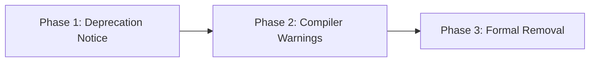

# Deprecation policy

[Docs](../README.md) / [Reference](deprecation-policy.md) / Deprecation policy

This document defines the Semantic Versioning commitments, binary ABI compatibility rules, and the three-phase deprecation cycle for Razobill.

- **Who this is for**: Package maintainers, FFI integrators, and systems developers relying on stable interfaces.
- **What you will have at the end**: An understanding of how breaking changes are announced, warned, and removed.

---

## Semantic versioning and the ABI contract

Razobill adheres to [Semantic Versioning 2.0.0](https://semver.org/spec/v2.0.0.html) (`MAJOR.MINOR.PATCH`).

### API compatibility

Source-level compatibility guarantees that code written against version `1.x.x` will compile against `1.y.x` (where $y > x$) without modifications.
Functions and parameters are never removed within a minor version series without a formal deprecation window.

### ABI compatibility

Binary-level compatibility is governed by `LIBRAZOBILL_ABI_VERSION` in `include/librazobill/Version.hpp` and `RZ_ABI_VERSION` in `include/librazobill/RazobillC.h`.
As long as the ABI version remains unchanged:

- Consumers can swap shared library binaries (`razobill.dll`, `librazobill.so`) without recompiling host applications.
- Struct field order, memory alignment, and member types in `RzRecord` remain fixed.

---

## Three-phase deprecation cycle

When a function, symbol, or flag is slated for replacement, it progresses through three distinct phases:

The deprecation workflow gives consumers time to migrate across versions before breaking changes occur.

1. **Phase 1 (Documentation notice)**: The symbol is documented as deprecated in release notes and the glossary. The documentation identifies the recommended replacement.
2. **Phase 2 (Compiler and runtime warnings)**: The symbol is marked with `[[deprecated]]` in C++20 and `LIBRAZOBILL_DEPRECATED` in C headers. Python bindings emit a `DeprecationWarning` upon invocation.
3. **Phase 3 (Formal removal)**: The deprecated symbol is removed only upon incrementing the `MAJOR` version number (e.g. from 1.x to 2.0.0).

---

## Related

- [Universal C ABI reference](c-abi.md): exported binary interfaces and struct layouts.
- [Release governance](release-governance.md): release engineering checklists and verification.
- [Controlled glossary](glossary.md): current and deprecated function names.
