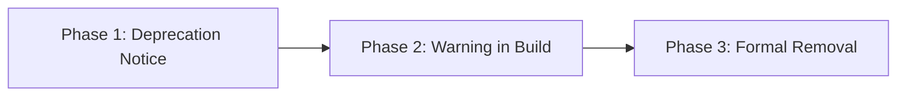

# Deprecation policy

Version stability commitments, ABI compatibility rules, and the 3-phase deprecation cycle.
Read this document if you depend on stable ABI contracts or want to understand breaking change policies.
Skip this document if you only write queries.

---

## Semantic versioning and the ABI contract

Razobill adheres to [Semantic Versioning 2.0.0](https://semver.org/spec/v2.0.0.html) (`MAJOR.MINOR.PATCH`).

### 1. API compatibility (source level)
- Minor version releases (`1.x` to `1.y`) guarantee that existing valid code compiles without modification.
- Functions and symbols are never removed in a minor release without a deprecation window.

### 2. ABI compatibility (binary level)
- Governed by `LIBRAZOBILL_ABI_VERSION`.
- As long as `LIBRAZOBILL_ABI_VERSION` remains unchanged, consumers can swap shared library binaries (`.dll`, `.so`) without recompiling host applications.
- Struct field order in `RzRecord` is fixed and immutable for a given ABI version.

---

## Three-phase deprecation cycle

When a function or flag is scheduled for replacement, it follows three distinct phases:

1. **Phase 1 (Announced)**: Marked as deprecated in documentation with replacement guidance.
2. **Phase 2 (Compiler warnings)**: Marked with `[[deprecated]]` in C++ and `LIBRAZOBILL_DEPRECATED` in headers. Python emits a `DeprecationWarning`.
3. **Phase 3 (Removal)**: Removed only upon incrementing `MAJOR`.
