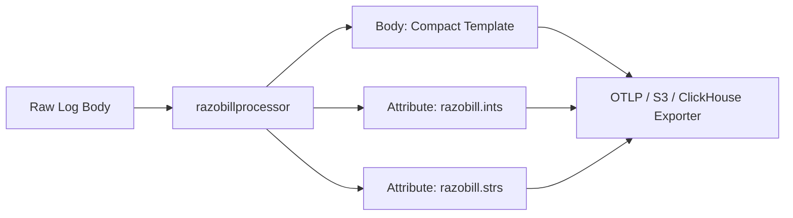

# Razobill OpenTelemetry collector processor

<p align="center">
  <picture>
    <source media="(prefers-color-scheme: dark)" srcset="../../assets/Logo.jpeg">
    
  </picture>
</p>

Edge-level log compaction processor (`razobillprocessor`) for the OpenTelemetry Collector.
Powered by the librazobill C ABI, it decomposes incoming log records in sub-microsecond time.
It replaces verbose message bodies with compact templates and attaches typed parameter slices for wire egress reduction.

---

## Architecture



---

## Configuration

Add `razobill` to your collector configuration (`config.yaml`):

```yaml
processors:
  razobill:
    drop_raw_body: true
    include_hash: true

service:
  pipelines:
    logs:
      receivers: [filelog]
      processors: [memory_limiter, razobill]
      exporters: [otlp]
```

---

## Building the collector

Use the OpenTelemetry Collector Builder with the provided manifest (`BuilderConfig.yaml`):

```bash
builder --config ext/otel/BuilderConfig.yaml
```

---

## Documentation

- [OpenTelemetry deployment guide](../../docs/how-to/opentelemetry.md)
- [C ABI reference](../../docs/reference/c-abi.md)
- [Lossless invertibility](../../docs/explanation/lossless-invertibility.md)
