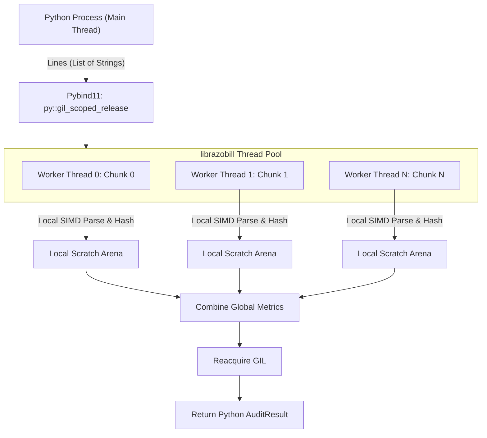

# pyrazobill Developer & Operations Guide

This guide provides deep technical instructions for developing, embedding, and operating **pyrazobill 1.0.0** within production Python applications, streaming telemetry backends, analytical lakehouses, and information-theoretic research pipelines.

---

## 1. Architectural Philosophy & Safety Invariants

Python string objects are managed dynamically by the CPython heap. When passing strings into high-performance native C++ libraries, passing raw pointers or string views without lifetime guarantees risks dangling memory references once CPython garbage collects or reallocates the object.

To prevent dangling pointers with zero cognitive burden on the Python developer, `pyrazobill` encapsulates parsed results in a memory-safe `PySlotRecord`:

```cpp
// PyRazobill.cpp
struct PySlotRecord {
    std::shared_ptr<std::string> msgBuffer; // Retains ownership of the underlying buffer
    core::SlotRecord slots;                 // String views point safely into msgBuffer
    // ...
};
```

### Safety & Structural Invariants:
1. **Lifetime Safety**: A `SlotRecord` can be passed across Python threads, stored in queues, or serialized without memory corruption or dangling pointer risks.
2. **Deterministic Round-Trip (Lossless Invertibility)**: Every parsed record satisfies the invertibility law:
   ```python
   reconstructed = record.reconstruct()
   assert reconstructed == originalMsg
   ```
3. **Zero-Underscore Convention**: All methods, functions, and properties adhere strictly to camelCase naming (`formKey`, `formKeyHash`, `parseBatch`, `auditParallel`, `computeLedger`).
4. **Gil-Free Concurrency**: All heavy batch loops (`parseBatch`, `decomposeBatch`, `auditParallel`) release CPython's Global Interpreter Lock (GIL) via `py::gil_scoped_release`, allowing true multi-core parallel scaling across hardware threads.

---

## 2. Ingestion Strategies & Threading Models

CPython's Global Interpreter Lock ordinarily constrains CPU-bound Python workloads to a single core. `pyrazobill` bypasses this barrier by delegating batch processing directly to its C++20 engine with the GIL released.

```text
┌────────────────────────────────────────────────────────────────────────────────────────┐
│                   GIL RELEASE & NATIVE THREAD POOL PIPELINE                            │
└────────────────────────────────────────────────────────────────────────────────────────┘
  Python Main Process: `pyrazobill.parseBatch(msgs)` or `decomposeBatch(msgs)`
                     │
                     ▼
  ┌────────────────────────────────────────────────────────────────────────────┐
  │ py::gil_scoped_release (CPython GIL Dropped — Other Python Threads Free)   │
  └──────────────────────────────────────┬─────────────────────────────────────┘
                                         │
                 ┌───────────────────────┼───────────────────────┐
                 ▼                       ▼                       ▼
      ┌─────────────────────┐ ┌─────────────────────┐ ┌─────────────────────┐
      │ Worker 0 (Chunk 0)  │ │ Worker 1 (Chunk 1)  │ │ Worker N (Chunk N)  │
      ├─────────────────────┤ ├─────────────────────┤ ├─────────────────────┤
      │ SIMD AVX2 Parse     │ │ SIMD AVX2 Parse     │ │ SIMD AVX2 Parse     │
      │ Local Bump Arena    │ │ Local Bump Arena    │ │ Local Bump Arena    │
      └──────────┬──────────┘ └──────────┬──────────┘ └──────────┬──────────┘
                 │                       │                       │
                 └───────────────────────┼───────────────────────┘
                                         ▼
  ┌────────────────────────────────────────────────────────────────────────────┐
  │ Thread Pool Aggregate: Combined Slot Records / Hashes (Zero Mutex Jitter)  │
  └──────────────────────────────────────┬─────────────────────────────────────┘
                                         │
                                         ▼
  ┌────────────────────────────────────────────────────────────────────────────┐
  │ py::gil_scoped_acquire (GIL Reacquired — Memory Safe PySlotRecord Returned)│
  └────────────────────────────────────────────────────────────────────────────┘
```



### Ingestion API Catalog:

| Use Case | Recommended API | GIL Released? | Scaling Characteristic |
| :--- | :--- | :---: | :--- |
| Single event processing (e.g., HTTP webhook) | `parse(msg, mode)` | No | Sub-microsecond ($0.1\,\mu\text{s}$) latency, returns `SlotRecord` |
| Micro-batch streaming (e.g., Kafka consumer) | `parseBatch(msgs, mode)` | **Yes** | Multi-threaded record vector creation |
| Direct tuple extraction (single event) | `decompose(msg, mode)` | No | Returns `(formKey, ints, strs)` without wrapper allocation |
| High-throughput columnar batch ingestion | `decomposeBatch(msgs, mode)` | **Yes** | Returns `list[tuple]`, releases GIL, 515k–737k+ logs/sec |
| Symmetrical tuple reconstruction | `reconstruct(formKey, ints, strs)` | No | Exact bit-for-bit raw log string recovery |
| Large-scale file or corpus audit | `auditParallel(lines, mode, numThreads)` | **Yes** | Hardware thread pool, zero allocations, up to 69.4M msgs/sec |
| Lightweight template key lookup | `formKey(msg, mode)` | No | Direct string return |
| Information Ledger calculation | `computeLedger(cells, totalEvents, alpha)` | No | Theorem 1 & 4 balance identities with finite-sample bounds |
| Consequence decomposition | `consequenceDecomposition(xy, map)` | No | Theorem 6 diagnostic sufficiency decomposition |
| Finite-sample bias correction | `millerMadow(plugin, categories, n)` | No | First-order asymptotic bias compensation |
| Proposition 10 certified bounds | `certifiedInterval(k, n, alpha)` | No | Finite-sample confidence interval |
| Steganographic capacity audit | `channelAnalyzeCapacity(sequence)` | No | Theorem 4c safe payload bits calculation |
| Dynamic log watermarking | `channelEmbed(seq, msg, bits, key)` | No | Arithmetic cumulative interval embedding |
| Watermark verification & extraction | `channelDecode(seq, forms, bits, key)` | No | Arithmetic decoding from observed form indices |

---

## 3. Step-by-Step Code Walkthroughs

### Recipe A: Streaming Micro-Batch Ingestion
Ingesting events from a Kafka topic, Redis Stream, or AWS SQS consumer:

```python
import pyrazobill

def processStreamBatch(eventBatch: list[str]) -> list[dict]:
    # parseBatch releases GIL while parsing hundreds or thousands of messages
    records = pyrazobill.parseBatch(eventBatch, pyrazobill.ScanMode.Semantic)

    structuredPayloads = []
    for rec in records:
        structuredPayloads.append({
            "formKey": rec.formKey,
            "formHash": rec.formKeyHash,
            "ints": rec.ints,
            "strs": rec.strs,
        })
    return structuredPayloads
```

---

### Recipe B: Multi-Core Ingestion and Lossless Verification
Processing a 1,000,000-line server log file and auditing exact lossless reconstruction across all hardware threads:

```python
import sys
import time
from pathlib import Path
import pyrazobill

def auditLogFile(filePath: Path):
    print(f"Reading {filePath.name}...")
    t0 = time.perf_counter()
    with open(filePath, "r", encoding="utf-8", errors="replace") as f:
        lines = [line.rstrip("\r\n") for line in f if line.strip()]
    tRead = time.perf_counter() - t0
    print(f"Loaded {len(lines):,} lines in {tRead:.2f}s")

    # Audit across all hardware cores with zero GIL contention
    res = pyrazobill.auditParallel(
        lines,
        mode=pyrazobill.ScanMode.Semantic,
        numThreads=0 # auto-detect CPU count
    )

    print("\n--- Audit Results ---")
    print(f"Lines Processed      : {res.totalLines:,}")
    print(f"Data Volume          : {res.totalBytes / (1024**2):.2f} MB")
    print(f"Processing Wall Time : {res.elapsedSec:.3f} s")
    print(f"Throughput           : {res.msgsPerSec:,.0f} msgs/s ({res.mbPerSec:.2f} MB/s)")
    print(f"Unique Form Skeletons: {res.uniqueFormsCount:,}")
    print(f"Bit Mismatches       : {res.mismatches} (100% Exact)")

    if res.mismatches == 0:
        print("INVARIANT SATISFIED: Every message is 100% losslessly reconstructible.")
    else:
        raise RuntimeError(f"Reconstruction error: {res.mismatches} mismatches detected!")

if __name__ == "__main__":
    auditLogFile(Path("server.log"))
```

---

### Recipe C: Parallel Stream Decomposition with ThreadPoolExecutor
When feeding high-throughput streaming events into columnar memory formats (DuckDB Appender, Apache Arrow, Polars, or Parquet), decomposing directly into tuples avoids Python object allocation. Releasing the GIL in `decomposeBatch()` allows Python worker threads to scale linearly:

```python
import concurrent.futures
import time
import pyrazobill

def streamWorkerParallel(batches: list[list[str]], numWorkers: int = 4) -> list[tuple]:
    """
    Decomposes log batches concurrently across multiple worker threads.
    Because pyrazobill.decomposeBatch releases the GIL, workers achieve true multi-core scaling.
    """
    t0 = time.perf_counter()
    with concurrent.futures.ThreadPoolExecutor(max_workers=numWorkers) as executor:
        # Each worker processes a chunk of messages in C++
        futures = list(executor.map(lambda b: pyrazobill.decomposeBatch(b, pyrazobill.ScanMode.Semantic), batches))

    # Flatten results: list of (formKey, ints, strs) tuples
    allDecomposed = [record for batch in futures for record in batch]
    elapsed = time.perf_counter() - t0

    totalCount = len(allDecomposed)
    rate = totalCount / elapsed if elapsed > 0 else 0
    print(f"Decomposed {totalCount:,} events in {elapsed:.3f}s ({rate:,.0f} logs/sec across {numWorkers} threads)")
    return allDecomposed

# Example invocation
if __name__ == "__main__":
    testEvents = [
        f"Server node-{i%10} reported status {200 if i%5!=0 else 500} responseTime={i*3%150}ms client={10+i%5}.0.0.1"
        for i in range(100_000)
    ]
    chunkSize = 25_000
    workChunks = [testEvents[i:i + chunkSize] for i in range(0, len(testEvents), chunkSize)]

    decomposedTuples = streamWorkerParallel(workChunks, numWorkers=4)
    # Validate lossless invertibility on sample
    form, ints, strs = decomposedTuples[0]
    assert pyrazobill.reconstruct(form, ints, strs) == testEvents[0]
```

---

### Recipe D: Lossless Storage Compaction with DuckDB Single-Pass Struct
Eliminating raw log strings to cut persistent storage requirements by ~45% while maintaining transparent querying.

> [!TIP]
> Use `rbDecomposeSemantic` or `rbDecompose` which returns a single composite `STRUCT(form VARCHAR, ints BIGINT[], strs VARCHAR[])`. This cuts parsing overhead by 66% compared to calling separate scalar functions.

```python
import duckdb
import pyrazobill

# Initialize DuckDB connection
con = duckdb.connect("logs.duckdb", config={"allow_unsigned_extensions": "true"})

# Dynamically load the native librazobill extension
extPath = pyrazobill.extensionPath().replace("\\", "/")
con.execute(f"LOAD '{extPath}';")

# 1. Create compressed physical storage table
con.execute("""
    CREATE TABLE IF NOT EXISTS logsPhysical (
        timestamp TIMESTAMP,
        level VARCHAR,
        form VARCHAR,
        ints BIGINT[],
        strs VARCHAR[]
    );
""")

# 2. Ingest raw log strings into decomposed columnar primitives via single-pass struct
rawEvents = [
    ("2026-10-07 12:00:01", "INFO", "User 1042 authenticated from 192.168.1.10"),
    ("2026-10-07 12:00:02", "WARN", "Connection timeout on port 5432 after 3 retries"),
    ("2026-10-07 12:00:03", "ERROR", "Failed to bind socket 8080: address in use"),
]

con.executemany("""
    INSERT INTO logsPhysical
    SELECT
        CAST(? AS TIMESTAMP),
        ?,
        d.form,
        d.ints,
        d.strs
    FROM (SELECT rbDecomposeSemantic(?) AS d);
""", [(ts, lvl, msg) for ts, lvl, msg in rawEvents])

# 3. Create transparent zero-copy reconstruction view
con.execute("""
    CREATE OR REPLACE VIEW logs AS
    SELECT
        timestamp,
        level,
        form,
        rbReconstruct(form, ints, strs) AS msg
    FROM logsPhysical;
""")

# 4. Analysts query 'logs' naturally as if raw strings were stored on disk
results = con.execute("SELECT timestamp, level, msg FROM logs WHERE level = 'WARN';").fetchall()
for row in results:
    print(row)
```

---

### Recipe E: Information-Theoretic Entropy Monitoring
Detecting operational anomalies and schema drift using compensated Shannon entropy:

```python
from collections import Counter
import pyrazobill

def computeClusterEntropy(records: list[pyrazobill.SlotRecord]) -> float:
    # Tally frequency of each structural form key
    counts = Counter(r.formKey for r in records)
    frequencyVector = [float(c) for c in counts.values()]

    # Calculate Shannon entropy with Neumaier floating-point compensation
    bits = pyrazobill.entropy(frequencyVector)
    return bits

# Baseline observation window
normalLogs = [
    "GET /api/v1/health 200 OK",
    "GET /api/v1/health 200 OK",
    "GET /api/v1/health 200 OK",
    "POST /api/v1/items 201 Created",
]
hNormal = computeClusterEntropy([pyrazobill.parse(m) for m in normalLogs])
print(f"Normal Operational Entropy: {hNormal:.4f} bits")

# Anomaly window (sudden emergence of novel error templates)
anomalyLogs = [
    "GET /api/v1/health 200 OK",
    "Internal server error: DB connection pool exhausted",
    "Kernel OOM killer invoked for pid 9481",
    "Segfault at 0x7fff0032 in libnative.so",
]
hAnomaly = computeClusterEntropy([pyrazobill.parse(m) for m in anomalyLogs])
print(f"Anomaly Operational Entropy: {hAnomaly:.4f} bits")
```

---

### Recipe F: Information Ledger & Finite-Sample Correction
Auditing the information balance of a log cluster according to Theorems 1 and 4 from *Latitude and Doubt* (Atta, 2026):

$$\Lambda(Y \mid X) = H(Y \mid X) - \Delta(Y \mid X)$$

```python
import pyrazobill

# Define joint observation counts between form templates and underlying semantic meanings
cells = [
    pyrazobill.Cell(form=1, meaning=1, mass=500.0),
    pyrazobill.Cell(form=2, meaning=1, mass=300.0), # Synonymous form
    pyrazobill.Cell(form=3, meaning=2, mass=200.0),
]
totalEvents = 1000.0

# Compute exact information ledger with 95% confidence bounds
ledger = pyrazobill.computeLedger(cells, totalEvents, confidenceAlpha=0.05)

print(f"Coverage Ratio       : {ledger.coverage:.4f}")
print(f"Content H(Y)         : {ledger.content:.4f} bits")
print(f"Expression H(X)      : {ledger.expression:.4f} bits")
print(f"Latitude Lambda(Y|X) : {ledger.latitude:.4f} bits")
print(f"Doubt Delta(Y|X)     : {ledger.doubt:.4f} bits")
print(f"Conveyance I(X;Y)    : {ledger.conveyance:.4f} bits")
print(f"Variation Distance   : {ledger.distance:.4f} bits")

# Verify fundamental mathematical invariants
assert ledger.satisfiesLedgerIdentities()
assert ledger.satisfiesVocabularyLaw(nDistinctForms=3)

# Evaluate Theorem 6 diagnostic sufficiency
xy = [
    pyrazobill.XY(form=1, y=1, n=500.0),
    pyrazobill.XY(form=2, y=1, n=300.0),
    pyrazobill.XY(form=3, y=2, n=200.0),
]
mapping = [
    pyrazobill.FormMeaning(form=1, meaning=1, p=1.0),
    pyrazobill.FormMeaning(form=2, meaning=1, p=1.0),
    pyrazobill.FormMeaning(form=3, meaning=2, p=1.0),
]
decomp = pyrazobill.consequenceDecomposition(xy, mapping)
print(f"Consequence Decomposition: E={decomp.expression:.4f}, I={decomp.consequence:.4f}, H_M={decomp.hedge:.4f}")
assert decomp.satisfiesIdentity()
```

---

### Recipe G: Latitude Channel Capacity & Provenance Watermarking
Embedding tamper-evident provenance watermarks or tracing metadata into dynamic log streams using synonym selection without alerting downstream consumers (Theorem 4c):

```python
import pyrazobill

# Define sequence of semantic events with available synonymous log forms
seq = [
    pyrazobill.MeaningChoice(
        meaning=101,
        options=[
            pyrazobill.SynonymousOption(formIndex=0, probability=0.5), # "User auth succeeded"
            pyrazobill.SynonymousOption(formIndex=1, probability=0.5), # "Authentication OK for user"
        ]
    )
    for _ in range(32)
]

# 1. Analyze safe steganographic transmission capacity
capacity = pyrazobill.channelAnalyzeCapacity(seq)
print(f"Mean Capacity: {capacity.meanCapacityBits:.2f} bits")
print(f"Safe Payload : {capacity.safePayloadBits} bits")

# 2. Embed a 16-bit payload (e.g. cluster node ID = 42) into form selections
payload = 42
sharedKey = 0.81726354
res = pyrazobill.channelEmbed(seq, payload, payloadBits=16, sharedKey=sharedKey)
assert res.success
print(f"Chosen Form Indices: {res.chosenForms[:8]}...")

# 3. Decode payload from observed forms on downstream aggregator
dec = pyrazobill.channelDecode(seq, res.chosenForms, payloadBits=16, sharedKey=sharedKey)
assert dec.success
assert dec.message == payload
print(f"Successfully decoded watermark payload: {dec.message}")
```

---

## 4. ClickHouse chDB Compatibility

`librazobill` uses xxHash64 (`hash64`) which is byte-for-byte identical to ClickHouse's native `xxHash64()` scalar function:

```python
import chdb
import pyrazobill

msg = "Service started on port 8080"
pyHash = pyrazobill.hash64(msg)

chRes = chdb.query(f"SELECT xxHash64('{msg}') AS h;").to_dict()
chHash = chRes["h"][0]

assert pyHash == chHash
print(f"Parity Verified: pyrazobill ({pyHash}) == chDB ({chHash})")
```

---

## 5. Summary Cheat Sheet: API & Properties

```python
# Scan Modes
pyrazobill.ScanMode.Exact
pyrazobill.ScanMode.DigitOnly
pyrazobill.ScanMode.Semantic

# Core Parsing Functions
record = pyrazobill.parse(msg, mode)                    # -> SlotRecord
records = pyrazobill.parseBatch(msgs, mode)             # -> list[SlotRecord] (releases GIL)
form, ints, strs = pyrazobill.decompose(msg, mode)      # -> tuple[str, list[int], list[str]]
tuples = pyrazobill.decomposeBatch(msgs, mode)          # -> list[tuple] (releases GIL)
orig = pyrazobill.reconstruct(record)                   # -> str
orig = pyrazobill.reconstruct(form, ints, strs)         # -> str
key = pyrazobill.formKey(msg, mode)                     # -> str
tmpl = pyrazobill.templateOf(form)                      # -> str (converts to <*>)
h64 = pyrazobill.hash64(str)                            # -> int (xxHash64)
ent = pyrazobill.entropy(counts)                        # -> float (Neumaier-compensated bits)
audit = pyrazobill.auditParallel(lines, mode, threads)  # -> AuditResult (multi-threaded, releases GIL)

# Statistical & Information Theory Functions
ledger = pyrazobill.computeLedger(cells, totalEvents, alpha)
decomp = pyrazobill.consequenceDecomposition(xy, mapping)
hCorrected = pyrazobill.millerMadow(pluginEntropy, k, n)
eps, halfW = pyrazobill.certifiedInterval(k, n, alpha)

# Latitude Steganographic Channel Functions
cap = pyrazobill.channelAnalyzeCapacity(sequence)
emb = pyrazobill.channelEmbed(sequence, msg, bits, key, dither)
dec = pyrazobill.channelDecode(sequence, observedForms, bits, key)

# SlotRecord Properties
record.formKey        # -> str (e.g. 'User {} logged in')
record.formKeyHash    # -> int (64-bit uint)
record.ints           # -> list[int]
record.strs           # -> list[str]
record.skeleton       # -> str
record.types          # -> str (e.g. 'IS')
record.reconstruct()  # -> str (rebuilds original string)

# AuditResult Properties
audit.totalLines        # -> int
audit.totalBytes        # -> int
audit.elapsedSec        # -> float
audit.uniqueFormsCount  # -> int
audit.msgsPerSec        # -> float
audit.mbPerSec          # -> float
audit.mismatches        # -> int (always 0 in valid runs)
```
